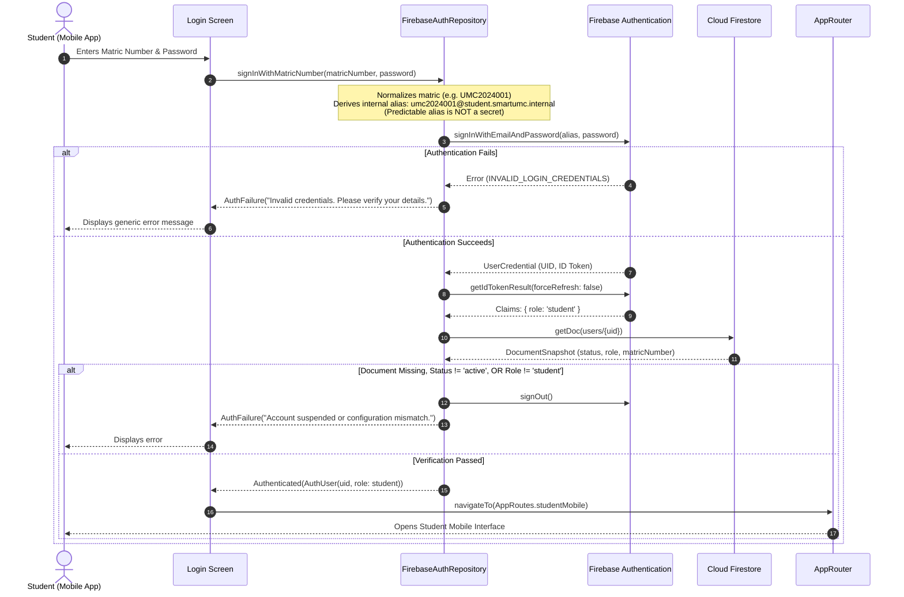
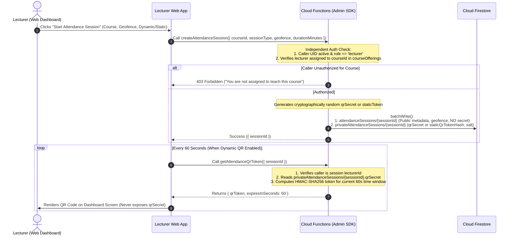
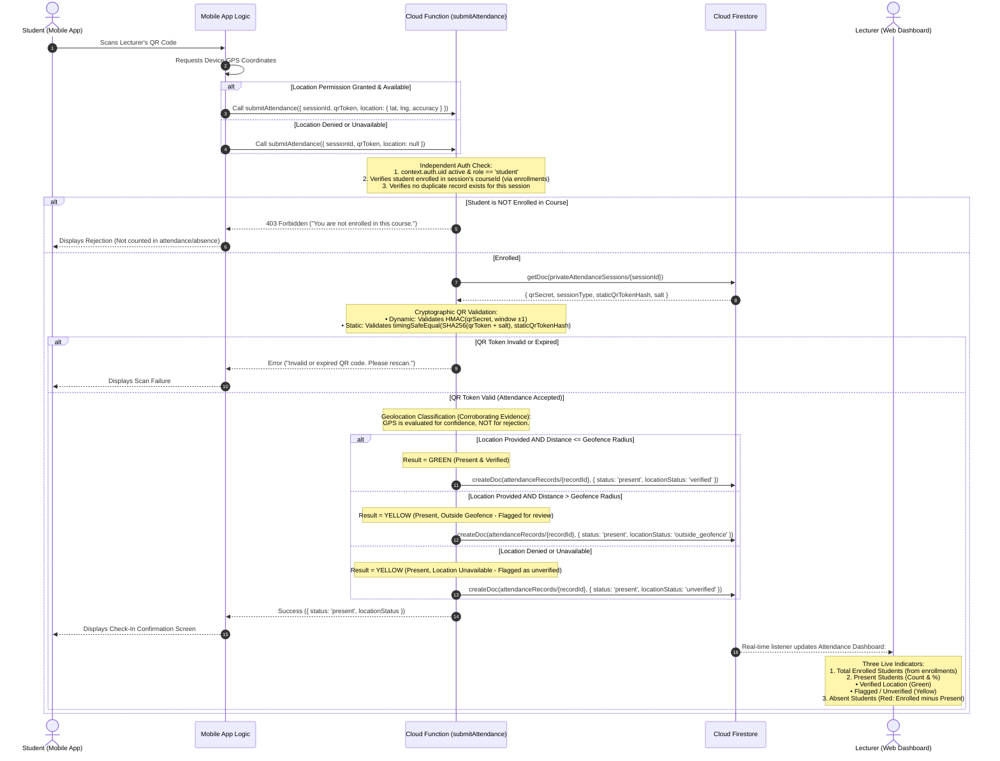

# SMARTUMC — Mission 10.5: Final Authentication Security Consistency Review & Implementation Plan

This document establishes the finalized, production-grade architectural specification for the backend-first authentication, authorization, complete 22-collection database schema security, and attendance verification systems of **SmartUMC** (Firebase Project: `smartumc-2cdc4`).

> [!NOTE]
> **Implementation Status Disclaimer**: This document represents an architectural and security specification. No component is claimed to be implemented, tested, or production-ready merely because it is documented here; concrete implementations will proceed in their designated development missions.

---

## 1. Executive Summary & Review Context

Following the Mission 10.5 security consistency review, this plan integrates six crucial refinements:
1. **Super Admin Custom Claims Preservation & Rollback**: Hardens `scripts/bootstrap_admin.ts` to preserve pre-existing Custom Claims (`{ ...previousClaims, role: 'admin' }`), prevents silent overwriting of unexpected existing user documents, and implements automated Custom Claim rollback with emergency recovery logging if the Firestore write fails.
2. **Super Admin Security Test Precision**: Corrects testing assumptions by specifying that Super Admins have universal read permissions on administrative collections (`users`, `students`, `auditLogs`, `enrollments`, etc.), but have **ZERO direct client SDK access** to backend-only collections (`privateAttendanceSessions`, `matricMappings`). Explicit negative tests verify this restriction.
3. **Notification Value Validation**: Enforces that user notification updates are restricted exclusively to `isRead` (boolean) and `readAt` (timestamp), guaranteeing that message content, recipient UID, and notification ownership remain strictly immutable.
4. **Device Token Schema Validation**: Enforces mandatory fields (`userId`, `token`, `platform`, `updatedAt`), strict type checks, platform enum restrictions (`['android', 'ios', 'web']`), and non-transferable ownership.
5. **Static QR Token Security**: Documents the static QR token verification process: storing only a salted cryptographic hash (`SHA-256`) in `privateAttendanceSessions`, hashing incoming scan submissions, performing timing-safe comparisons, and purging token hashes upon session termination.
6. **Student Profile Identity Consistency**: Confirms the canonical document structure as `students/{uid}` where the document ID is the Firebase Auth `UID` (matching `request.auth.uid`), with `matricNumber` maintained as a profile attribute rather than the document key.

---

## 2. Classification of Architectural Elements

### 2.1 Confirmed Requirements (Immutable Project Policies)
- **Target Project**: Firebase project `smartumc-2cdc4`.
- **Target Interfaces**: Unified Flutter codebase supporting:
  - Student: Android mobile application.
  - Lecturer: Desktop-first Flutter Web dashboard.
  - Super Admin: Desktop-first Flutter Web dashboard.
- **Canonical Identity**: Firebase Authentication User ID (`UID`) is the canonical identity across all system collections (`users/{uid}`, `students/{uid}`).
- **Student Login Interface**: Strictly **Matric Number and Password**.
- **Staff Login Interface**: Provisioned staff credentials (institutional email).
- **Client Role Immutability**: Clients cannot self-assign or elevate roles.
- **Zero Passwords in Database**: Plaintext, hashed, or encrypted passwords must never be stored in Cloud Firestore.
- **Backend Provisioning**: User accounts are provisioned via administrative backend workflows; public self-registration is disabled.
- **Attendance Policy**: Outside-geofence scans must **never** be automatically rejected solely because of location; they are recorded as present and flagged as unverified for lecturer review. Non-enrolled student check-ins must be rejected.
- **Synthetic Demonstration Data**: All user records and demonstration data are strictly synthetic.

### 2.2 Proposed Technical Decisions (Architectural Specifications)
- **Dual-Collection Session Architecture**: Partitioning session data into client-readable `attendanceSessions` and backend-only `privateAttendanceSessions`.
- **Backend QR Token Issuance**: Lecturer dashboard requests rotating tokens from `getAttendanceQrToken` without possessing the session secret.
- **Backend Session Creation**: Creating and closing attendance sessions exclusively through Cloud Functions to guarantee ownership and atomic creation of private secrets.
- **Failsafe Authorization in Security Rules**: Checking document existence, required keys, status, and claim matching in Firestore Security Rules.
- **Scoped Enrollment & Attendance Read Rules**: Enforcing that lecturers can query only enrollments and attendance records corresponding to their assigned `courseOfferingId` and `sessionId`.
- **Deterministic Student Email Alias**: Format `<matric_lowercase>@student.smartumc.internal` used internally by the client to interface with Firebase Auth.
- **Verified Secondary Recovery Email**: Mandatory verification of `recoveryEmail` before it can be used for self-service password recovery.

### 2.3 Unresolved Decisions (Requiring Project-Owner Approval)
- **Staff Email Domain Confirmation**: Placeholder domain `<staff>@umc.edu` requires confirmation of the actual university domain.
- **Classroom Geofencing Radius**: Confirmation of default classroom tolerance radius (e.g. 50m vs. 100m) to accommodate campus building scale.
- **Transactional Email Provider**: Selection of delivery service (SendGrid, Mailgun, or Firebase Extension) for password reset emails.
- **Firebase Blaze Plan Upgrade**: Formal authorization to upgrade `smartumc-2cdc4` to pay-as-you-go for Cloud Functions.
- **App Check Enforcement Timeline**: Determination of whether App Check will operate in monitoring mode during initial testing or be strictly enforced upon initial deployment.

---

## 3. Security Principles & System Boundaries

SmartUMC enforces a strict Defense-in-Depth model with clear privilege boundaries:

```
┌────────────────────────────────────────────────────────────────────────┐
│                        PRESENTATION / CLIENT LAYER                     │
│  • Student App: Matric Number + Password; camera QR scanner & GPS      │
│  • Lecturer Web: Institutional Email + Password; displays QR tokens    │
│  • ZERO write access to: users, students, attendanceRecords            │
│  • ZERO access to: privateAttendanceSessions, matricMappings           │
└───────────────────────────────────┬────────────────────────────────────┘
                                    │ HTTPS / Firebase SDK
                                    ▼
┌────────────────────────────────────────────────────────────────────────┐
│                     CANONICAL IDENTITY (FIREBASE AUTH)                 │
│  • Cryptographically signed JWT (ID Token, 1-hour expiration)          │
│  • Custom User Claims ({ role: 'student' | 'lecturer' | 'admin' })     │
│  • Refresh token revocation mechanism                                  │
└───────────────────────────────────┬────────────────────────────────────┘
                                    │
            ┌───────────────────────┴───────────────────────┐
            ▼                                               ▼
┌───────────────────────────────────────┐ ┌──────────────────────────────┐
│     DATABASE LAYER (FIRESTORE)        │ │  TRUSTED BACKEND (FUNCTIONS) │
│  • Enforces Firestore Security Rules  │ │  • Uses Firebase Admin SDK   │
│  • users/{uid}: Profile & live status │ │  • BYPASSES SECURITY RULES   │
│  • students/{uid}: Student records    │ │  • Performs independent auth │
│  • attendanceSessions: Metadata only  │ │  • Exclusive writer: records │
│  • privateSessions: DENY ALL CLIENTS  │ │  • Generates QR tokens       │
│  • matricMappings: DENY ALL CLIENTS   │ │  • Validates check-ins       │
│  • Failsafe check: live role == claim │ │  • Role assignment & claims  │
└───────────────────────────────────────┘ └──────────────────────────────┘
```

> [!CAUTION]
> **Admin SDK Security Rules Bypass**: Firebase Admin SDK operations within Cloud Functions completely bypass Firestore Security Rules. Consequently, Cloud Functions cannot rely on Firestore rules for authorization; **every function must implement strict independent authorization, role validation, and input sanitation**.

---

## 4. Authentication and Attendance Workflows

### 4.1 Student Login Workflow (Matric Number + Password)



### 4.2 Lecturer Session Creation and QR Token Generation



### 4.3 Secure Attendance Submission & Indicator Classification



---

## 5. Protected QR Secret Architecture & Static Token Security

### 5.1 Dual-Collection Isolation
SmartUMC strictly isolates public metadata from cryptographic secrets:

```
┌──────────────────────────────────────────────┐
│       attendanceSessions/{sessionId}         │  ◄── Publicly readable by active users
├──────────────────────────────────────────────┤      • courseId, lecturerId
│ • Non-sensitive session metadata             │      • sessionType ("dynamic" | "static")
│ • Geofence coordinates & radius              │      • validFrom, validUntil
│ • isActive, refreshIntervalSeconds           │      • ZERO SECRETS STORED HERE
└──────────────────────────────────────────────┘

┌──────────────────────────────────────────────┐
│    privateAttendanceSessions/{sessionId}     │  ◄── ZERO CLIENT ACCESS (DENY ALL)
├──────────────────────────────────────────────┤      • Accessible ONLY via Admin SDK
│ • qrSecret: 256-bit cryptographically random │      • staticQrTokenHash: Salted SHA-256
│ • salt: Cryptographic per-session salt       │      • Never leaves trusted backend
└──────────────────────────────────────────────┘
```

### 5.2 Dynamic QR Verification Mechanics
1. **Dynamic Token Generation**:
   $$\text{qrToken} = \text{HMAC-SHA256}(\text{qrSecret}, \text{currentTimestampWindow})$$
   where $\text{currentTimestampWindow} = \lfloor \text{unixTimeSeconds} / 60 \rfloor$.
2. **Validation**: The backend calculates expected HMAC values for the current window and allows a grace window of $\pm 1$ (accommodating network transit latency between lecturer display and student scan).

### 5.3 Static QR Verification Mechanics
1. **Creation**:
   - The Cloud Function generates a high-entropy random token string ($\ge 128$ bits of entropy) and a session salt.
   - Computes: $\text{staticQrTokenHash} = \text{SHA-256}(\text{staticToken} + \text{salt})$.
   - Stores `{ staticQrTokenHash: staticQrTokenHash, salt: salt }` in `privateAttendanceSessions/{sessionId}`.
   - Returns the raw `staticToken` string **once** to the lecturer web client for QR rendering. The raw token is **never** persisted in Firestore.
2. **Verification in `submitAttendance`**:
   - The student mobile app reads the QR code and transmits `{ sessionId, qrToken }`.
   - The Cloud Function reads `privateAttendanceSessions/{sessionId}` via the Admin SDK.
   - Computes: $\text{submittedHash} = \text{SHA-256}(\text{qrToken} + \text{salt})$.
   - Compares hashes using a **constant-time, timing-safe equality check** (`crypto.timingSafeEqual`) to prevent timing side-channel attacks:
     ```typescript
     const isMatch = crypto.timingSafeEqual(
       Buffer.from(submittedHash, 'hex'),
       Buffer.from(storedHash, 'hex')
     );
     ```
3. **Session Revocation on Close**:
   - When `closeAttendanceSession` is executed, the Cloud Function updates `attendanceSessions/{sessionId}.isActive = false` and purges `staticQrTokenHash` in `privateAttendanceSessions/{sessionId}`.
   - Any subsequent check-in attempt using the static QR code photo is rejected immediately as revoked.

---

## 6. Lecturer Session Ownership and Lifecycle Management

All session lifecycle operations are mediated by Cloud Functions:
- `createAttendanceSession`
- `updateAttendanceSession`
- `closeAttendanceSession`

Direct client writes to `attendanceSessions` are **completely disabled** (`allow write: if false;`).

### Ownership Validation:
When `createAttendanceSession` is called, the Cloud Function queries `courseOfferings/{courseId}` using the Admin SDK to verify that `courseDoc.lecturerId == context.auth.uid` (or caller is Super Admin). The function atomically writes `attendanceSessions/{sessionId}` (public metadata) and `privateAttendanceSessions/{sessionId}` (secret) in a single Firestore transaction.

---

## 7. Failsafe Role Consistency and Safe Authentication Checks

### 7.1 Hardened Authentication Guard (`isAccountActiveAndConsistent`)
To eliminate unhandled runtime exceptions on missing documents and ensure missing/malformed records fail closed:

```javascript
// Step 1: Verify authenticated session
function isAuthenticated() {
  return request.auth != null;
}

// Step 2: Verify user document exists before invoking get()
function userDocExists() {
  return isAuthenticated() && 
    exists(/databases/$(database)/documents/users/$(request.auth.uid));
}

// Step 3: Fetch user document data
function getUserDoc() {
  return get(/databases/$(database)/documents/users/$(request.auth.uid)).data;
}

// Step 4: Failsafe evaluation: Must exist, contain required keys, be active, and match token claim
function isAccountActiveAndConsistent() {
  return userDocExists() &&
         getUserDoc().keys().hasAll(['status', 'role']) &&
         getUserDoc().status == 'active' && 
         getUserDoc().role == request.auth.token.role;
}
```

### 7.2 Fail-Closed Behavior
- **Unauthenticated**: `request.auth == null` $\rightarrow$ Fails at Step 1.
- **Missing User Document**: `exists(...) == false` $\rightarrow$ Fails at Step 2 without throwing an evaluation error.
- **Malformed User Document**: Missing `status` or `role` fields $\rightarrow$ Fails at Step 4 via `keys().hasAll(...)`.
- **Suspended User**: `status != 'active'` $\rightarrow$ Instantly rejected, neutralizing stale 1-hour JWT tokens.
- **Role Mismatch**: Role modified in Firestore while token carries old claim $\rightarrow$ Instantly rejected until token refresh.

---

## 8. Final Attendance Indicator Semantics & Geolocation Policy

### 8.1 SmartUMC Three-State Geolocation Indicator System
Outside-geofence scans must **never** automatically reject an attendance submission. Attendance validity (session active, token verified, student enrolled) is strictly separated from location classification:

| Indicator State | Condition | Recorded `locationStatus` | Lecturer Dashboard Representation |
| :---: | :--- | :--- | :--- |
| <span style="color:green;font-weight:bold;">GREEN</span> | Scanned valid QR; GPS coordinates verified within classroom geofence radius. | `verified` | **Present (Verified)**: Student is physically confirmed in lecture hall. |
| <span style="color:#d4a017;font-weight:bold;">YELLOW</span> | Scanned valid QR; GPS coordinates outside geofence, permission denied, or location unavailable. | `outside_geofence` or `unverified` | **Present (Flagged / Unverified)**: Attendance is recorded, but flagged with distance/status for lecturer review. |
| <span style="color:red;font-weight:bold;">RED</span> | Enrolled student has no valid attendance submission for the session. | `absent` | **Absent**: Student has no record for the session. |

### 8.2 Enrollment Guard and Absence Computation
- **Non-Enrolled Students**: If a student scans the QR code but is not enrolled in `courseOfferings/{courseId}` (verified via `enrollments`), `submitAttendance` immediately returns `403 Forbidden`. **They are not recorded in attendance, nor counted as absent.**
- **Absence Calculation**: Absences are dynamically calculated by subtracting verified check-ins from the official course enrollment roster:
  $$\text{Absent Students (Red)} = \text{Enrolled Students} \setminus \text{Students with Present Record}$$

---

## 9. Attendance Record Privacy and Scoped Access

- **Students**: May read only their own attendance records (`resource.data.studentId == request.auth.uid`).
- **Lecturers**: May read only attendance records for sessions belonging to courses they are assigned to teach.
- **Super Admins**: May read all attendance records across the institution.
- **Unrelated Lecturers**: Are strictly forbidden from accessing another lecturer's attendance records.

---

## 10. Hardened Super Admin Bootstrap Procedure

### 10.1 Custom Claims Preservation & Rollback Architecture
The bootstrap script mandates **both** `INTENDED_ADMIN_UID` and `INTENDED_ADMIN_EMAIL`. Execution is rejected if either variable is missing. It verifies both values against the target account in Firebase Auth, enforces actual email verification, preserves pre-existing claims, and provides automatic Custom Claim rollback with emergency manual instructions if the Firestore write fails.

```typescript
import * as admin from 'firebase-admin';

// Initialize using Application Default Credentials (ADC)
admin.initializeApp({
  projectId: 'smartumc-2cdc4'
});

async function hardenedSuperAdminBootstrap() {
  const intendedAdminEmail = process.env.INTENDED_ADMIN_EMAIL?.trim().toLowerCase();
  const intendedAdminUid = process.env.INTENDED_ADMIN_UID?.trim();
  const confirmationFlag = process.argv.includes('--confirm-initial-bootstrap');

  if (!confirmationFlag) {
    console.error('ERROR: Missing required operator confirmation flag: --confirm-initial-bootstrap');
    process.exit(1);
  }

  // 1. Enforce Mandatory Dual-Identifier Specification
  if (!intendedAdminEmail || !intendedAdminUid) {
    console.error('CRITICAL REJECTION: Both INTENDED_ADMIN_EMAIL and INTENDED_ADMIN_UID are strictly mandatory.');
    console.error('Execution halted: Cannot elevate an account based on email alone.');
    process.exit(1);
  }

  const auth = admin.auth();
  const db = admin.firestore();

  try {
    // 2. Check if any Super Admin already exists in Firestore
    const existingAdminsSnapshot = await db.collection('users')
      .where('role', '==', 'admin')
      .limit(1)
      .get();

    if (!existingAdminsSnapshot.empty) {
      console.error('CRITICAL ABORT: A Super Admin account already exists in the system.');
      console.error('Bootstrap script cannot be executed on an already initialized system.');
      process.exit(1);
    }

    // 3. Fetch the targeted account from Firebase Auth
    let userRecord: admin.auth.UserRecord;
    try {
      userRecord = await auth.getUserByEmail(intendedAdminEmail);
    } catch (err: any) {
      console.error(`ERROR: Target account ${intendedAdminEmail} does not exist in Firebase Auth.`);
      console.error('Account must be pre-created and email-verified through sanctioned channels.');
      process.exit(1);
    }

    // 4. Strict Dual-Identifier Verification (UID + Email)
    if (userRecord.uid !== intendedAdminUid) {
      console.error(`CRITICAL IDENTITY MISMATCH: Account for ${intendedAdminEmail} has UID ${userRecord.uid}, but INTENDED_ADMIN_UID specified ${intendedAdminUid}.`);
      console.error('Elevation rejected: Possible account collision or unauthorized target.');
      process.exit(1);
    }

    // 5. Verification Check: Never spoof email verification
    if (!userRecord.emailVerified) {
      console.error(`CRITICAL: The account ${intendedAdminEmail} has not completed actual email verification.`);
      console.error('Admin elevation requires a pre-verified institutional identity. Execution aborted.');
      process.exit(1);
    }

    // 6. Verify Existing Firestore Document Integrity (Do not silently overwrite unexpected profiles)
    const existingDoc = await db.collection('users').doc(userRecord.uid).get();
    if (existingDoc.exists) {
      const data = existingDoc.data();
      if (data?.role && data.role !== 'admin') {
        console.error(`CRITICAL ABORT: Document users/${userRecord.uid} already exists with conflicting role: ${data.role}.`);
        console.error('Refusing to silently overwrite an existing user profile.');
        process.exit(1);
      }
    }

    // 7. Preserve Existing Custom Claims
    const previousClaims = userRecord.customClaims || {};
    const updatedClaims = { ...previousClaims, role: 'admin' };

    console.log(`Assigning admin claim while preserving existing claims for UID: ${userRecord.uid}...`);
    await auth.setCustomUserClaims(userRecord.uid, updatedClaims);

    // 8. Transactional Firestore Profile Creation with Automated Rollback
    try {
      console.log(`Writing authoritative Firestore user profile for UID: ${userRecord.uid}...`);
      await db.collection('users').doc(userRecord.uid).set({
        uid: userRecord.uid,
        role: 'admin',
        status: 'active',
        email: intendedAdminEmail,
        displayName: userRecord.displayName || 'Initial Super Administrator',
        staffId: 'ADMIN-INITIAL',
        createdAt: admin.firestore.FieldValue.serverTimestamp(),
        updatedAt: admin.firestore.FieldValue.serverTimestamp()
      }, { merge: true });

      console.log(`SUCCESS: Super Admin established for verified UID: ${userRecord.uid}`);
    } catch (firestoreError) {
      console.error('CRITICAL WRITE FAILURE: Firestore profile write failed after Custom Claims assignment!');
      console.error('Initiating safe rollback of Custom Claims to previous state...');
      try {
        await auth.setCustomUserClaims(userRecord.uid, previousClaims);
        console.log('Rollback successful: Previous Custom Claims restored.');
      } catch (rollbackError) {
        console.error('EMERGENCY: Rollback of Custom Claims failed! System may be in an inconsistent state.');
        console.error(`Target UID: ${userRecord.uid}. Previous Claims: ${JSON.stringify(previousClaims)}.`);
        console.error('Manual intervention required via Firebase CLI or Google Cloud Console:');
        console.error(`Execute: firebase auth:claims:set ${userRecord.uid} '${JSON.stringify(previousClaims)}'`);
      }
      throw firestoreError;
    }

  } catch (error) {
    console.error('Bootstrap execution failed:', error);
    process.exit(1);
  }
}

hardenedSuperAdminBootstrap();
```

---

## 11. Complete SmartUMC Database Architecture Compatibility

All **22 SmartUMC collections** are explicitly cataloged below with access permissions:

| # | Collection Name | Purpose & Contents | Read Authorization | Write Authorization |
| :--- | :--- | :--- | :--- | :--- |
| 1 | `users` | Authoritative user profiles, roles, and account status. | Own profile or Super Admin | Cloud Functions only |
| 2 | `students` | Detailed student records (matric, programme, intake, faculty). Keyed by UID: `students/{uid}`. | Own record (`studentUid == auth.uid`) or Super Admin | Cloud Functions only |
| 3 | `lecturers` | Lecturer profiles, department, faculty, and academic titles. Keyed by UID: `lecturers/{uid}`. | Authenticated active users | Cloud Functions only |
| 4 | `programs` | Academic degree programmes and curriculum specifications. | Authenticated active users | Super Admin (via backend) |
| 5 | `groups` | Student tutorial / lab / cohort group assignments. | Authenticated active users | Super Admin (via backend) |
| 6 | `courses` | Master course catalog (course codes, titles, credit hours). | Authenticated active users | Super Admin (via backend) |
| 7 | `semesters` | Academic semester terms and calendar boundaries. | Authenticated active users | Super Admin (via backend) |
| 8 | `courseOfferings` | Active semester course instances assigned to lecturers. | Authenticated active users | Super Admin (via backend) |
| 9 | `enrollments` | Official student course enrollments and roster mapping. | Student (own), Assigned Lecturer, Admin | Cloud Functions only |
| 10 | `classSchedules` | Timetables, lecture slots, and physical venue allocations. | Authenticated active users | Super Admin (via backend) |
| 11 | `academicResults` | Student grades, GPA/CGPA, and examination transcripts. | Student (own), Super Admin | Cloud Functions only |
| 12 | `attendanceSessions` | Non-sensitive attendance session metadata and geofences. | Authenticated active users | Cloud Functions only |
| 13 | `privateAttendanceSessions` | Cryptographic secrets and tokens for QR generation. | **ZERO CLIENT READ (DENY ALL)** | Cloud Functions only |
| 14 | `attendanceRecords` | Verified student attendance check-in records. | Student (own), Assigned Lecturer, Admin | Cloud Functions only |
| 15 | `events` | Campus bulletins, academic notices, and public news. | Authenticated active users | Super Admin (via backend) |
| 16 | `academicCalendar` | Key university academic milestones, holidays, and exam dates. | Authenticated active users | Super Admin (via backend) |
| 17 | `notifications` | Targeted user alerts (attendance warnings, schedule changes). | Recipient user only | Owner update (`isRead`, `readAt`); Cloud Functions create |
| 18 | `userPreferences` | UI theme settings, language preferences, notification toggles. Keyed by UID: `userPreferences/{uid}`. | Owner user only | Owner user (strict schema) |
| 19 | `deviceTokens` | FCM registration tokens for mobile push notifications. | Owner user only | Owner user (strict schema) |
| 20 | `supportRequests` | In-app user help tickets and technical support queries. | Requestor user and Super Admin | Requestor user (create only; status: pending) |
| 21 | `auditLogs` | Immutable administrative audit trails for privileged actions. | Super Admin only | Cloud Functions only |
| 22 | `matricMappings` | Private $O(1)$ index mapping matric numbers to UIDs. Keyed by Matric Number: `matricMappings/{matric}`. | **ZERO CLIENT READ (DENY ALL)** | Cloud Functions only |

### 11.1 Student Profile Identity Consistency (`students/{uid}`)
To ensure architectural consistency across the database:
- The document ID for student records is the **canonical Firebase Auth UID** (`students/{uid}`).
- Firestore Security Rules verify ownership by matching the document ID directly against `request.auth.uid`:
  `match /students/{studentUid} { allow read: if isAccountActiveAndConsistent() && (studentUid == request.auth.uid || isSuperAdmin()); }`
- The student's matriculation number is preserved as a profile field (`matricNumber: "UMC2024001"`), maintaining clean separation between user identity and institutional student registration numbers.

---

## 12. Complete 22-Collection Firestore Security Rules

```javascript
rules_version = '2';
service cloud.firestore {
  match /databases/{database}/documents {

    // -------------------------------------------------------------------------
    // HARDENED HELPER FUNCTIONS (FAIL-CLOSED)
    // -------------------------------------------------------------------------
    function isAuthenticated() {
      return request.auth != null;
    }

    function userDocExists() {
      return isAuthenticated() && 
        exists(/databases/$(database)/documents/users/$(request.auth.uid));
    }

    function getUserDoc() {
      return get(/databases/$(database)/documents/users/$(request.auth.uid)).data;
    }

    // Failsafe check: Verifies auth, doc existence, schema keys, active status, and claim match
    function isAccountActiveAndConsistent() {
      return userDocExists() &&
             getUserDoc().keys().hasAll(['status', 'role']) &&
             getUserDoc().status == 'active' && 
             getUserDoc().role == request.auth.token.role;
    }

    function isSuperAdmin() {
      return isAccountActiveAndConsistent() && request.auth.token.role == 'admin';
    }

    function isLecturer() {
      return isAccountActiveAndConsistent() && request.auth.token.role == 'lecturer';
    }

    function isStudent() {
      return isAccountActiveAndConsistent() && request.auth.token.role == 'student';
    }

    // Helper: Verify if lecturer is assigned to a specific course offering
    function isAssignedLecturerForOffering(courseOfferingId) {
      return isLecturer() && 
        get(/databases/$(database)/documents/courseOfferings/$(courseOfferingId)).data.lecturerId == request.auth.uid;
    }

    // Helper: Verify if lecturer is assigned to the session's course offering
    function isAssignedLecturerForSession(sessionId) {
      return isLecturer() && 
        get(/databases/$(database)/documents/attendanceSessions/$(sessionId)).data.lecturerId == request.auth.uid;
    }

    // -------------------------------------------------------------------------
    // DEFAULT DENY FOR UNMATCHED PATHS
    // -------------------------------------------------------------------------
    match /{document=**} {
      allow read, write: if false;
    }

    // -------------------------------------------------------------------------
    // 1. USERS COLLECTION (Keyed by UID)
    // -------------------------------------------------------------------------
    match /users/{userId} {
      allow read: if isAccountActiveAndConsistent() && 
        (request.auth.uid == userId || isSuperAdmin());
      allow write: if false; // Cloud Functions (Admin SDK) exclusive
    }

    // -------------------------------------------------------------------------
    // 2. STUDENTS COLLECTION (Keyed by canonical UID: students/{uid})
    // -------------------------------------------------------------------------
    match /students/{studentUid} {
      allow read: if isAccountActiveAndConsistent() && 
        (studentUid == request.auth.uid || isSuperAdmin());
      allow write: if false;
    }

    // -------------------------------------------------------------------------
    // 3. LECTURERS COLLECTION (Keyed by canonical UID: lecturers/{uid})
    // -------------------------------------------------------------------------
    match /lecturers/{lecturerUid} {
      allow read: if isAccountActiveAndConsistent();
      allow write: if false;
    }

    // -------------------------------------------------------------------------
    // 4. PROGRAMS COLLECTION
    // -------------------------------------------------------------------------
    match /programs/{programId} {
      allow read: if isAccountActiveAndConsistent();
      allow write: if false;
    }

    // -------------------------------------------------------------------------
    // 5. GROUPS COLLECTION
    // -------------------------------------------------------------------------
    match /groups/{groupId} {
      allow read: if isAccountActiveAndConsistent();
      allow write: if false;
    }

    // -------------------------------------------------------------------------
    // 6. COURSES COLLECTION
    // -------------------------------------------------------------------------
    match /courses/{courseId} {
      allow read: if isAccountActiveAndConsistent();
      allow write: if false;
    }

    // -------------------------------------------------------------------------
    // 7. SEMESTERS COLLECTION
    // -------------------------------------------------------------------------
    match /semesters/{semesterId} {
      allow read: if isAccountActiveAndConsistent();
      allow write: if false;
    }

    // -------------------------------------------------------------------------
    // 8. COURSE OFFERINGS COLLECTION
    // -------------------------------------------------------------------------
    match /courseOfferings/{courseOfferingId} {
      allow read: if isAccountActiveAndConsistent();
      allow write: if false;
    }

    // -------------------------------------------------------------------------
    // 9. ENROLLMENTS COLLECTION (Strict Scoped Read Privacy)
    // -------------------------------------------------------------------------
    match /enrollments/{enrollmentId} {
      allow read: if isAccountActiveAndConsistent() && (
        resource.data.studentId == request.auth.uid ||
        isAssignedLecturerForOffering(resource.data.courseOfferingId) ||
        isSuperAdmin()
      );
      allow write: if false;
    }

    // -------------------------------------------------------------------------
    // 10. CLASS SCHEDULES COLLECTION
    // -------------------------------------------------------------------------
    match /classSchedules/{scheduleId} {
      allow read: if isAccountActiveAndConsistent();
      allow write: if false;
    }

    // -------------------------------------------------------------------------
    // 11. ACADEMIC RESULTS COLLECTION (Strict Student & Admin Privacy)
    // -------------------------------------------------------------------------
    match /academicResults/{resultId} {
      allow read: if isAccountActiveAndConsistent() && 
        (resource.data.studentId == request.auth.uid || isSuperAdmin());
      allow write: if false;
    }

    // -------------------------------------------------------------------------
    // 12. ATTENDANCE SESSIONS COLLECTION (Public Metadata)
    // -------------------------------------------------------------------------
    match /attendanceSessions/{sessionId} {
      allow read: if isAccountActiveAndConsistent();
      allow write: if false;
    }

    // -------------------------------------------------------------------------
    // 13. PRIVATE ATTENDANCE SESSIONS (ZERO CLIENT ACCESS)
    // -------------------------------------------------------------------------
    match /privateAttendanceSessions/{sessionId} {
      allow read, write: if false;
    }

    // -------------------------------------------------------------------------
    // 14. ATTENDANCE RECORDS COLLECTION (Scoped Lecturer & Student Access)
    // -------------------------------------------------------------------------
    match /attendanceRecords/{recordId} {
      allow read: if isAccountActiveAndConsistent() && (
        resource.data.studentId == request.auth.uid ||
        isAssignedLecturerForSession(resource.data.sessionId) ||
        isSuperAdmin()
      );
      allow write: if false;
    }

    // -------------------------------------------------------------------------
    // 15. CAMPUS EVENTS COLLECTION
    // -------------------------------------------------------------------------
    match /events/{eventId} {
      allow read: if isAccountActiveAndConsistent();
      allow write: if false;
    }

    // -------------------------------------------------------------------------
    // 16. ACADEMIC CALENDAR COLLECTION
    // -------------------------------------------------------------------------
    match /academicCalendar/{calendarId} {
      allow read: if isAccountActiveAndConsistent();
      allow write: if false;
    }

    // -------------------------------------------------------------------------
    // 17. NOTIFICATIONS COLLECTION (Strict Read-Status Validation & Immutability)
    // -------------------------------------------------------------------------
    match /notifications/{notificationId} {
      allow read: if isAccountActiveAndConsistent() && resource.data.userId == request.auth.uid;
      // Allow user to mark notifications as read without mutating content, recipient, or ownership
      allow update: if isAccountActiveAndConsistent() && 
        resource.data.userId == request.auth.uid &&
        request.resource.data.userId == resource.data.userId &&
        request.resource.data.title == resource.data.title &&
        request.resource.data.body == resource.data.body &&
        request.resource.data.diff(resource.data).affectedKeys().hasOnly(['isRead', 'readAt']) &&
        request.resource.data.isRead is bool &&
        (!('readAt' in request.resource.data) || request.resource.data.readAt is timestamp || request.resource.data.readAt == null);
      allow create, delete: if false;
    }

    // -------------------------------------------------------------------------
    // 18. USER PREFERENCES COLLECTION (Keyed by UID: userPreferences/{uid})
    // -------------------------------------------------------------------------
    match /userPreferences/{userId} {
      allow read: if isAccountActiveAndConsistent() && request.auth.uid == userId;
      allow create, update: if isAccountActiveAndConsistent() && 
        request.auth.uid == userId &&
        request.resource.data.keys().hasOnly(['themeMode', 'language', 'notificationsEnabled', 'biometricsEnabled', 'updatedAt']);
      allow delete: if false;
    }

    // -------------------------------------------------------------------------
    // 19. DEVICE TOKENS COLLECTION (Strict Schema & Non-Transferable Ownership)
    // -------------------------------------------------------------------------
    match /deviceTokens/{tokenId} {
      allow read, delete: if isAccountActiveAndConsistent() && resource.data.userId == request.auth.uid;
      allow create: if isAccountActiveAndConsistent() && 
        request.resource.data.userId == request.auth.uid &&
        request.resource.data.keys().hasAll(['userId', 'token', 'platform', 'updatedAt']) &&
        request.resource.data.keys().hasOnly(['userId', 'token', 'platform', 'deviceModel', 'updatedAt']) &&
        request.resource.data.userId is string &&
        request.resource.data.token is string && request.resource.data.token.size() > 0 &&
        request.resource.data.platform in ['android', 'ios', 'web'] &&
        request.resource.data.updatedAt is timestamp &&
        (!('deviceModel' in request.resource.data) || request.resource.data.deviceModel is string);
      allow update: if isAccountActiveAndConsistent() && 
        resource.data.userId == request.auth.uid &&
        request.resource.data.userId == resource.data.userId &&
        request.resource.data.keys().hasAll(['userId', 'token', 'platform', 'updatedAt']) &&
        request.resource.data.keys().hasOnly(['userId', 'token', 'platform', 'deviceModel', 'updatedAt']) &&
        request.resource.data.userId is string &&
        request.resource.data.token is string && request.resource.data.token.size() > 0 &&
        request.resource.data.platform in ['android', 'ios', 'web'] &&
        request.resource.data.updatedAt is timestamp &&
        (!('deviceModel' in request.resource.data) || request.resource.data.deviceModel is string);
    }

    // -------------------------------------------------------------------------
    // 20. SUPPORT REQUESTS COLLECTION (User Create & Read Own, Super Admin Manage)
    // -------------------------------------------------------------------------
    match /supportRequests/{requestId} {
      allow read: if isAccountActiveAndConsistent() && 
        (resource.data.userId == request.auth.uid || isSuperAdmin());
      allow create: if isAccountActiveAndConsistent() && 
        request.resource.data.userId == request.auth.uid &&
        request.resource.data.status == 'pending' &&
        request.resource.data.keys().hasOnly(['userId', 'userRole', 'category', 'subject', 'message', 'status', 'createdAt']);
      allow update, delete: if false; // Managed via Super Admin Cloud Functions
    }

    // -------------------------------------------------------------------------
    // 21. AUDIT LOGS COLLECTION (Super Admin Read Only, Immutable Write)
    // -------------------------------------------------------------------------
    match /auditLogs/{logId} {
      allow read: if isSuperAdmin();
      allow write: if false;
    }

    // -------------------------------------------------------------------------
    // 22. MATRIC MAPPINGS COLLECTION (ZERO CLIENT ACCESS)
    // -------------------------------------------------------------------------
    match /matricMappings/{matric} {
      allow read, write: if false;
    }
  }
}
```

---

## 13. Firestore Query Compatibility & Client Access Patterns

> [!IMPORTANT]
> **Firestore Security Rules Are Not Filters**: A query in Firestore succeeds only if the rule would allow every document that the query could potentially return. If a client attempts an unbounded query across a collection where they only have partial read access, Firestore **rejects the entire query** with `permission-denied`. Client code must structure queries with filters matching the applicable security rule constraints.

### 13.1 Lecturer Attendance Records Query
- **Rule Constraint**: Lecturer may read records only where `session.lecturerId == request.auth.uid`.
- **Invalid Query (Rejected)**:
  `FirebaseFirestore.instance.collection('attendanceRecords').get();` *(Fails: Requests all records)*
- **Compliant Client Query**:
  ```dart
  FirebaseFirestore.instance
      .collection('attendanceRecords')
      .where('sessionId', isEqualTo: activeSessionId)
      .snapshots();
  ```

### 13.2 Lecturer Course Enrollments Query
- **Rule Constraint**: Lecturer may read enrollments only for their assigned `courseOfferingId`.
- **Invalid Query (Rejected)**:
  `FirebaseFirestore.instance.collection('enrollments').get();` *(Fails: Requests all enrollments)*
- **Compliant Client Query**:
  ```dart
  FirebaseFirestore.instance
      .collection('enrollments')
      .where('courseOfferingId', isEqualTo: assignedOfferingId)
      .snapshots();
  ```

### 13.3 Student Academic Results Query
- **Rule Constraint**: Student may read only records where `studentId == request.auth.uid`.
- **Invalid Query (Rejected)**:
  `FirebaseFirestore.instance.collection('academicResults').get();`
- **Compliant Client Query**:
  ```dart
  FirebaseFirestore.instance
      .collection('academicResults')
      .where('studentId', isEqualTo: currentStudentUid)
      .get();
  ```

### 13.4 Student Profile Query
- **Compliant Client Query**:
  ```dart
  FirebaseFirestore.instance
      .collection('users')
      .doc(currentUserUid)
      .get();
  ```

---

## 14. Comprehensive Security Testing Strategy (Firebase Emulator Suite)

The security rules must be validated against the **Firebase Emulator Suite** across positive and negative authorization cases before deploying to production.

> [!NOTE]
> **Execution Status**: The following test matrix describes the formal testing strategy and test suites planned for execution in subsequent testing phases. No test suite has been executed yet.

### 14.1 Test Personas
1. `student-enrolled`: Authenticated student enrolled in Course CS101.
2. `student-unrelated`: Authenticated student NOT enrolled in Course CS101.
3. `lecturer-assigned`: Authenticated lecturer assigned to teach Course CS101.
4. `lecturer-unrelated`: Authenticated lecturer assigned to teach Course EE201 (unrelated).
5. `super-admin`: Authenticated user with verified `{ role: 'admin' }` and active profile.
6. `user-suspended`: User with `{ role: 'student' }`, but `users/{uid}.status == 'suspended'`.
7. `user-mismatched-claim`: User with token claim `{ role: 'lecturer' }`, but Firestore document `role == 'student'`.

### 14.2 Test Matrix

| # | Test Scenario | Actor / Persona | Target Resource | Operation | Expected Result | Security Rationale |
| :--- | :--- | :--- | :--- | :--- | :--- | :--- |
| **P1** | Read Own Profile | `student-enrolled` | `users/student-enrolled` | `get()` | **ALLOW** | Student can inspect their own user record. |
| **P2** | Read Assigned Session Attendance | `lecturer-assigned` | `attendanceRecords` (filtered by assigned session) | `list()` | **ALLOW** | Lecturer can audit attendance for their class. |
| **P3** | Read Own Academic Results | `student-enrolled` | `academicResults` (where `studentId == uid`) | `list()` | **ALLOW** | Student can review their personal grades. |
| **P4** | Super Admin Authorized Read | `super-admin` | `users`, `students`, `auditLogs`, `enrollments` | `get() / list()` | **ALLOW** | Administrative oversight across authorized administrative records. |
| **P5** | Update Own Device Token | `student-enrolled` | `deviceTokens/{tokenId}` | `set()` | **ALLOW** | User registers valid FCM push token matching schema. |
| **P6** | Mark Notification as Read | `student-enrolled` | `notifications/{notifId}` | `update({ isRead: true })` | **ALLOW** | User updates read status of personal alert without mutating content. |
| **N1** | Cross-Lecturer Attendance Snooping | `lecturer-unrelated` | `attendanceRecords` of CS101 session | `get() / list()` | **DENY** | Lecturer cannot read another lecturer's attendance records. |
| **N2** | Cross-Lecturer Enrollment Access | `lecturer-unrelated` | `enrollments` of CS101 offering | `get() / list()` | **DENY** | Lecturer cannot inspect rosters of courses they do not teach. |
| **N3** | Student Forging Attendance Record | `student-enrolled` | `attendanceRecords/rec-123` | `create()` | **DENY** | Client writes permanently disabled; submissions must use `submitAttendance`. |
| **N4** | Direct User Role Elevation | `student-enrolled` | `users/student-enrolled` | `update({ role: 'admin' })` | **DENY** | Client writes permanently disabled on `users`. |
| **N5** | Suspended Account Data Access | `user-suspended` | `users/user-suspended` | `get()` | **DENY** | Status check immediately revokes data access despite valid JWT. |
| **N6** | Mismatched Claim Access | `user-mismatched-claim`| `lecturers` / any collection | `get() / list()` | **DENY** | Token claim does not match live document role; fails closed. |
| **N7** | Client Access to Private QR Secrets | `student-enrolled` | `privateAttendanceSessions/ses-123` | `get()` | **DENY** | Private session secrets have absolute client deny. |
| **N8** | Client Access to Matric Mappings | `student-enrolled` | `matricMappings/UMC2024001` | `get()` | **DENY** | Private matric directory has absolute client deny. |
| **N9** | Notification Content Tampering | `student-enrolled` | `notifications/{notifId}` | `update({ message: 'Fake' })` | **DENY** | Users cannot mutate notification text or sender. |
| **N10**| Device Token Transfer | `student-enrolled` | `deviceTokens/{tokenId}` | `update({ userId: 'other' })`| **DENY** | Token ownership cannot be transferred between users. |
| **N11**| Super Admin Direct Read of Private QR Secrets | `super-admin` | `privateAttendanceSessions/{sessionId}` | `get()` | **DENY** | Backend-only cryptographic secrets are completely blocked from client SDKs, even for Super Admins. |
| **N12**| Super Admin Direct Read of Private Matric Index | `super-admin` | `matricMappings/{matric}` | `get()` | **DENY** | Private matric index has zero client access; reserved exclusively for Admin SDK in Cloud Functions. |

---

## 15. Additional Security Recommendations

The following items are documented as **recommended architectural safeguards** for implementation during respective development phases:

1. **Firebase App Check Integration**:
   - Protects backend resources against automated abuse, scraping, and unauthorized API clients.
   - Attestation providers: **Play Integrity** for the Student Android application; **reCAPTCHA Enterprise** for Lecturer/Admin Web dashboards.
2. **Rate Limiting on Public Endpoints**:
   - Public callable endpoints (`requestStudentPasswordReset`) must enforce IP-based and identifier-based rate limiting (maximum 3 requests per matric number per hour) to mitigate email flooding and account enumeration.
3. **Secure Recovery Token Lifecycle**:
   - One-time password (OTP) verification codes for secondary email recovery must use high-entropy 6-digit tokens with a maximum **15-minute time-to-live (TTL)**.
   - Invalidate the code after **3 consecutive failed attempts**.
4. **Student Academic Privacy Protections**:
   - `academicResults` must be shielded from unauthorized lecturer viewing. A lecturer teaching Course A must not be permitted to view a student's grades in Course B unless explicitly granted academic advisor privileges.
5. **Centralized Server-Side Authorization Middleware**:
   - Cloud Functions should route through a shared middleware verifying caller UID, active status, token consistency, and role privileges before executing business logic.

---

## 16. Technical Consistency Audit Across Revisions

| Review Dimension | Mission 10.4 Plan | Mission 10.5 Plan (Final Consistency Review) | Architectural Rationale |
| :--- | :--- | :--- | :--- |
| **Super Admin Bootstrap Claims** | Replaced claims with `{ role: 'admin' }`. | Preserves existing claims (`{ ...previousClaims, role: 'admin' }`). Restores previous claims on write failure. | Prevents loss of custom permissions and maintains atomic elevation. |
| **Super Admin Bootstrap Profile** | Overwrote document blindly. | Checks existing document to prevent overwriting conflicting user profiles. | Prevents silent corruption of pre-existing accounts. |
| **Super Admin Universal Read Test** | Claimed Super Admin can read "Any collection". | Clarified universal read applies to administrative collections only; `privateAttendanceSessions` and `matricMappings` remain strictly blocked. | Corrects test assumption to match security rule default-deny. |
| **Notification Schema Validation** | Checked `affectedKeys().hasOnly(['isRead', 'readAt'])`. | Enforces `isRead is bool`, `readAt is timestamp`, and immutability of `title` and `body`. | Prevents invalid data types and text tampering. |
| **Device Token Schema Validation** | Basic ownership check. | Enforces `keys().hasAll(...)`, `platform in ['android', 'ios', 'web']`, and non-transferability. | Prevents token hijacking and invalid platform injection. |
| **Static QR Verification** | Mentioned token comparison. | Documents salted SHA-256 hash storage, constant-time `timingSafeEqual`, and session close purge. | Eliminates timing attacks and invalidates shared QR photos. |
| **Student Identity Structure** | Documented general collection. | Confirms canonical identity as `students/{uid}` (keyed by UID, not matric number). | Aligns profile identity with Firebase Auth UID across all collections. |

---

## 17. Phased Implementation Sequence

```
┌────────────────────────────────────────────────────────────────────────┐
│ Phase 1: Firebase Project Foundation & Dependencies                    │
│ • Confirm project smartumc-2cdc4 configuration in Firebase Console     │
│ • Enable Email/Password authentication & Email Enumeration Protection  │
│ • Add firebase_core and firebase_auth dependencies to pubspec.yaml    │
│ • Execute flutterfire configure to generate firebase_options.dart      │
└───────────────────────────────────┬────────────────────────────────────┘
                                    │
                                    ▼
┌────────────────────────────────────────────────────────────────────────┐
│ Phase 2: Hardened Super Admin Operator Bootstrap                       │
│ • Pre-create and verify initial administrator in Firebase Auth         │
│ • Configure operator Application Default Credentials (ADC)             │
│ • Execute scripts/bootstrap_admin.ts verifying exact UID and email     │
│ • Confirm initial Super Admin record in users/{uid} and Auth claims   │
└───────────────────────────────────┬────────────────────────────────────┘
                                    │
                                    ▼
┌────────────────────────────────────────────────────────────────────────┐
│ Phase 3: Cloud Functions Development (Admin SDK)                       │
│ • Implement session lifecycle: createAttendanceSession, getQrToken     │
│ • Implement submitAttendance with 3-state geolocation classification   │
│ • Implement provisionUser, deactivateUser, and password recovery       │
│ • Deploy functions to smartumc-2cdc4                                   │
└───────────────────────────────────┬────────────────────────────────────┘
                                    │
                                    ▼
┌────────────────────────────────────────────────────────────────────────┐
│ Phase 4: Firestore Security Rules Deployment & Emulator Testing        │
│ • Run 18-case security test matrix on Firebase Emulator Suite          │
│ • Deploy verified 22-collection security rules to smartumc-2cdc4       │
│ • Verify private lockdown on privateAttendanceSessions & matricMappings│
└───────────────────────────────────┬────────────────────────────────────┘
                                    │
                                    ▼
┌────────────────────────────────────────────────────────────────────────┐
│ Phase 5: Client Repository & UI Integration                            │
│ • Implement FirebaseAuthRepository implementing AuthRepository         │
│ • Wire student matric login & lecturer credential login                │
│ • Connect mobile camera to submitAttendance with location telemetry    │
│ • Activate live Green/Yellow/Red listeners on lecturer web dashboard   │
└────────────────────────────────────────────────────────────────────────┘
```

---

## 18. Remaining Security & Architectural Decisions Requiring Approval

1. **Staff Institutional Email Domain**:
   - *Current State*: Represented by the placeholder `@umc.edu`.
   - *Action Required*: Confirm the official domain format for lecturers and administrators.
2. **Classroom Geofencing Radius**:
   - *Current State*: Proposed default of 50 meters.
   - *Action Required*: Confirm radius tolerance based on campus lecture hall dimensions and structural shielding.
3. **Transactional Email Service Provider**:
   - *Current State*: Planned integration with a transactional provider (SendGrid, Mailgun, or Firebase Extension).
   - *Action Required*: Select provider and supply API credentials during Phase 3.
4. **Firebase Blaze Plan Upgrade**:
   - *Action Required*: Authorize upgrade of `smartumc-2cdc4` to Firebase Blaze plan to enable Cloud Functions deployment.
5. **App Check Enforcement Timeline**:
   - *Action Required*: Determine whether App Check will be in monitoring mode during initial testing or strictly enforced upon deployment.
6. **Execution of Emulator Security Test Suite**:
   - *Action Required*: Authorize execution of the 18-case security rule test matrix on the Firebase Emulator Suite prior to production deployment.
