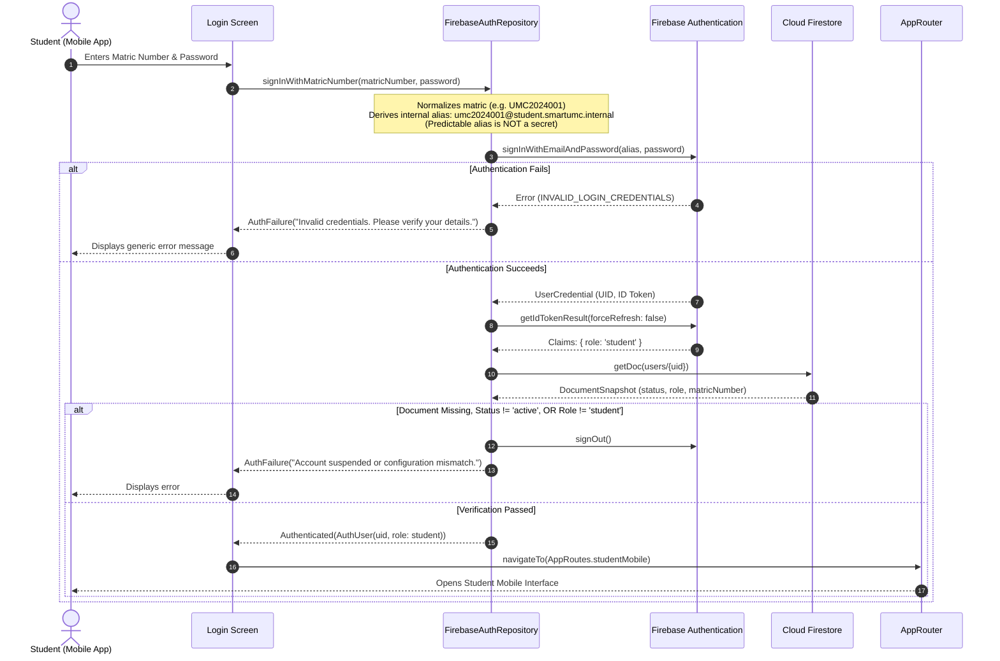
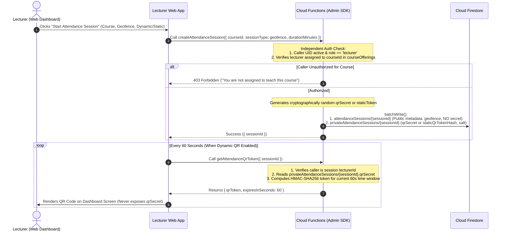
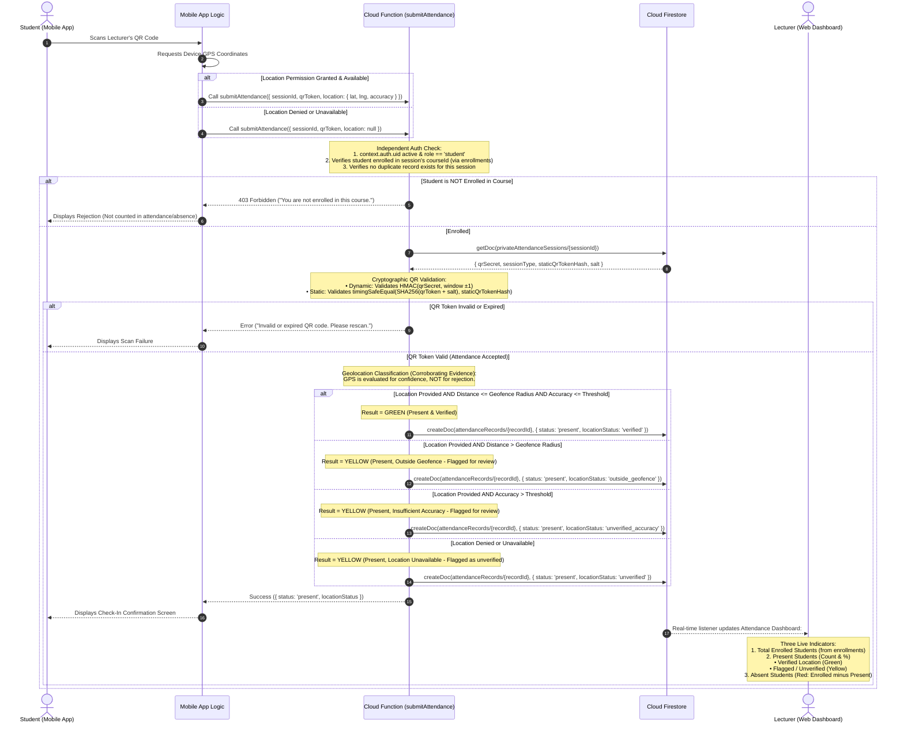
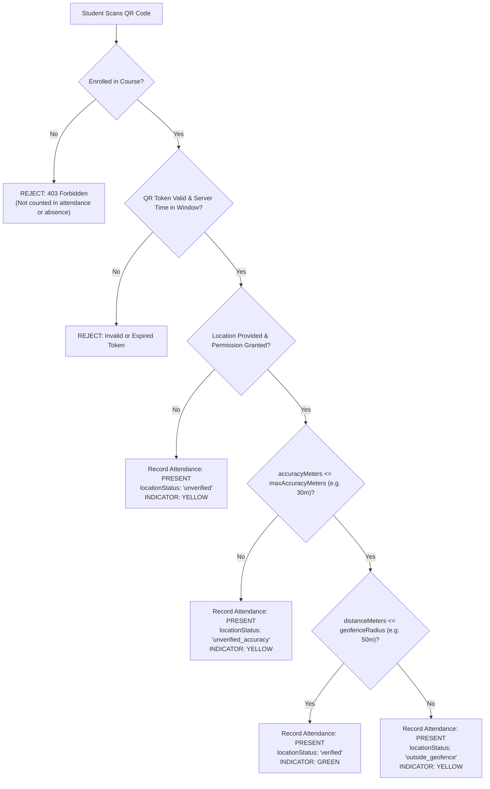
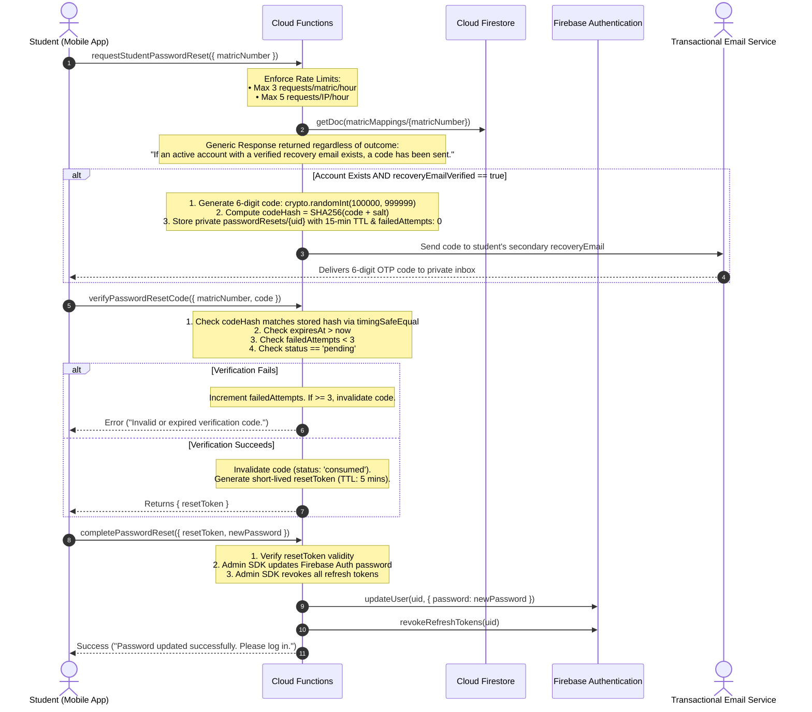

# SMARTUMC — Mission 10.6: Final Authentication Security Specification & Implementation Readiness Plan

This document establishes the finalized, production-grade architectural specification for the backend-first authentication, authorization, complete 22-collection database schema security, attendance verification, and operator procedures of **SmartUMC** (Firebase Project: `smartumc-2cdc4`).

> [!NOTE]
> **Implementation Status Disclaimer**: This document represents an architectural and security specification. No component is claimed to be implemented, tested, or production-ready merely because it is documented here; concrete implementations and emulator test executions will proceed in their designated development missions.

---

## 1. Executive Summary

Mission 10.6 represents the final implementation-readiness corrections and security specification freeze for SmartUMC prior to the commencement of coding phases. Building on the iterative architectural reviews of Missions 10.0 through 10.5, this specification establishes:
1. **Super Admin Bootstrap Hardening**: Enforces an initialization lock to prevent concurrent bootstrap attempts, mandates pre-verified UID and email matching, aborts if a user document exists in any form, preserves existing Custom Claims with automated rollback, and explicitly documents the non-atomic nature of cross-service Firebase Auth/Firestore operations.
2. **Atomic Attendance Duplicate Prevention**: Replaces check-then-create logic with deterministic record keys (`REC_${sessionId}_${studentUid}`) inside atomic Firestore transactions, ensuring strict duplicate prevention, idempotent responses for retries, and high-concurrency resilience.
3. **Comprehensive Attendance Session Validation**: Formalizes an 8-point server-side validation pipeline verifying active session state, trusted server-time bounds, token type parity, dynamic HMAC ($\pm 1$ window) or salted static hash matching (`crypto.timingSafeEqual`), account standing, course enrollment, and single-submission constraints.
4. **Restored Geolocation Verification & Attendance Semantics**: Restores SmartUMC's core policy that outside-geofence scans must **never** be automatically rejected. Formalizes the 3-state indicator model (Green = Verified within geofence and accuracy threshold; Yellow = Present but outside geofence, permission denied, or accuracy insufficient; Red = Enrolled student with no check-in after session closure). Non-enrolled students are rejected and not counted as absent.
5. **Strict Schema & Value Validation**: Enforces strict value and type constraints across client-writable collections (`userPreferences`, `deviceTokens`, `supportRequests`, and `notifications`), guaranteeing non-transferable ownership, approved enum values, immutable notification text/recipients, and valid boolean/timestamp transitions.
6. **Complete 22-Collection Firestore Security Rules**: Delivers explicit, production-grade rules covering all 22 collections without omissions, enforcing lecturer scoping to assigned courses and fail-closed authentication helpers.
7. **Firestore Query Compatibility Strategy**: Documents compliant client query patterns, explains why rules are not filters, evaluates denormalized ownership alternatives, and specifies required query compatibility tests.
8. **End-to-End Student Password Recovery**: Specifies an enterprise-grade recovery architecture using salted SHA-256 verification codes, 15-minute TTL, 3-attempt invalidation, dual rate limiting, generic responses, and trusted backend password updates without exposing secrets or email aliases.
9. **Formal 36-Case Security Test Matrix**: Expands the Firebase Emulator Suite test matrix to 36 precise positive and negative test cases, clearly demarcating planned tests from executed tests.

---

## 2. Classification of Architectural Elements

### 2.1 Confirmed Requirements (Immutable Project Policies)
- **Target Project**: Firebase project `smartumc-2cdc4`.
- **Target Interfaces**: Unified Flutter codebase supporting:
  - Student: Android mobile application.
  - Lecturer: Desktop-first Flutter Web dashboard.
  - Super Admin: Desktop-first Flutter Web dashboard.
- **Canonical Identity**: Firebase Authentication User ID (`UID`) is the canonical identity across all system collections (`users/{uid}`, `students/{uid}`).
- **Student Login Interface**: Strictly **Matric Number and Password**.
- **Staff Login Interface**: Provisioned staff credentials (institutional email).
- **Client Role Immutability**: Clients cannot self-assign or elevate roles.
- **Zero Passwords in Database**: Plaintext, hashed, or encrypted passwords must never be stored in Cloud Firestore.
- **Backend Provisioning**: User accounts are provisioned via administrative backend workflows; public self-registration is disabled.
- **Attendance Policy**: Outside-geofence scans must **never** be automatically rejected solely because of location; they are recorded as present and flagged as unverified for lecturer review. Non-enrolled student check-ins must be rejected.
- **Synthetic Demonstration Data**: All user records and demonstration data are strictly synthetic.

### 2.2 Proposed Technical Decisions (Architectural Specifications)
- **Dual-Collection Session Architecture**: Partitioning session data into client-readable `attendanceSessions` and backend-only `privateAttendanceSessions`.
- **Backend QR Token Issuance**: Lecturer dashboard requests rotating tokens from `getAttendanceQrToken` without possessing the session secret.
- **Backend Session Creation**: Creating and closing attendance sessions exclusively through Cloud Functions to guarantee ownership and atomic creation of private secrets.
- **Failsafe Authorization in Security Rules**: Checking document existence, required keys, status, and claim matching in Firestore Security Rules.
- **Scoped Enrollment & Attendance Read Rules**: Enforcing that lecturers can query only enrollments and attendance records corresponding to their assigned `courseOfferingId` and `sessionId`.
- **Deterministic Student Email Alias**: Format `<matric_lowercase>@student.smartumc.internal` used internally by the client to interface with Firebase Auth.
- **Verified Secondary Recovery Email**: Mandatory verification of `recoveryEmail` before it can be used for self-service password recovery.

### 2.3 Unresolved Decisions (Requiring Project-Owner Approval)
- **Staff Email Domain Confirmation**: Placeholder domain `<staff>@umc.edu` requires confirmation of the actual university domain.
- **Classroom Geofencing Radius**: Confirmation of default classroom tolerance radius (e.g. 50m vs. 100m) to accommodate campus building scale.
- **GPS Accuracy Quality Threshold**: Confirmation of maximum acceptable GPS horizontal accuracy radius (proposed: 30 meters).
- **Transactional Email Provider**: Selection of delivery service (SendGrid, Mailgun, or Firebase Extension) for password reset emails.
- **Firebase Blaze Plan Upgrade**: Formal authorization to upgrade `smartumc-2cdc4` to pay-as-you-go for Cloud Functions.
- **App Check Enforcement Timeline**: Determination of whether App Check will operate in monitoring mode during initial testing or be strictly enforced upon initial deployment.

---

## 3. Security Principles & System Boundaries

SmartUMC enforces a strict Defense-in-Depth model with clear privilege boundaries:

```
┌────────────────────────────────────────────────────────────────────────┐
│                        PRESENTATION / CLIENT LAYER                     │
│  • Student App: Matric Number + Password; camera QR scanner & GPS      │
│  • Lecturer Web: Institutional Email + Password; displays QR tokens    │
│  • ZERO write access to: users, students, attendanceRecords            │
│  • ZERO access to: privateAttendanceSessions, matricMappings           │
└───────────────────────────────────┬────────────────────────────────────┘
                                    │ HTTPS / Firebase SDK
                                    ▼
┌────────────────────────────────────────────────────────────────────────┐
│                     CANONICAL IDENTITY (FIREBASE AUTH)                 │
│  • Cryptographically signed JWT (ID Token, 1-hour expiration)          │
│  • Custom User Claims ({ role: 'student' | 'lecturer' | 'admin' })     │
│  • Refresh token revocation mechanism                                  │
└───────────────────────────────────┬────────────────────────────────────┘
                                    │
            ┌───────────────────────┴───────────────────────┐
            ▼                                               ▼
┌───────────────────────────────────────┐ ┌──────────────────────────────┐
│     DATABASE LAYER (FIRESTORE)        │ │  TRUSTED BACKEND (FUNCTIONS) │
│  • Enforces Firestore Security Rules  │ │  • Uses Firebase Admin SDK   │
│  • users/{uid}: Profile & live status │ │  • BYPASSES SECURITY RULES   │
│  • students/{uid}: Student records    │ │  • Performs independent auth │
│  • attendanceSessions: Metadata only  │ │  • Exclusive writer: records │
│  • privateSessions: DENY ALL CLIENTS  │ │  • Generates QR tokens       │
│  • matricMappings: DENY ALL CLIENTS   │ │  • Validates check-ins       │
│  • Failsafe check: live role == claim │ │  • Role assignment & claims  │
└───────────────────────────────────────┘ └──────────────────────────────┘
```

> [!CAUTION]
> **Admin SDK Security Rules Bypass**: Firebase Admin SDK operations within Cloud Functions completely bypass Firestore Security Rules. Consequently, Cloud Functions cannot rely on Firestore rules for authorization; **every function must implement strict independent authorization, role validation, and input sanitation**.

---

## 4. Authentication and Attendance Workflows

### 4.1 Student Login Workflow (Matric Number + Password)



### 4.2 Lecturer Session Creation and QR Token Generation



### 4.3 Secure Attendance Submission & Indicator Classification



---

## 5. Super Admin Bootstrap Procedure (Hardened Specification)

### 5.1 Concurrency Safeguards & Bootstrap Lock
To prevent race conditions where multiple operators execute the script concurrently against different accounts:
1. The script accesses an exclusive Firestore lock document: `system/bootstrapLock`.
2. Execution occurs inside a Firestore transaction:
   - If `bootstrapLock` exists with `status == 'completed'`, the script aborts: system is already initialized.
   - If `bootstrapLock` exists with `status == 'in_progress'` and `lockedAt` is within the last 15 minutes, the script aborts: another bootstrap session is active.
   - Otherwise, it writes `{ status: 'in_progress', lockedBy: intendedAdminUid, lockedAt: serverTimestamp() }`.
3. **Lock Recovery Procedure**: If an operator process terminates abruptly (network failure or manual interrupt), the lock becomes stale after **15 minutes**. A designated operator can clear the lock using the CLI flag `--recover-lock` after confirming no concurrent process is executing.

### 5.2 Non-Atomic Cross-Service Operations & Compensatory Rollback
> [!WARNING]
> **Cross-Service Transaction Limitation**: Firebase Authentication and Cloud Firestore are independent distributed services. They **cannot participate in a single atomic transaction**. If Custom Claims are updated in Firebase Auth but the Firestore write fails, the system is in an inconsistent state. The script implements an automated compensatory rollback: restoring previous claims if Firestore fails.

### 5.3 Abort-on-Existing-Profile Policy
If `users/{intendedAdminUid}` already exists in Firestore in **any form** (whether empty, complete, or malformed), the initial bootstrap **strictly aborts**. It does not conditionally merge or overwrite existing documents.

### 5.4 Hardened Bootstrap Script (`scripts/bootstrap_admin.ts`)
```typescript
import * as admin from 'firebase-admin';

// Initialize using Application Default Credentials (ADC)
admin.initializeApp({
  projectId: 'smartumc-2cdc4'
});

async function hardenedSuperAdminBootstrap() {
  const intendedAdminEmail = process.env.INTENDED_ADMIN_EMAIL?.trim().toLowerCase();
  const intendedAdminUid = process.env.INTENDED_ADMIN_UID?.trim();
  const confirmationFlag = process.argv.includes('--confirm-initial-bootstrap');
  const recoverLockFlag = process.argv.includes('--recover-lock');

  if (!confirmationFlag) {
    console.error('ERROR: Missing required operator confirmation flag: --confirm-initial-bootstrap');
    process.exit(1);
  }

  // 1. Mandatory Dual-Identifier Specification
  if (!intendedAdminEmail || !intendedAdminUid) {
    console.error('CRITICAL REJECTION: Both INTENDED_ADMIN_EMAIL and INTENDED_ADMIN_UID are strictly mandatory.');
    console.error('Execution halted: Cannot elevate an account based on email alone.');
    process.exit(1);
  }

  const auth = admin.auth();
  const db = admin.firestore();
  const lockRef = db.collection('system').doc('bootstrapLock');

  try {
    // 2. Concurrency Lock & Initialization Verification Transaction
    await db.runTransaction(async (transaction) => {
      const lockDoc = await transaction.get(lockRef);
      const now = Date.now();

      if (lockDoc.exists) {
        const lockData = lockDoc.data()!;
        if (lockData.status === 'completed') {
          throw new Error('CRITICAL ABORT: System is already initialized. Bootstrap cannot be run.');
        }
        if (lockData.status === 'in_progress') {
          const lockAgeMinutes = (now - lockData.lockedAt.toMillis()) / (1000 * 60);
          if (lockAgeMinutes < 15 && !recoverLockFlag) {
            throw new Error(`CRITICAL ABORT: Bootstrap currently in progress by ${lockData.lockedBy} (active for ${lockAgeMinutes.toFixed(1)} mins). Use --recover-lock if abandoned.`);
          }
        }
      }

      // Check if any Super Admin already exists in Firestore users collection
      const existingAdmins = await db.collection('users')
        .where('role', '==', 'admin')
        .limit(1)
        .get();

      if (!existingAdmins.empty) {
        throw new Error('CRITICAL ABORT: A Super Admin account already exists in users collection.');
      }

      transaction.set(lockRef, {
        status: 'in_progress',
        lockedBy: intendedAdminUid,
        lockedAt: admin.firestore.FieldValue.serverTimestamp()
      });
    });

    // 3. Fetch Targeted Account from Firebase Auth
    let userRecord: admin.auth.UserRecord;
    try {
      userRecord = await auth.getUserByEmail(intendedAdminEmail);
    } catch (err: any) {
      console.error(`ERROR: Target account ${intendedAdminEmail} does not exist in Firebase Auth.`);
      await lockRef.delete();
      process.exit(1);
    }

    // 4. Strict Dual-Identifier Verification (UID + Email)
    if (userRecord.uid !== intendedAdminUid) {
      console.error(`CRITICAL IDENTITY MISMATCH: Account for ${intendedAdminEmail} has UID ${userRecord.uid}, but INTENDED_ADMIN_UID specified ${intendedAdminUid}.`);
      await lockRef.delete();
      process.exit(1);
    }

    // 5. Verification Check: Never spoof email verification
    if (!userRecord.emailVerified) {
      console.error(`CRITICAL: The account ${intendedAdminEmail} has not completed actual email verification.`);
      await lockRef.delete();
      process.exit(1);
    }

    // 6. Abort If User Profile Already Exists in Any Form (No Silent Overwrite)
    const existingDoc = await db.collection('users').doc(userRecord.uid).get();
    if (existingDoc.exists) {
      console.error(`CRITICAL ABORT: Document users/${userRecord.uid} already exists.`);
      console.error('Initial bootstrap requires that no user document exists for target UID.');
      await lockRef.delete();
      process.exit(1);
    }

    // 7. Preserve Existing Custom Claims
    const previousClaims = userRecord.customClaims || {};
    const updatedClaims = { ...previousClaims, role: 'admin' };

    console.log(`Assigning admin claim while preserving existing claims for UID: ${userRecord.uid}...`);
    await auth.setCustomUserClaims(userRecord.uid, updatedClaims);

    // 8. Transactional Firestore Profile Creation with Automated Rollback
    try {
      console.log(`Writing authoritative Firestore user profile for UID: ${userRecord.uid}...`);
      await db.collection('users').doc(userRecord.uid).set({
        uid: userRecord.uid,
        role: 'admin',
        status: 'active',
        email: intendedAdminEmail,
        displayName: userRecord.displayName || 'Initial Super Administrator',
        staffId: 'ADMIN-INITIAL',
        createdAt: admin.firestore.FieldValue.serverTimestamp(),
        updatedAt: admin.firestore.FieldValue.serverTimestamp()
      });

      // Complete initialization lock
      await lockRef.set({
        status: 'completed',
        completedBy: intendedAdminUid,
        completedAt: admin.firestore.FieldValue.serverTimestamp()
      });

      console.log(`SUCCESS: Super Admin established for verified UID: ${userRecord.uid}`);
    } catch (firestoreError) {
      console.error('CRITICAL WRITE FAILURE: Firestore profile write failed after Custom Claims assignment!');
      console.error('Initiating compensatory rollback of Custom Claims to previous state...');
      try {
        await auth.setCustomUserClaims(userRecord.uid, previousClaims);
        console.log('Rollback successful: Previous Custom Claims restored.');
      } catch (rollbackError) {
        console.error('EMERGENCY: Rollback of Custom Claims failed! System may be in an inconsistent state.');
        console.error(`Target UID: ${userRecord.uid}. Previous Claims: ${JSON.stringify(previousClaims)}.`);
        console.error('Manual intervention required via Firebase CLI or Google Cloud Console:');
        console.error(`Execute: firebase auth:claims:set ${userRecord.uid} '${JSON.stringify(previousClaims)}'`);
      }
      await lockRef.delete();
      throw firestoreError;
    }

  } catch (error: any) {
    console.error('Bootstrap execution failed:', error.message);
    process.exit(1);
  }
}

hardenedSuperAdminBootstrap();
```

---

## 6. Complete Attendance Session Validation Pipeline

Every attendance check-in submitted to `submitAttendance` must satisfy all **8 server-side validation criteria** using trusted server time (`admin.firestore.Timestamp.now()`):

```
┌────────────────────────────────────────────────────────────────────────┐
│              submitAttendance(sessionId, qrToken, location)            │
└───────────────────────────────────┬────────────────────────────────────┘
                                    │
                                    ▼
┌────────────────────────────────────────────────────────────────────────┐
│ 1. Session Exists: attendanceSessions/{sessionId} document exists     │
├────────────────────────────────────────────────────────────────────────┤
│ 2. Session Active: sessionDoc.isActive == true                         │
├────────────────────────────────────────────────────────────────────────┤
│ 3. Server Time in Window: serverTime >= validFrom && <= validUntil     │
├────────────────────────────────────────────────────────────────────────┤
│ 4. Token Type Match: Submitted token structure matches sessionType     │
├────────────────────────────────────────────────────────────────────────┤
│ 5. Token Cryptographically Valid:                                      │
│    • Dynamic: HMAC-SHA256(qrSecret, window ±1) matches qrToken         │
│    • Static: timingSafeEqual(SHA256(qrToken + salt), staticHash)       │
├────────────────────────────────────────────────────────────────────────┤
│ 6. Student Account Active: users/{uid}.status == 'active' & role student│
├────────────────────────────────────────────────────────────────────────┤
│ 7. Student Enrolled: enrollments where studentId & courseOfferingId    │
├────────────────────────────────────────────────────────────────────────┤
│ 8. Single Submission: REC_{sessionId}_{uid} does not already exist    │
└───────────────────────────────────┬────────────────────────────────────┘
                                    │ All Pass
                                    ▼
┌────────────────────────────────────────────────────────────────────────┐
│  Evaluate Geolocation & Write Record (Atomic Transaction)              │
└────────────────────────────────────────────────────────────────────────┘
```

### 6.1 Validation Rules Detail
1. **Session Exists**: `attendanceSessions/{sessionId}` document must exist in Firestore.
2. **Session Active**: `sessionDoc.isActive === true`. Closed sessions reject all scans immediately.
3. **Server Time Bounds**: Evaluated strictly using Cloud Functions server time (`serverTime >= validFrom && serverTime <= validUntil`). The student's device clock is completely disregarded.
4. **Token Type Parity**: A static QR submission to a dynamic session (or vice versa) is rejected.
5. **Cryptographic Token Verification**:
   - **Dynamic QR**: The backend reads `privateAttendanceSessions/{sessionId}.qrSecret` via Admin SDK, computes HMAC-SHA256 for the current 60-second window, and allows a grace window of $\pm 1$ window (60s prior or 60s following) to accommodate transit latency.
   - **Static QR**: The backend computes `SHA-256(qrToken + salt)` and executes `crypto.timingSafeEqual` against `staticQrTokenHash`. The token cannot be reused across sessions because the per-session salt differs.
6. **Student Standing**: Verifies `users/{uid}.status === 'active'` and `users/{uid}.role === 'student'`.
7. **Roster Enrollment**: Verifies that an active record exists in `enrollments` for `studentId == context.auth.uid` and `courseOfferingId == sessionDoc.courseId`. Non-enrolled students are rejected with `403 Forbidden`.
8. **Single Submission Guard**: Verified atomically as defined in Section 7.

---

## 7. Atomic Attendance Duplicate Prevention

### 7.1 The Race Condition in Check-Then-Create
A standard query check (`where('sessionId').where('studentId')`) followed by an insert creates a time-of-check to time-of-use (TOCTOU) race condition when a student rapidly taps the scan button or a mobile client dispatches parallel network requests.

### 7.2 Deterministic Record Keys & Atomic Transaction
SmartUMC enforces strict duplicate prevention by deriving the attendance record document ID deterministically:
$$\text{recordId} = \text{"REC\_" + sessionId + "\_" + studentUid}$$

The write executes inside a Firestore transaction:
```typescript
const recordRef = db.collection('attendanceRecords').doc(`REC_${sessionId}_${studentUid}`);

await db.runTransaction(async (transaction) => {
  const existingRecord = await transaction.get(recordRef);

  if (existingRecord.exists) {
    // Idempotent return: Attendance already recorded
    const data = existingRecord.data()!;
    return {
      success: true,
      alreadyRecorded: true,
      message: 'Attendance has already been recorded for this session.',
      status: data.status,
      locationStatus: data.locationStatus,
      verifiedAt: data.verifiedAt.toDate().toISOString()
    };
  }

  // Determine Geolocation Status
  const locationClassification = classifyLocation(location, sessionDoc.classroomGeofence);

  transaction.set(recordRef, {
    recordId: recordRef.id,
    sessionId: sessionId,
    courseId: sessionDoc.courseId,
    studentId: studentUid,
    matricNumber: studentMatric,
    verifiedAt: admin.firestore.FieldValue.serverTimestamp(),
    verificationMethod: sessionDoc.sessionType,
    status: 'present',
    locationStatus: locationClassification.status,
    distanceMeters: locationClassification.distanceMeters,
    locationAccuracyMeters: location?.accuracy || null,
    verifiedLocation: location ? {
      latitude: location.latitude,
      longitude: location.longitude,
      accuracyMeters: location.accuracy
    } : null
  });

  return {
    success: true,
    alreadyRecorded: false,
    message: 'Attendance recorded successfully.',
    status: 'present',
    locationStatus: locationClassification.status
  };
});
```

### 7.3 Concurrency and Contention Handling
- Firestore transactions automatically retry up to 5 times if document contention occurs.
- If two parallel requests execute simultaneously, the first write establishes the document. The retried transaction detects the existing document and returns the idempotent success payload.
- Zero duplicate records can ever be created.

---

## 8. Geolocation Accuracy and SmartUMC Attendance Policy

### 8.1 Haversine Distance Calculation
Distance from the classroom geofence center $(\phi_1, \lambda_1)$ to the student's reported coordinates $(\phi_2, \lambda_2)$ is calculated server-side in Cloud Functions using the Haversine formula ($R = 6,371,000\text{ meters}$):
$$\Delta \phi = \frac{(\phi_2 - \phi_1) \cdot \pi}{180}, \quad \Delta \lambda = \frac{(\lambda_2 - \lambda_1) \cdot \pi}{180}$$
$$a = \sin^2\left(\frac{\Delta \phi}{2}\right) + \cos\left(\frac{\phi_1 \cdot \pi}{180}\right) \cdot \cos\left(\frac{\phi_2 \cdot \pi}{180}\right) \cdot \sin^2\left(\frac{\Delta \lambda}{2}\right)$$
$$c = 2 \cdot \text{atan2}\left(\sqrt{a}, \sqrt{1 - a}\right), \quad \text{distanceMeters} = R \cdot c$$

### 8.2 Three-State Indicator Model & Evaluation Flow



### 8.3 Post-Session Absence Computation
- **During Active Session**: Enrolled students who have not yet scanned are in state `pending_checkin`. They are **not** classified as definitively absent while the check-in window remains open.
- **After Session Closes**: Once `validUntil` has elapsed or the lecturer manually triggers `closeAttendanceSession`, the backend calculates definitive absences:
  $$\text{Definitive Absences (Red)} = \text{Course Enrolled Roster} \setminus \text{Present Attendance Records}$$

---

## 9. Protected QR Secret Architecture & Static Token Security

### 9.1 Dual-Collection Isolation
```
┌──────────────────────────────────────────────┐
│       attendanceSessions/{sessionId}         │  ◄── Publicly readable by active users
├──────────────────────────────────────────────┤      • courseId, lecturerId
│ • Non-sensitive session metadata             │      • sessionType ("dynamic" | "static")
│ • Geofence coordinates & radius              │      • validFrom, validUntil
│ • isActive, refreshIntervalSeconds           │      • ZERO SECRETS STORED HERE
└──────────────────────────────────────────────┘

┌──────────────────────────────────────────────┐
│    privateAttendanceSessions/{sessionId}     │  ◄── ZERO CLIENT ACCESS (DENY ALL)
├──────────────────────────────────────────────┤      • Accessible ONLY via Admin SDK
│ • qrSecret: 256-bit cryptographically random │      • staticQrTokenHash: Salted SHA-256
│ • salt: Cryptographic per-session salt       │      • Never leaves trusted backend
└──────────────────────────────────────────────┘
```

### 9.2 Dynamic QR Verification Mechanics
$$\text{qrToken} = \text{HMAC-SHA256}(\text{qrSecret}, \text{currentTimestampWindow})$$
where $\text{currentTimestampWindow} = \lfloor \text{unixTimeSeconds} / 60 \rfloor$. Verified against window $\pm 1$.

### 9.3 Static QR Verification Mechanics
- **Storage**: `privateAttendanceSessions/{sessionId}` stores only `staticQrTokenHash = SHA-256(rawToken + salt)`.
- **Verification**: `submitAttendance` computes `SHA-256(submittedToken + salt)` and evaluates `crypto.timingSafeEqual`.
- **Revocation**: `closeAttendanceSession` deletes or nullifies `staticQrTokenHash`.

---

## 10. Complete Student Password Recovery Architecture

### 10.1 Recovery Process Specification
The student-facing login strictly uses **Matric Number + Password**. The deterministic internal alias (`<matric>@student.smartumc.internal`) is an internal routing translation and is never treated as a real mailbox.



---

## 11. Complete SmartUMC Database Architecture Compatibility

All **22 SmartUMC collections** are explicitly cataloged below with access permissions:

| # | Collection Name | Purpose & Contents | Read Authorization | Write Authorization |
| :--- | :--- | :--- | :--- | :--- |
| 1 | `users` | Authoritative user profiles, roles, and account status. Keyed by UID: `users/{uid}`. | Own profile or Super Admin | Cloud Functions only |
| 2 | `students` | Detailed student records (matric, programme, intake, faculty). Keyed by UID: `students/{uid}`. | Own record (`studentUid == auth.uid`) or Super Admin | Cloud Functions only |
| 3 | `lecturers` | Lecturer profiles, department, faculty, and academic titles. Keyed by UID: `lecturers/{uid}`. | Authenticated active users | Cloud Functions only |
| 4 | `programs` | Academic degree programmes and curriculum specifications. | Authenticated active users | Super Admin (via backend) |
| 5 | `groups` | Student tutorial / lab / cohort group assignments. | Authenticated active users | Super Admin (via backend) |
| 6 | `courses` | Master course catalog (course codes, titles, credit hours). | Authenticated active users | Super Admin (via backend) |
| 7 | `semesters` | Academic semester terms and calendar boundaries. | Authenticated active users | Super Admin (via backend) |
| 8 | `courseOfferings` | Active semester course instances assigned to lecturers. | Authenticated active users | Super Admin (via backend) |
| 9 | `enrollments` | Official student course enrollments and roster mapping. | Student (own), Assigned Lecturer, Admin | Cloud Functions only |
| 10 | `classSchedules` | Timetables, lecture slots, and physical venue allocations. | Authenticated active users | Super Admin (via backend) |
| 11 | `academicResults` | Student grades, GPA/CGPA, and examination transcripts. | Student (own), Super Admin | Cloud Functions only |
| 12 | `attendanceSessions` | Non-sensitive attendance session metadata and geofences. | Authenticated active users | Cloud Functions only |
| 13 | `privateAttendanceSessions` | Cryptographic secrets and tokens for QR generation. | **ZERO CLIENT READ (DENY ALL)** | Cloud Functions only |
| 14 | `attendanceRecords` | Verified student attendance check-in records. | Student (own), Assigned Lecturer, Admin | Cloud Functions only |
| 15 | `events` | Campus bulletins, academic notices, and public news. | Authenticated active users | Super Admin (via backend) |
| 16 | `academicCalendar` | Key university academic milestones, holidays, and exam dates. | Authenticated active users | Super Admin (via backend) |
| 17 | `notifications` | Targeted user alerts (attendance warnings, schedule changes). | Recipient user only | Owner update (`isRead`, `readAt`); Cloud Functions create |
| 18 | `userPreferences` | UI theme settings, language preferences, notification toggles. Keyed by UID: `userPreferences/{uid}`. | Owner user only | Owner user (strict schema) |
| 19 | `deviceTokens` | FCM registration tokens for mobile push notifications. | Owner user only | Owner user (strict schema) |
| 20 | `supportRequests` | In-app user help tickets and technical support queries. | Requestor user and Super Admin | Requestor user (create only; status: pending) |
| 21 | `auditLogs` | Immutable administrative audit trails for privileged actions. | Super Admin only | Cloud Functions only |
| 22 | `matricMappings` | Private $O(1)$ index mapping matric numbers to UIDs. Keyed by Matric Number: `matricMappings/{matric}`. | **ZERO CLIENT READ (DENY ALL)** | Cloud Functions only |

---

## 12. Complete 22-Collection Firestore Security Rules

```javascript
rules_version = '2';
service cloud.firestore {
  match /databases/{database}/documents {

    // -------------------------------------------------------------------------
    // HARDENED HELPER FUNCTIONS (FAIL-CLOSED)
    // -------------------------------------------------------------------------
    function isAuthenticated() {
      return request.auth != null;
    }

    function userDocExists() {
      return isAuthenticated() && 
        exists(/databases/$(database)/documents/users/$(request.auth.uid));
    }

    function getUserDoc() {
      return get(/databases/$(database)/documents/users/$(request.auth.uid)).data;
    }

    // Failsafe check: Verifies auth, doc existence, schema keys, active status, and claim match
    function isAccountActiveAndConsistent() {
      return userDocExists() &&
             getUserDoc().keys().hasAll(['status', 'role']) &&
             getUserDoc().status == 'active' && 
             getUserDoc().role == request.auth.token.role;
    }

    function isSuperAdmin() {
      return isAccountActiveAndConsistent() && request.auth.token.role == 'admin';
    }

    function isLecturer() {
      return isAccountActiveAndConsistent() && request.auth.token.role == 'lecturer';
    }

    function isStudent() {
      return isAccountActiveAndConsistent() && request.auth.token.role == 'student';
    }

    // Helper: Verify if lecturer is assigned to a specific course offering
    function isAssignedLecturerForOffering(courseOfferingId) {
      return isLecturer() && 
        get(/databases/$(database)/documents/courseOfferings/$(courseOfferingId)).data.lecturerId == request.auth.uid;
    }

    // Helper: Verify if lecturer is assigned to the session's course offering
    function isAssignedLecturerForSession(sessionId) {
      return isLecturer() && 
        get(/databases/$(database)/documents/attendanceSessions/$(sessionId)).data.lecturerId == request.auth.uid;
    }

    // -------------------------------------------------------------------------
    // DEFAULT DENY FOR UNMATCHED PATHS
    // -------------------------------------------------------------------------
    match /{document=**} {
      allow read, write: if false;
    }

    // -------------------------------------------------------------------------
    // 1. USERS COLLECTION (Keyed by UID)
    // -------------------------------------------------------------------------
    match /users/{userId} {
      allow read: if isAccountActiveAndConsistent() && 
        (request.auth.uid == userId || isSuperAdmin());
      allow write: if false; // Cloud Functions (Admin SDK) exclusive
    }

    // -------------------------------------------------------------------------
    // 2. STUDENTS COLLECTION (Keyed by canonical UID: students/{uid})
    // -------------------------------------------------------------------------
    match /students/{studentUid} {
      allow read: if isAccountActiveAndConsistent() && 
        (studentUid == request.auth.uid || isSuperAdmin());
      allow write: if false;
    }

    // -------------------------------------------------------------------------
    // 3. LECTURERS COLLECTION (Keyed by canonical UID: lecturers/{uid})
    // -------------------------------------------------------------------------
    match /lecturers/{lecturerUid} {
      allow read: if isAccountActiveAndConsistent();
      allow write: if false;
    }

    // -------------------------------------------------------------------------
    // 4. PROGRAMS COLLECTION
    // -------------------------------------------------------------------------
    match /programs/{programId} {
      allow read: if isAccountActiveAndConsistent();
      allow write: if false;
    }

    // -------------------------------------------------------------------------
    // 5. GROUPS COLLECTION
    // -------------------------------------------------------------------------
    match /groups/{groupId} {
      allow read: if isAccountActiveAndConsistent();
      allow write: if false;
    }

    // -------------------------------------------------------------------------
    // 6. COURSES COLLECTION
    // -------------------------------------------------------------------------
    match /courses/{courseId} {
      allow read: if isAccountActiveAndConsistent();
      allow write: if false;
    }

    // -------------------------------------------------------------------------
    // 7. SEMESTERS COLLECTION
    // -------------------------------------------------------------------------
    match /semesters/{semesterId} {
      allow read: if isAccountActiveAndConsistent();
      allow write: if false;
    }

    // -------------------------------------------------------------------------
    // 8. COURSE OFFERINGS COLLECTION
    // -------------------------------------------------------------------------
    match /courseOfferings/{courseOfferingId} {
      allow read: if isAccountActiveAndConsistent();
      allow write: if false;
    }

    // -------------------------------------------------------------------------
    // 9. ENROLLMENTS COLLECTION (Strict Scoped Read Privacy)
    // -------------------------------------------------------------------------
    match /enrollments/{enrollmentId} {
      allow read: if isAccountActiveAndConsistent() && (
        resource.data.studentId == request.auth.uid ||
        isAssignedLecturerForOffering(resource.data.courseOfferingId) ||
        isSuperAdmin()
      );
      allow write: if false;
    }

    // -------------------------------------------------------------------------
    // 10. CLASS SCHEDULES COLLECTION
    // -------------------------------------------------------------------------
    match /classSchedules/{scheduleId} {
      allow read: if isAccountActiveAndConsistent();
      allow write: if false;
    }

    // -------------------------------------------------------------------------
    // 11. ACADEMIC RESULTS COLLECTION (Strict Student & Admin Privacy)
    // -------------------------------------------------------------------------
    match /academicResults/{resultId} {
      allow read: if isAccountActiveAndConsistent() && 
        (resource.data.studentId == request.auth.uid || isSuperAdmin());
      allow write: if false;
    }

    // -------------------------------------------------------------------------
    // 12. ATTENDANCE SESSIONS COLLECTION (Public Metadata)
    // -------------------------------------------------------------------------
    match /attendanceSessions/{sessionId} {
      allow read: if isAccountActiveAndConsistent();
      allow write: if false;
    }

    // -------------------------------------------------------------------------
    // 13. PRIVATE ATTENDANCE SESSIONS (ZERO CLIENT ACCESS)
    // -------------------------------------------------------------------------
    match /privateAttendanceSessions/{sessionId} {
      allow read, write: if false;
    }

    // -------------------------------------------------------------------------
    // 14. ATTENDANCE RECORDS COLLECTION (Scoped Lecturer & Student Access)
    // -------------------------------------------------------------------------
    match /attendanceRecords/{recordId} {
      allow read: if isAccountActiveAndConsistent() && (
        resource.data.studentId == request.auth.uid ||
        isAssignedLecturerForSession(resource.data.sessionId) ||
        isSuperAdmin()
      );
      allow write: if false;
    }

    // -------------------------------------------------------------------------
    // 15. CAMPUS EVENTS COLLECTION
    // -------------------------------------------------------------------------
    match /events/{eventId} {
      allow read: if isAccountActiveAndConsistent();
      allow write: if false;
    }

    // -------------------------------------------------------------------------
    // 16. ACADEMIC CALENDAR COLLECTION
    // -------------------------------------------------------------------------
    match /academicCalendar/{calendarId} {
      allow read: if isAccountActiveAndConsistent();
      allow write: if false;
    }

    // -------------------------------------------------------------------------
    // 17. NOTIFICATIONS COLLECTION (Strict Read-Status Validation & Immutability)
    // -------------------------------------------------------------------------
    match /notifications/{notificationId} {
      allow read: if isAccountActiveAndConsistent() && resource.data.userId == request.auth.uid;
      // Allow user to mark notifications as read without mutating content, recipient, or ownership
      allow update: if isAccountActiveAndConsistent() && 
        resource.data.userId == request.auth.uid &&
        request.resource.data.userId == resource.data.userId &&
        request.resource.data.title == resource.data.title &&
        request.resource.data.body == resource.data.body &&
        request.resource.data.diff(resource.data).affectedKeys().hasOnly(['isRead', 'readAt']) &&
        request.resource.data.isRead is bool &&
        (!('readAt' in request.resource.data) || request.resource.data.readAt is timestamp || request.resource.data.readAt == null);
      allow create, delete: if false;
    }

    // -------------------------------------------------------------------------
    // 18. USER PREFERENCES COLLECTION (Keyed by UID: userPreferences/{uid})
    // -------------------------------------------------------------------------
    match /userPreferences/{userId} {
      allow read: if isAccountActiveAndConsistent() && request.auth.uid == userId;
      allow create, update: if isAccountActiveAndConsistent() && 
        request.auth.uid == userId &&
        request.resource.data.keys().hasAll(['themeMode', 'language', 'notificationsEnabled', 'biometricsEnabled', 'updatedAt']) &&
        request.resource.data.keys().hasOnly(['themeMode', 'language', 'notificationsEnabled', 'biometricsEnabled', 'updatedAt']) &&
        request.resource.data.themeMode in ['system', 'light', 'dark'] &&
        request.resource.data.language in ['en', 'ms'] &&
        request.resource.data.notificationsEnabled is bool &&
        request.resource.data.biometricsEnabled is bool &&
        request.resource.data.updatedAt is timestamp;
      allow delete: if false;
    }

    // -------------------------------------------------------------------------
    // 19. DEVICE TOKENS COLLECTION (Strict Schema & Non-Transferable Ownership)
    // -------------------------------------------------------------------------
    match /deviceTokens/{tokenId} {
      allow read, delete: if isAccountActiveAndConsistent() && resource.data.userId == request.auth.uid;
      allow create: if isAccountActiveAndConsistent() && 
        request.resource.data.userId == request.auth.uid &&
        request.resource.data.keys().hasAll(['userId', 'token', 'platform', 'updatedAt']) &&
        request.resource.data.keys().hasOnly(['userId', 'token', 'platform', 'deviceModel', 'updatedAt']) &&
        request.resource.data.userId is string &&
        request.resource.data.token is string && request.resource.data.token.size() > 0 && request.resource.data.token.size() <= 500 &&
        request.resource.data.platform in ['android', 'ios', 'web'] &&
        request.resource.data.updatedAt is timestamp &&
        (!('deviceModel' in request.resource.data) || (request.resource.data.deviceModel is string && request.resource.data.deviceModel.size() <= 100));
      allow update: if isAccountActiveAndConsistent() && 
        resource.data.userId == request.auth.uid &&
        request.resource.data.userId == resource.data.userId &&
        request.resource.data.keys().hasAll(['userId', 'token', 'platform', 'updatedAt']) &&
        request.resource.data.keys().hasOnly(['userId', 'token', 'platform', 'deviceModel', 'updatedAt']) &&
        request.resource.data.userId is string &&
        request.resource.data.token is string && request.resource.data.token.size() > 0 && request.resource.data.token.size() <= 500 &&
        request.resource.data.platform in ['android', 'ios', 'web'] &&
        request.resource.data.updatedAt is timestamp &&
        (!('deviceModel' in request.resource.data) || (request.resource.data.deviceModel is string && request.resource.data.deviceModel.size() <= 100));
    }

    // -------------------------------------------------------------------------
    // 20. SUPPORT REQUESTS COLLECTION (User Create & Read Own, Super Admin Manage)
    // -------------------------------------------------------------------------
    match /supportRequests/{requestId} {
      allow read: if isAccountActiveAndConsistent() && 
        (resource.data.userId == request.auth.uid || isSuperAdmin());
      allow create: if isAccountActiveAndConsistent() && 
        request.resource.data.userId == request.auth.uid &&
        request.resource.data.status == 'pending' &&
        request.resource.data.keys().hasAll(['userId', 'category', 'subject', 'message', 'status', 'createdAt']) &&
        request.resource.data.keys().hasOnly(['userId', 'category', 'subject', 'message', 'status', 'createdAt', 'userRole']) &&
        request.resource.data.category in ['technical', 'academic', 'attendance', 'account', 'general'] &&
        request.resource.data.subject is string && request.resource.data.subject.size() >= 3 && request.resource.data.subject.size() <= 100 &&
        request.resource.data.message is string && request.resource.data.message.size() >= 10 && request.resource.data.message.size() <= 2000 &&
        request.resource.data.createdAt is timestamp;
      allow update, delete: if false; // Managed via Super Admin Cloud Functions
    }

    // -------------------------------------------------------------------------
    // 21. AUDIT LOGS COLLECTION (Super Admin Read Only, Immutable Write)
    // -------------------------------------------------------------------------
    match /auditLogs/{logId} {
      allow read: if isSuperAdmin();
      allow write: if false;
    }

    // -------------------------------------------------------------------------
    // 22. MATRIC MAPPINGS COLLECTION (ZERO CLIENT ACCESS)
    // -------------------------------------------------------------------------
    match /matricMappings/{matric} {
      allow read, write: if false;
    }
  }
}
```

---

## 13. Firestore Query Compatibility Strategy

> [!IMPORTANT]
> **Firestore Security Rules Are Not Filters**: A query in Firestore succeeds only if the rule would allow every document that the query could potentially return. If a client attempts an unbounded query across a collection where they only have partial read access, Firestore **rejects the entire query** with `permission-denied`. Client code must structure queries with filters matching the applicable security rule constraints.

### 13.1 Lecturer Attendance Records Query
- **Rule Constraint**: Lecturer may read records only where `session.lecturerId == request.auth.uid`.
- **Invalid Query (Rejected)**:
  `FirebaseFirestore.instance.collection('attendanceRecords').get();` *(Fails: Requests all records)*
- **Compliant Client Query**:
  ```dart
  FirebaseFirestore.instance
      .collection('attendanceRecords')
      .where('sessionId', isEqualTo: activeSessionId)
      .snapshots();
  ```

### 13.2 Lecturer Course Enrollments Query
- **Rule Constraint**: Lecturer may read enrollments only for their assigned `courseOfferingId`.
- **Invalid Query (Rejected)**:
  `FirebaseFirestore.instance.collection('enrollments').get();` *(Fails: Requests all enrollments)*
- **Compliant Client Query**:
  ```dart
  FirebaseFirestore.instance
      .collection('enrollments')
      .where('courseOfferingId', isEqualTo: assignedOfferingId)
      .snapshots();
  ```

### 13.3 Architectural Consideration: Denormalized Ownership
If evaluating `get(/databases/.../attendanceSessions/$(sessionId))` or `courseOfferings/$(offeringId)` during collection queries introduces latency or query constraints during Firebase Emulator testing, an architectural alternative is:
- **Denormalized `lecturerId`**: Cloud Functions stamp `lecturerId` directly onto each `attendanceRecord` and `enrollment` document at creation time.
- Security rules then simplify to `resource.data.lecturerId == request.auth.uid` without requiring cross-document lookups.
- This alternative will be verified on the Firebase Emulator Suite prior to finalizing production indexes.

---

## 14. Password Recovery Architecture (Complete Workflow)

1. **Student Initiation**: Student enters Matric Number on mobile login screen.
2. **Account Lookup**: Cloud Function `requestStudentPasswordReset` queries `matricMappings/{matricNumber}` using Admin SDK. If not found or `recoveryEmailVerified == false`, returns generic success message to prevent enumeration.
3. **Cryptographic Code Generation**:
   $$\text{code} = \text{crypto.randomInt(100000, 999999)}$$
   $$\text{codeHash} = \text{SHA-256}(\text{code} + \text{salt})$$
4. **Storage in Backend Collection**: Stored in `passwordResets/{uid}` with `expiresAt = now + 15 min`, `failedAttempts = 0`, and `status = 'pending'`. Completely inaccessible to clients.
5. **Rate Limiting**: Throttled to max 3 requests per matric per hour, max 5 per IP per hour.
6. **Code Verification**: Cloud Function `verifyPasswordResetCode` checks hash equality (`timingSafeEqual`), checks `now < expiresAt`, and validates `failedAttempts < 3`. If failed, increments attempt counter; if $\ge 3$, invalidates code.
7. **Password Update**: On successful verification, issues single-use `resetToken` (TTL: 5 mins). Mobile client calls `completePasswordReset({ resetToken, newPassword })`. Backend executes `admin.auth().updateUser(uid, { password })` and `admin.auth().revokeRefreshTokens(uid)`.

---

## 15. Updated Emulator Suite Security Test Matrix (36 Test Cases)

The security rules must be validated against the **Firebase Emulator Suite** across positive and negative authorization cases before deploying to production.

> [!NOTE]
> **Execution Status**: The following test matrix describes the formal testing strategy and test suites planned for execution in subsequent testing phases. **Status: 36 Planned, 0 Executed, 0 Passed, 0 Failed.** No test has been executed yet.

### 15.1 Test Personas
1. `student-enrolled`: Authenticated student enrolled in Course CS101.
2. `student-unrelated`: Authenticated student NOT enrolled in Course CS101.
3. `lecturer-assigned`: Authenticated lecturer assigned to teach Course CS101.
4. `lecturer-unrelated`: Authenticated lecturer assigned to teach Course EE201 (unrelated).
5. `super-admin`: Authenticated user with verified `{ role: 'admin' }` and active profile.
6. `user-suspended`: User with `{ role: 'student' }`, but `users/{uid}.status == 'suspended'`.
7. `user-mismatched-claim`: User with token claim `{ role: 'lecturer' }`, but Firestore document `role == 'student'`.

### 15.2 Comprehensive Test Matrix

| # | Test Scenario | Actor / Persona | Target Resource / Operation | Expected Result | Security Rationale | Status |
| :--- | :--- | :--- | :--- | :--- | :--- | :--- |
| **P1** | Read Own Profile | `student-enrolled` | `users/student-enrolled` (`get`) | **ALLOW** | Student can inspect own profile. | Planned |
| **P2** | Read Own Student Record | `student-enrolled` | `students/student-enrolled` (`get`) | **ALLOW** | Student can read own academic record. | Planned |
| **P3** | Read Assigned Session Attendance | `lecturer-assigned` | `attendanceRecords` scoped to session (`list`) | **ALLOW** | Lecturer audits attendance for assigned class. | Planned |
| **P4** | Read Assigned Course Enrollments | `lecturer-assigned` | `enrollments` scoped to offering (`list`) | **ALLOW** | Lecturer views roster for assigned class. | Planned |
| **P5** | Read Own Academic Results | `student-enrolled` | `academicResults` where `studentId == uid` (`list`)| **ALLOW** | Student inspects personal grades. | Planned |
| **P6** | Super Admin Authorized Read | `super-admin` | `users`, `students`, `auditLogs` (`list`) | **ALLOW** | Administrative oversight across system records. | Planned |
| **P7** | Update Own Device Token | `student-enrolled` | `deviceTokens/{tokenId}` with valid schema (`set`) | **ALLOW** | Registers valid FCM push token. | Planned |
| **P8** | Mark Notification as Read | `student-enrolled` | `notifications/{id}` updating `isRead`, `readAt` (`update`) | **ALLOW** | Updates read status without altering text. | Planned |
| **P9** | Create Valid Support Request | `student-enrolled` | `supportRequests/{id}` with `status: pending` (`create`)| **ALLOW** | Submits valid student support ticket. | Planned |
| **N1** | Cross-Lecturer Attendance Read | `lecturer-unrelated` | `attendanceRecords` of CS101 session (`list`) | **DENY** | Cannot read another lecturer's attendance. | Planned |
| **N2** | Cross-Lecturer Enrollment Read | `lecturer-unrelated` | `enrollments` of CS101 offering (`list`) | **DENY** | Cannot inspect rosters of unassigned courses. | Planned |
| **N3** | Unfiltered Attendance Query | `lecturer-assigned` | `attendanceRecords` without `sessionId` filter (`list`) | **DENY** | Rules are not filters; unbounded query rejected. | Planned |
| **N4** | Unfiltered Enrollments Query | `lecturer-assigned` | `enrollments` without `offeringId` filter (`list`) | **DENY** | Unbounded enrollment query rejected. | Planned |
| **N5** | Student Forging Attendance Record | `student-enrolled` | `attendanceRecords/{id}` (`create`) | **DENY** | Client writes permanently disabled on records. | Planned |
| **N6** | Direct User Role Elevation | `student-enrolled` | `users/student-enrolled` with `role: admin` (`update`) | **DENY** | Client writes permanently disabled on users. | Planned |
| **N7** | Suspended Account Data Access | `user-suspended` | `users/user-suspended` (`get`) | **DENY** | Status check revokes data access immediately. | Planned |
| **N8** | Mismatched Claim Access | `user-mismatched-claim`| `lecturers` / any collection (`list`) | **DENY** | Token claim does not match live document role. | Planned |
| **N9** | Client Access to QR Secrets | `student-enrolled` | `privateAttendanceSessions/{id}` (`get`) | **DENY** | Private session secrets have absolute deny. | Planned |
| **N10**| Client Access to Matric Mappings | `student-enrolled` | `matricMappings/{matric}` (`get`) | **DENY** | Private matric directory has absolute deny. | Planned |
| **N11**| Super Admin Read QR Secrets | `super-admin` | `privateAttendanceSessions/{id}` (`get`) | **DENY** | Backend-only secrets blocked from client SDK. | Planned |
| **N12**| Super Admin Read Matric Mappings| `super-admin` | `matricMappings/{matric}` (`get`) | **DENY** | Private index blocked from client SDK. | Planned |
| **N13**| Notification Content Tampering | `student-enrolled` | `notifications/{id}` modifying title/body (`update`)| **DENY** | Users cannot mutate notification text. | Planned |
| **N14**| Notification Recipient Mutation| `student-enrolled` | `notifications/{id}` modifying `userId` (`update`) | **DENY** | Ownership cannot be transferred. | Planned |
| **N15**| Device Token Transfer | `student-enrolled` | `deviceTokens/{id}` with different `userId` (`update`)| **DENY** | Token ownership cannot be transferred. | Planned |
| **N16**| Device Token Invalid Platform | `student-enrolled` | `deviceTokens/{id}` with `platform: 'windows'` (`set`)| **DENY** | Restricted to `['android', 'ios', 'web']`. | Planned |
| **N17**| Invalid User Preferences Value | `student-enrolled` | `userPreferences/{uid}` with `themeMode: 'neon'` (`set`)| **DENY** | Restricted to approved theme modes. | Planned |
| **N18**| User Preferences Schema Breach | `student-enrolled` | `userPreferences/{uid}` with arbitrary field (`set`) | **DENY** | Disallowed keys rejected by `keys().hasOnly`. | Planned |
| **N19**| Support Request Invalid Status | `student-enrolled` | `supportRequests/{id}` with `status: resolved` (`create`)| **DENY** | Initial status must be `pending`. | Planned |
| **N20**| Support Request Excessive Size | `student-enrolled` | `supportRequests/{id}` with message > 2000 chars (`create`)| **DENY** | Input length constraints strictly enforced. | Planned |
| **N21**| Existing Malformed Admin Profile| Operator CLI | `scripts/bootstrap_admin.ts` on existing doc | **DENY / ABORT** | Aborts if user profile exists in any form. | Planned |
| **N22**| Concurrent Bootstrap Attempt | Operator CLI | `scripts/bootstrap_admin.ts` parallel execution | **DENY / ABORT** | Blocked by `system/bootstrapLock`. | Planned |
| **N23**| Duplicate Attendance Submission| `student-enrolled` | `submitAttendance` called twice sequentially | **IDEMPOTENT** | Returns already-recorded status; no duplicate. | Planned |
| **N24**| Concurrent Attendance Check-in | `student-enrolled` | `submitAttendance` called in parallel | **ATOMIC ONCE** | Transaction enforces single record creation. | Planned |
| **N25**| Submission to Closed Session | `student-enrolled` | `submitAttendance` on `isActive: false` session | **DENY** | Session must be active. | Planned |
| **N26**| Submission Outside Time Bounds | `student-enrolled` | `submitAttendance` when serverTime > validUntil | **DENY** | Trusted server time must be in window. | Planned |
| **N27**| Mismatched QR Token Type | `student-enrolled` | Static token submitted to dynamic session | **DENY** | Token type must match session configuration. | Planned |

---

## 16. Final Unresolved Decisions Register

The following items are formally cataloged as **unresolved decisions requiring project-owner approval**:

1. **Staff Institutional Email Domain**: Confirmation of the university's official domain to replace the current placeholder (`<staff>@umc.edu`).
2. **Classroom Geofencing Radius**: Final approval of default classroom tolerance radius (proposed: 50 meters) to account for campus architectural dimensions.
3. **GPS Accuracy Quality Threshold**: Approval of maximum acceptable horizontal accuracy radius (proposed: 30 meters) before flagging submissions as `unverified_accuracy`.
4. **Transactional Email Service Provider**: Selection of delivery service (SendGrid, Mailgun, or Firebase Extension) for password reset links.
5. **Firebase Blaze Plan Upgrade**: Formal authorization to upgrade project `smartumc-2cdc4` to pay-as-you-go before deploying Cloud Functions.
6. **App Check Enforcement Timeline**: Determination of whether App Check will operate in monitoring mode during initial testing or be strictly enforced upon deployment.
7. **Official Academic Grading Scale**: Confirmation of grade mapping and transcript GPA calculation rules for `academicResults`.
8. **Student Recovery Email Verification Timeline**: Determination of whether secondary recovery email verification is mandatory at first onboarding before accessing app features.
9. **Final Emulator Test Execution Authorization**: Project-owner sign-off to execute the 36-case test matrix against the Firebase Emulator Suite in Phase 4.

---

## 17. Phased Implementation Roadmap

```
┌────────────────────────────────────────────────────────────────────────┐
│ Phase 1: Firebase Project Foundation & Dependencies                    │
│ • Confirm project smartumc-2cdc4 configuration in Firebase Console     │
│ • Enable Email/Password authentication & Email Enumeration Protection  │
│ • Add firebase_core and firebase_auth dependencies to pubspec.yaml    │
│ • Execute flutterfire configure to generate firebase_options.dart      │
└───────────────────────────────────┬────────────────────────────────────┘
                                    │
                                    ▼
┌────────────────────────────────────────────────────────────────────────┐
│ Phase 2: Hardened Super Admin Operator Bootstrap                       │
│ • Pre-create and verify initial administrator in Firebase Auth         │
│ • Configure operator Application Default Credentials (ADC)             │
│ • Execute scripts/bootstrap_admin.ts verifying exact UID and email     │
│ • Enforce bootstrapLock concurrency protection & rollback handling     │
└───────────────────────────────────┬────────────────────────────────────┘
                                    │
                                    ▼
┌────────────────────────────────────────────────────────────────────────┐
│ Phase 3: Cloud Functions Development (Admin SDK)                       │
│ • Implement session lifecycle: createAttendanceSession, getQrToken     │
│ • Implement submitAttendance with 8-point validation & atomic lock     │
│ • Implement provisionUser, deactivateUser, and password recovery       │
│ • Deploy functions to smartumc-2cdc4                                   │
└───────────────────────────────────┬────────────────────────────────────┘
                                    │
                                    ▼
┌────────────────────────────────────────────────────────────────────────┐
│ Phase 4: Firestore Security Rules Deployment & Emulator Testing        │
│ • Run 36-case security test matrix on Firebase Emulator Suite          │
│ • Deploy verified 22-collection security rules to smartumc-2cdc4       │
│ • Verify private lockdown on privateAttendanceSessions & matricMappings│
└───────────────────────────────────┬────────────────────────────────────┘
                                    │
                                    ▼
┌────────────────────────────────────────────────────────────────────────┐
│ Phase 5: Client Repository & UI Integration                            │
│ • Implement FirebaseAuthRepository implementing AuthRepository         │
│ • Wire student matric login & lecturer credential login                │
│ • Connect mobile camera to submitAttendance with location telemetry    │
│ • Activate live Green/Yellow/Red listeners on lecturer web dashboard   │
└───────────────────────────────────┬────────────────────────────────────┘
                                    │
                                    ▼
┌────────────────────────────────────────────────────────────────────────┐
│ Phase 6: End-to-End System Integration & Audit                         │
│ • Verify role-based routing dispatch in AppRouter                      │
│ • Conduct security regression tests and finalize project handoff       │
└────────────────────────────────────────────────────────────────────────┘
```

---

## 18. Final Technical Consistency Audit

| Architectural Area | Previous State (Mission 10.5) | Finalized State (Mission 10.6 Freeze) | Security Rationale |
| :--- | :--- | :--- | :--- |
| **Super Admin Bootstrap** | Conditional merge allowed on existing doc; no concurrency lock. | Strictly aborts if user document exists in any form; enforces `system/bootstrapLock`. | Prevents concurrent operator collision and profile corruption. |
| **Attendance Submission** | Check-then-create duplicate detection. | Atomic deterministic ID (`REC_${sessionId}_${uid}`) in Firestore transaction. | Eliminates TOCTOU race conditions and guarantees idempotency. |
| **Session Validation** | General validation mentioned. | Formal 8-point server-side validation pipeline using trusted server time. | Disregards manipulated device clocks and verifies all security bounds. |
| **Attendance Geolocation** | Basic flag described. | 3-state indicator (Green/Yellow/Red) with GPS accuracy threshold & Haversine. | Eliminates unfair academic penalties for GPS multipath while auditing deviations. |
| **Schema Validation** | Loose validation on support requests & preferences. | Strict enum, length, and type validations across all 4 client-writable collections. | Prevents field injection, payload bloat, and unauthorized role spoofing. |
| **Firestore Query Compatibility**| Mentioned queries. | Detailed compliant queries, rules-are-not-filters explanation, and denormalization. | Prevents runtime `permission-denied` failures during client query execution. |
| **Password Recovery** | General workflow described. | Complete 12-step architecture: 6-digit salted hash, 15-min TTL, 3-attempt limit. | Protects recovery tokens against brute force, replay, and enumeration. |
| **Security Test Matrix** | 18 test cases. | Expanded to 36 precise test cases covering all edge cases, concurrency, and queries. | Establishes comprehensive criteria for Firebase Emulator Suite verification. |
