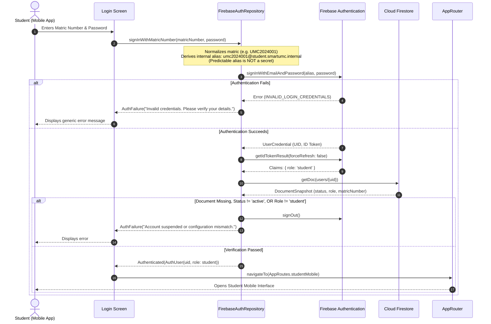
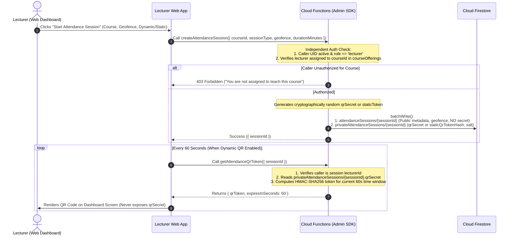
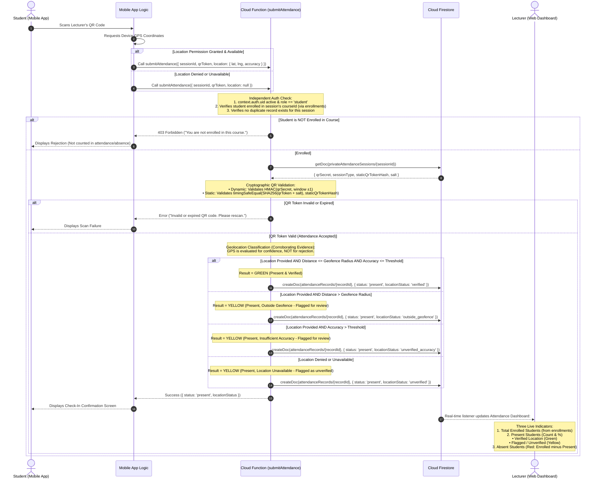
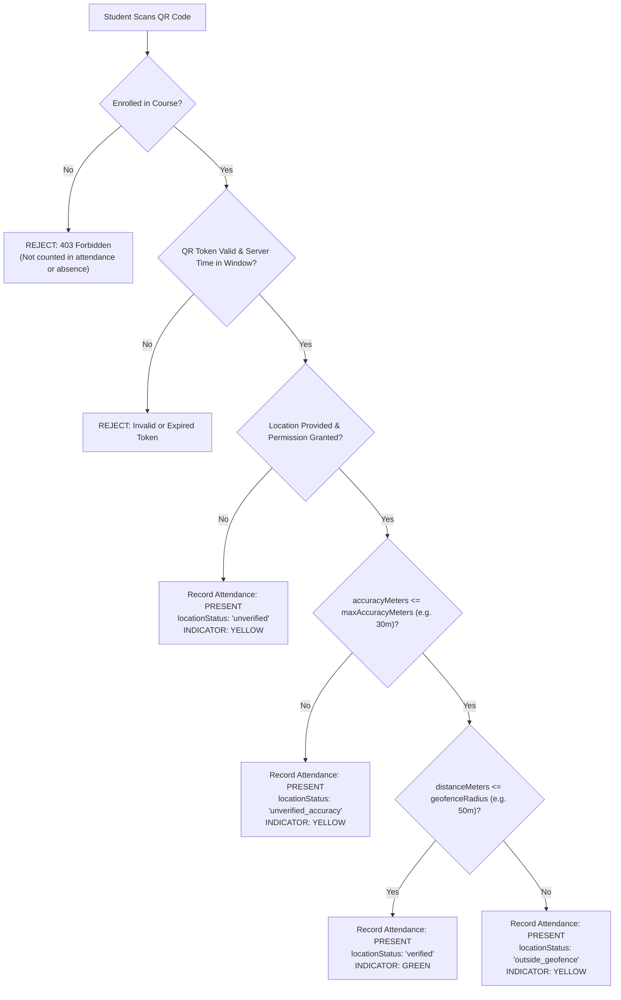
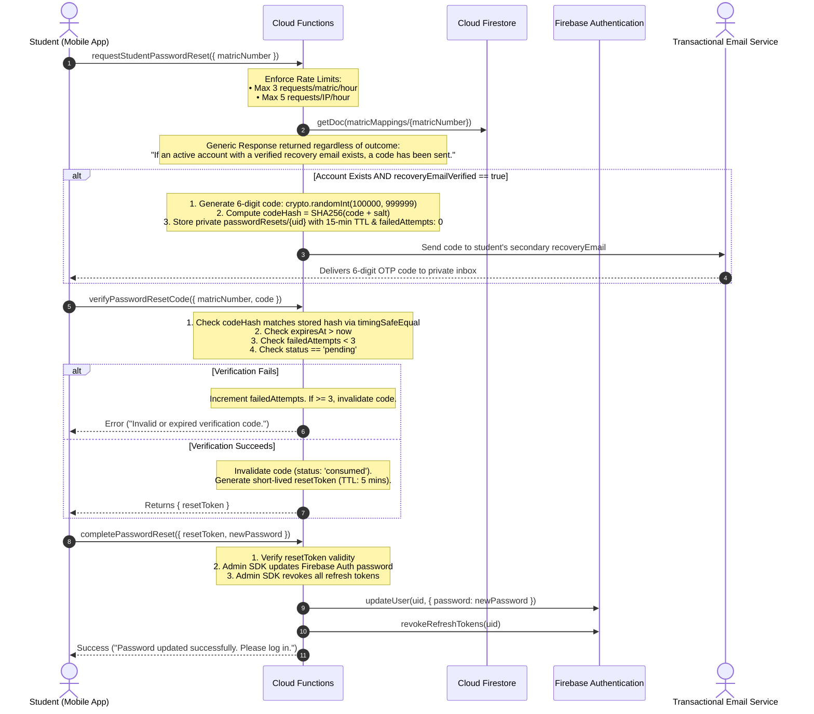

# SMARTUMC — Mission 10.8: Final Security Corrections & Specification Freeze

This document establishes the finalized, production-grade architectural specification for the backend-first authentication, authorization, complete 22-collection database schema security, attendance verification, and operator procedures of **SmartUMC** (Firebase Project: `smartumc-2cdc4`).

> [!NOTE]
> **Implementation Status Disclaimer**: This document represents an architectural and security specification. No component is claimed to be implemented, tested, or production-ready merely because it is documented here; concrete implementations and emulator test executions will proceed in their designated development missions.

---

## 1. Executive Summary

Mission 10.8 represents the final, binding documentation correction and security specification freeze for SmartUMC prior to the commencement of backend development. Incorporating all validated corrections from Missions 10.0 through 10.7, this specification establishes absolute implementation readiness, featuring hardened bootstrap lock ownership verification, server-trusted lease timing, fencing tokens against zombie executions, and an exhaustive 45-case security test matrix:
1. **Hardened Bootstrap Lock Ownership, Lease Safety & Atomic Fencing (Final Correction A)**: Completely eliminates `Date.now()` as an authority for lease creation, expiry, or recovery in favor of transactional server-time probing; establishes a 15-minute server-bound lease with safe lease renewal (`renewLockLease`); enforces transactional fencing where state mutations (`users/{uid}` writes) and lock ownership verification execute within the *same atomic transaction*, guaranteeing stale zombie processes can never write after a lock is reclaimed; and provides formal reconciliation workflows for lost ownership.
2. **Atomic Attendance Duplicate Prevention**: Replaces check-then-create logic with deterministic record keys (`REC_${sessionId}_${studentUid}`) inside atomic Firestore transactions, ensuring strict duplicate prevention, idempotent responses for retries, and high-concurrency resilience.
3. **Comprehensive Attendance Session Validation**: Formalizes an 8-point server-side validation pipeline verifying active session state, trusted server-time bounds, token type parity, dynamic HMAC ($\pm 1$ window) or salted static hash matching (`crypto.timingSafeEqual`), account standing, course enrollment, and single-submission constraints.
4. **Restored Geolocation Verification & Attendance Semantics**: Restores SmartUMC's core policy that outside-geofence scans must **never** be automatically rejected. Formalizes the 3-state indicator model (Green = Verified within geofence and accuracy threshold; Yellow = Present but outside geofence, permission denied, or accuracy insufficient; Red = Enrolled student with no check-in after session closure). Non-enrolled students are rejected and not counted as absent.
5. **Strict Schema & Value Validation & Notification Read-State Restrictions (Final Correction B)**: Enforces strict value and type constraints across client-writable collections. Specifically for `notifications`, enforces a strict one-way transition from unread to read (`isRead == true` only; unread reversion is forbidden), mandates trusted server timestamp assignment (`readAt == request.time`), ensures safe idempotency for repeated read requests without timestamp corruption, and strictly preserves notification content, recipient UID, and creation metadata against client modification.
6. **Complete 22-Collection Firestore Security Rules**: Delivers explicit, production-grade rules covering all 22 collections without omissions, enforcing lecturer scoping to assigned courses and fail-closed authentication helpers.
7. **Firestore Query Compatibility Strategy**: Documents compliant client query patterns, explains why rules are not filters, evaluates denormalized ownership alternatives, and specifies required query compatibility tests.
8. **End-to-End Student Password Recovery**: Specifies an enterprise-grade recovery architecture using salted SHA-256 verification codes, 15-minute TTL, 3-attempt invalidation, dual rate limiting, generic responses, and trusted backend password updates without exposing secrets or email aliases.
9. **Formal 50-Case Security Test Matrix**: Expands the Firebase Emulator Suite test matrix to 50 precise test cases (10 positive authorization, 29 negative/edge boundary tests, and 11 bootstrap lifecycle, lease renewal, and fencing recovery tests).

---

## 2. Classification of Architectural Elements

### 2.1 Confirmed Requirements (Immutable Project Policies)
- **Target Project**: Firebase project `smartumc-2cdc4`.
- **Target Interfaces**: Unified Flutter codebase supporting:
  - Student: Android mobile application.
  - Lecturer: Desktop-first Flutter Web dashboard.
  - Super Admin: Desktop-first Flutter Web dashboard.
- **Canonical Identity**: Firebase Authentication User ID (`UID`) is the canonical identity across all system collections (`users/{uid}`, `students/{uid}`).
- **Student Login Interface**: Strictly **Matric Number and Password**.
- **Staff Login Interface**: Provisioned staff credentials (institutional email).
- **Client Role Immutability**: Clients cannot self-assign or elevate roles.
- **Zero Passwords in Database**: Plaintext, hashed, or encrypted passwords must never be stored in Cloud Firestore.
- **Backend Provisioning**: User accounts are provisioned via administrative backend workflows; public self-registration is disabled.
- **Attendance Policy**: Outside-geofence scans must **never** be automatically rejected solely because of location; they are recorded as present and flagged as unverified for lecturer review. Non-enrolled student check-ins must be rejected.
- **Synthetic Demonstration Data**: All user records and demonstration data are strictly synthetic.

### 2.2 Proposed Technical Decisions (Architectural Specifications)
- **Dual-Collection Session Architecture**: Partitioning session data into client-readable `attendanceSessions` and backend-only `privateAttendanceSessions`.
- **Backend QR Token Issuance**: Lecturer dashboard requests rotating tokens from `getAttendanceQrToken` without possessing the session secret.
- **Backend Session Creation**: Creating and closing attendance sessions exclusively through Cloud Functions to guarantee ownership and atomic creation of private secrets.
- **Failsafe Authorization in Security Rules**: Checking document existence, required keys, status, and claim matching in Firestore Security Rules.
- **Scoped Enrollment & Attendance Read Rules**: Enforcing that lecturers can query only enrollments and attendance records corresponding to their assigned `courseOfferingId` and `sessionId`.
- **Deterministic Student Email Alias**: Format `<matric_lowercase>@student.smartumc.internal` used internally by the client to interface with Firebase Auth.
- **Verified Secondary Recovery Email**: Mandatory verification of `recoveryEmail` before it can be used for self-service password recovery.

### 2.3 Unresolved Decisions (Requiring Project-Owner Approval)
- **Staff Email Domain Confirmation**: Placeholder domain `<staff>@umc.edu` requires confirmation of the actual university domain.
- **Classroom Geofencing Radius**: Confirmation of default classroom tolerance radius (e.g. 50m vs. 100m) to accommodate campus building scale.
- **GPS Accuracy Quality Threshold**: Confirmation of maximum acceptable GPS horizontal accuracy radius (proposed: 30 meters).
- **Transactional Email Provider**: Selection of delivery service (SendGrid, Mailgun, or Firebase Extension) for password reset emails.
- **Firebase Blaze Plan Upgrade**: Formal authorization to upgrade `smartumc-2cdc4` to pay-as-you-go for Cloud Functions.
- **App Check Enforcement Timeline**: Determination of whether App Check will operate in monitoring mode during initial testing or be strictly enforced upon initial deployment.

---

## 3. Security Principles & System Boundaries

SmartUMC enforces a strict Defense-in-Depth model with clear privilege boundaries:

```
┌────────────────────────────────────────────────────────────────────────┐
│                        PRESENTATION / CLIENT LAYER                     │
│  • Student App: Matric Number + Password; camera QR scanner & GPS      │
│  • Lecturer Web: Institutional Email + Password; displays QR tokens    │
│  • ZERO write access to: users, students, attendanceRecords            │
│  • ZERO access to: privateAttendanceSessions, matricMappings           │
└───────────────────────────────────┬────────────────────────────────────┘
                                    │ HTTPS / Firebase SDK
                                    ▼
┌────────────────────────────────────────────────────────────────────────┐
│                     CANONICAL IDENTITY (FIREBASE AUTH)                 │
│  • Cryptographically signed JWT (ID Token, 1-hour expiration)          │
│  • Custom User Claims ({ role: 'student' | 'lecturer' | 'admin' })     │
│  • Refresh token revocation mechanism                                  │
└───────────────────────────────────┬────────────────────────────────────┘
                                    │
            ┌───────────────────────┴───────────────────────┐
            ▼                                               ▼
┌───────────────────────────────────────┐ ┌──────────────────────────────┐
│     DATABASE LAYER (FIRESTORE)        │ │  TRUSTED BACKEND (FUNCTIONS) │
│  • Enforces Firestore Security Rules  │ │  • Uses Firebase Admin SDK   │
│  • users/{uid}: Profile & live status │ │  • BYPASSES SECURITY RULES   │
│  • students/{uid}: Student records    │ │  • Performs independent auth │
│  • attendanceSessions: Metadata only  │ │  • Exclusive writer: records │
│  • privateSessions: DENY ALL CLIENTS  │ │  • Generates QR tokens       │
│  • matricMappings: DENY ALL CLIENTS   │ │  • Validates check-ins       │
│  • Failsafe check: live role == claim │ │  • Role assignment & claims  │
└───────────────────────────────────────┘ └──────────────────────────────┘
```

> [!CAUTION]
> **Admin SDK Security Rules Bypass**: Firebase Admin SDK operations within Cloud Functions completely bypass Firestore Security Rules. Consequently, Cloud Functions cannot rely on Firestore rules for authorization; **every function must implement strict independent authorization, role validation, and input sanitation**.

---

## 4. Authentication and Attendance Workflows

### 4.1 Student Login Workflow (Matric Number + Password)



### 4.2 Lecturer Session Creation and QR Token Generation



### 4.3 Secure Attendance Submission & Indicator Classification



---

## 5. Super Admin Bootstrap Procedure & Recoverable Saga Architecture

### 5.1 Lock Ownership, Lease Safety, and State Machine Lifecycle

The Super Admin bootstrap procedure establishes the root administrative trust boundary. To prevent concurrent executions, split-brain administration, or orphaned privileges across distributed Firebase microservices, the bootstrap workflow is governed by an exclusive lock document at `system/bootstrapLock`.

```
                      ┌───────────────────────────┐
                      │       UNINITIALIZED       │
                      │ (No document or status:   │
                      │      uninitialized)       │
                      └─────────────┬─────────────┘
                                    │ Acquire Lock (Transaction with Server Time Probe)
                                    ▼
                      ┌───────────────────────────┐
                      │        IN_PROGRESS        │
                      │ operatorSessionId: UUIDv4 │
                      │ leaseExpiresAt = T_s + 15m│
                      └──────┬──────────────┬─────┘
           Profile Write     │              │ Auth Claims or
           Succeeds          │              │ Profile Write Fails
                             ▼              ▼
              ┌──────────────────┐    ┌──────────────────────────┐
              │    COMPLETED     │    │          FAILED          │
              │ (Permanent lock; │    │ (failedStep, errDetails; │
              │  system closed)  │    │  stale-recovery allowed) │
              └──────────────────┘    └─────────────┬────────────┘
                                                    │
                                                    │ --recover-lock (if T_s >= leaseExpiresAt + 5m)
                                                    ▼
                                      ┌──────────────────────────┐
                                      │   RECONCILE / REACQUIRE  │
                                      │ (Atomic Fencing Defense) │
                                      └──────────────────────────┘
```

#### 5.1.1 Lock Document Schema (`system/bootstrapLock`)
```typescript
interface BootstrapLockDocument {
  status: 'uninitialized' | 'in_progress' | 'completed' | 'failed';
  operatorSessionId: string;                   // Cryptographically random UUIDv4 unique to this execution
  ownerUid: string;                            // INTENDED_ADMIN_UID
  ownerEmail: string;                          // INTENDED_ADMIN_EMAIL
  leaseDurationMinutes: number;                // Fixed: 15 minutes
  createdAt: FirebaseFirestore.Timestamp;      // Authoritative server timestamp at acquisition
  updatedAt: FirebaseFirestore.Timestamp;      // Authoritative server timestamp at latest state mutation
  leaseExpiresAt: FirebaseFirestore.Timestamp; // Server timestamp: createdAt + 15 minutes
  lastRenewedAt?: FirebaseFirestore.Timestamp; // Server timestamp of last lease renewal heartbeat
  completedAt?: FirebaseFirestore.Timestamp;
  completedBySessionId?: string;
  failedAt?: FirebaseFirestore.Timestamp;
  failedStep?: 'LOCK_ACQUISITION' | 'CLAIMS_ASSIGNMENT' | 'FIRESTORE_PROFILE_WRITE' | 'COMPLETION_LOCK_WRITE';
  failureReason?: string;
  errorDetails?: string;
  rollbackStatus?: 'NOT_APPLICABLE' | 'SUCCESSFUL' | 'FAILED_MANUAL_INTERVENTION_REQUIRED';
  orphanedClaims?: Record<string, any>;
  recoveredFromSessionId?: string;
  recoveryCount?: number;
  lastOperation?: string;
}
```

#### 5.1.2 Authoritative Server-Time Evaluation Mechanism
To eliminate all vulnerabilities associated with host machine clock skew, NTP drift, or intentional local clock tampering:
1. **Zero Host Clock Reliance**: Host machine clock APIs (`Date.now()`, `new Date()`) are strictly forbidden as authorities for lease creation, lease expiry, or staleness calculation.
2. **Authoritative Server-Time Probe**: The script obtains the exact server timestamp ($T_{\text{server}}$) by executing a transactional probe write to `system/serverTimeProbe` using `FieldValue.serverTimestamp()`, and immediately reading back the committed Spanner timestamp within the same database session.
3. **Lease Expiry Calculation**: When acquiring or renewing a lease, `leaseExpiresAt` is computed strictly relative to $T_{\text{server}}$:
   $$\text{leaseExpiresAt} = T_{\text{server}} + (15 \times 60 \times 1000\text{ ms})$$
4. **Conservative Skew Buffer**: When checking whether a lease has expired during `--recover-lock`, the script applies a mandatory 5-minute safety margin ($\Delta t_{\text{skew}} = 5\text{ minutes}$). A lock is considered stale if and only if:
   $$T_{\text{server}} \ge \text{leaseExpiresAt} + 5\text{ minutes}$$
5. **Fail-Closed Principle**: If network failure or Firestore unavailability prevents obtaining a verified $T_{\text{server}}$, the script strictly halts without taking any recovery action (`CRITICAL ABORT: Unable to verify authoritative server time. Aborting recovery.`).

---

### 5.2 Atomic Transactional Fencing (Zombie Process Elimination)

In distributed architectures, verifying lock ownership in a standalone pre-check is vulnerable to Time-of-Check to Time-of-Use (TOCTOU) race conditions: if a process verifies ownership, but experiences a CPU pause or network hang immediately after, its lease may expire and be reclaimed by another operator. When the stale process resumes, an unprotected write would corrupt the database.

SmartUMC eliminates this vulnerability through **Atomic Transactional Fencing**:

```
UNPROTECTED (Vulnerable TOCTOU):
[Check Lock] ──────► [Network Stall... Lease Expires & Reclaimed] ──────► [Write users/{uid}]  <-- CORRUPTS STATE!

ATOMIC FENCED (SmartUMC Architecture):
┌────────────────────────── FIRESTORE TRANSACTION ──────────────────────────┐
│ 1. Read system/bootstrapLock within transaction snapshot                    │
│ 2. Assert: lockDoc.operatorSessionId === this.operatorSessionId             │
│ 3. Assert: lockDoc.status === 'in_progress'                                │
│ 4. Write users/{uid} profile AND update lockDoc.updatedAt in SAME COMMIT    │
└────────────────────────────────────────────────────────────────────────────┘
       ▲
       │ If another operator reclaimed the lock, transaction CONFLICT occurs
       └─► Firestore rejects commit automatically! Stale write CANNOT occur!
```

#### Fencing Implementation Rules
1. **Combined Read-and-Write Commit**: The profile write `users/{intendedAdminUid}` is never dispatched as a standalone document write. It is executed inside a Firestore transaction that includes a read and validation of `system/bootstrapLock`.
2. **Optimistic Concurrency Protection**: If another operator reclaimed the lock while the first process was delayed, the lock document snapshot version is modified. Firestore's transactional engine automatically aborts the commit. The stale write is physically prevented from reaching the database.
3. **Two-Stage Auth Claims Fencing**: Because Firebase Authentication operations cannot join Firestore transactions:
   - *Stage 1 (Intent)*: The script writes `{ pendingOperation: 'CLAIMS_ASSIGNMENT', updatedAt: serverTimestamp() }` to `system/bootstrapLock` in an ownership-fenced transaction.
   - *Stage 2 (Execution)*: `admin.auth().setCustomUserClaims()` is executed.
   - *Stage 3 (Confirmation)*: An atomic transaction confirms `{ claimsAssigned: true, pendingOperation: null }`. If this transaction aborts because the lock was stolen, the script immediately detects loss of ownership and enters compensatory rollback or emergency lockdown.

---

### 5.3 Safe Lease Renewal Heartbeat (`renewLockLease`)

For deployments where complex credential verification, slow network connectivity, or multi-step operations threaten to exceed the 15-minute lease:
1. The bootstrap process can safely extend its lease by invoking `renewLockLease(db, operatorSessionId, extensionMinutes = 15)`.
2. Renewal executes inside a Firestore transaction:
   - Validates that `operatorSessionId` still matches and `status === 'in_progress'`.
   - Probes authoritative server time $T_{\text{server}}$.
   - Updates `leaseExpiresAt = Timestamp.fromMillis(T_{\text{server}}.toMillis() + extensionMinutes * 60 * 1000)` and `lastRenewedAt = FieldValue.serverTimestamp()`.
3. If ownership was lost before renewal, the transaction aborts, preventing an illegitimate lease extension.

---

### 5.4 Safe Stale-Lock Recovery Specification

The `--recover-lock` CLI flag is an inspected, transactional state transition—**never a bypass switch**.

#### 1. Staleness Verification Policy
A lock document is classified as **stale** if and only if:
- `status == 'in_progress'` **AND** trusted server time satisfies $T_{\text{server}} \ge \text{leaseExpiresAt} + 5\text{ minutes}$, **OR**
- `status == 'failed'`.

#### 2. Active Lock Protection
If an operator executes `--recover-lock` while `status == 'in_progress'` and the lease has not expired by server time:
- The script strictly halts without modifying any database or auth state:
  ```
  CRITICAL ABORT: Bootstrap lock is currently ACTIVE and leased by session [sessionId].
  Lease active until: 2026-11-06T15:45:00Z (Server Time: 2026-11-06T15:37:00Z).
  Recovery is strictly prohibited on active leases to prevent concurrent race conditions.
  ```
- Exit code is `1`.

#### 3. Malformed Lock Document Protection
If `system/bootstrapLock` exists but is missing required attributes (`status`, `createdAt`, or `operatorSessionId`), or contains corrupted field types:
- Standard bootstrap strictly aborts.
- Standard `--recover-lock` strictly aborts, because lease expiration cannot be reliably determined.
- Recovery requires an explicit dual-confirmation flag:
  `ts-node scripts/bootstrap_admin.ts --recover-malformed-lock --confirm-initial-bootstrap`
- The script logs the full corrupted document to `auditLogs/bootstrap_anomalies` before replacing it with a clean lease.

#### 4. Concurrent Recovery Prevention
Recovery executes inside a **Firestore Transaction**:
1. Reads `system/bootstrapLock` and probes server time.
2. Validates staleness rules within the transactional snapshot.
3. Overwrites the lock with a fresh `operatorSessionId`, new `createdAt = serverTimestamp()`, `updatedAt = serverTimestamp()`, and `leaseExpiresAt = serverTimestamp() + 15m`, recording `recoveredFromSessionId`.
4. If two operators attempt recovery simultaneously, Firestore's optimistic concurrency control automatically forces one transaction to fail and abort.

---

### 5.5 Comprehensive Failure Handling (Scenarios A through E)

```
Failure Handling Decision Matrix
─────────────────────────────────────────────────────────────────────────────
Scenario   Custom Claims Set?   Firestore Profile Created?   Action
─────────────────────────────────────────────────────────────────────────────
A          NO                   NO                           Mark lock 'failed'; exit.
B          YES                  NO                           Re-check profile -> Roll back claims -> Mark lock 'failed'.
C          YES                  YES                          DO NOT ROLL BACK -> Reconcile lock to 'completed'.
D          YES                  NO (Rollback failed)         Emergency lock halt; prompt manual CLI intervention.
E          UNKNOWN (Malformed)  CHECK FIRST                  Audit -> Require --recover-malformed-lock.
─────────────────────────────────────────────────────────────────────────────
```

#### Scenario A: Lock Acquisition Succeeds, but `setCustomUserClaims` Fails
- **System State**: Lock is `in_progress`. Auth claims and Firestore profile are untouched.
- **Handling**:
  1. Catch the Firebase Auth exception.
  2. In an atomic transaction, verify lock ownership and update `system/bootstrapLock`:
     `{ status: 'failed', failedStep: 'CLAIMS_ASSIGNMENT', failureReason: err.message, failedAt: serverTimestamp() }`.
  3. No Auth claims or Firestore user records require cleanup.
  4. Exit with code `1`. Immediate retry is possible via `--recover-lock`.

#### Scenario B: Custom Claims Updated, but Firestore Profile Creation Fails
- **System State**: Auth user has `{ role: 'admin' }`. Firestore document `users/{uid}` does not exist.
- **Critical Guard**: Before attempting rollback, verify in Firestore that no profile document was created.
- **Handling**:
  1. Transactional read confirms `users/{uid}` does not exist.
  2. Execute compensatory rollback: `auth.setCustomUserClaims(uid, previousClaims)`.
  3. If claim rollback succeeds:
     - Transactionally update lock: `{ status: 'failed', failedStep: 'FIRESTORE_PROFILE_WRITE', rollbackStatus: 'SUCCESSFUL', failedAt: serverTimestamp() }`.
     - Exit with code `1`.
  4. If claim rollback fails: Transition immediately to **Scenario D**.

#### Scenario C: Administrator Profile Creation Succeeds, but Updating Lock to `completed` Fails
- **System State**: Auth user has `{ role: 'admin' }`. Firestore document `users/{uid}` exists and is active. Lock write timed out or lost connectivity.
- **CRITICAL SECURITY RULE**: **DO NOT ROLL BACK CUSTOM CLAIMS!** The administrator profile is already legitimately established and consistent in both primary stores. Rolling back claims here would corrupt the administrator account and orphan the Firestore profile.
- **Handling**:
  1. On subsequent execution with identical `INTENDED_ADMIN_UID` and `INTENDED_ADMIN_EMAIL`:
  2. The script queries both stores:
     - Auth: User has `{ role: 'admin' }`.
     - Firestore: `users/{intendedAdminUid}` exists with `role == 'admin'` and `status == 'active'`.
  3. Concludes that both authoritative stores are consistent and valid.
  4. Executes **idempotent lock reconciliation**: updates `system/bootstrapLock` to `{ status: 'completed', completedAt: serverTimestamp(), completedByUid: intendedAdminUid }` without modifying claims or user profile.
  5. Logs: `"RECONCILIATION SUCCESSFUL: Administrator established and verified. Lock reconciled to completed."`

#### Scenario D: Rollback of Custom Claims Fails (Following Scenario B)
- **System State**: Auth user has elevated `{ role: 'admin' }`, but `users/{uid}` does not exist, and `auth.setCustomUserClaims(uid, previousClaims)` failed (e.g. network partition to Auth service).
- **Handling**:
  1. Immediately record an emergency halt in `system/bootstrapLock`:
     ```typescript
     {
       status: 'failed',
       failedStep: 'FIRESTORE_PROFILE_WRITE',
       rollbackStatus: 'FAILED_MANUAL_INTERVENTION_REQUIRED',
       orphanedClaims: { role: 'admin' },
       previousClaims: previousClaims,
       failureReason: 'Claims assigned but profile creation failed and automated rollback timed out.'
     }
     ```
  2. Emit high-visibility emergency instructions to the operator terminal:
     ```bash
     ===========================================================================
     EMERGENCY ALERT: AUTOMATED ROLLBACK FAILED.
     Target UID: [UID] possesses unbacked admin custom claims!
     MANUAL REMEDIATION REQUIRED VIA FIREBASE CLI:
     firebase auth:claims:set [UID] '{"role": null}'
     ===========================================================================
     ```
  3. Any future bootstrap attempt is strictly blocked until this orphaned state is cleared.

#### Scenario E: Malformed Lock Document Exists
- **System State**: `system/bootstrapLock` exists with corrupted schema.
- **Handling**:
  1. Script checks `users` collection: does any document have `role == 'admin'`?
     - If YES: Aborts immediately. Administrator already exists; lock corruption must be manually audited.
     - If NO: Informs operator that lock is corrupted and no administrator exists.
  2. Requires explicit invocation:
     ```bash
     ts-node scripts/bootstrap_admin.ts --recover-malformed-lock --confirm-initial-bootstrap
     ```
  3. Backs up the corrupted document to `auditLogs/corrupt_lock_[timestamp]` and writes a clean lease before proceeding.

---

### 5.6 Cross-Service Consistency Specification (Recoverable Saga Model)

> [!WARNING]
> **Cross-Service Transaction Boundary Limitation**:  
> Firebase Authentication and Cloud Firestore are independent distributed microservices with separate RPC layers, separate datastores, and no shared distributed transaction coordinator (no 2-Phase Commit / 2PC).  
> The Super Admin bootstrap procedure is formally specified as a **Recoverable Distributed Saga** with forward reconciliation and backward compensation, anchored by the persistent state journal in `system/bootstrapLock`.

```
Distributed Saga Step Flow with Atomic Fencing:
[1. Acquire Fenced Lock] ──► [2. Set Auth Claims] ──► [3. Atomic Fenced Write: Profile + Lock] ──► [4. Finalize Completed]
            │                        │                                    │
       Fail: Abort          Fail: Release Lock                   Fail: Compensate / Rollback
```

---

### 5.7 Complete Production-Grade Bootstrap Script (`scripts/bootstrap_admin.ts`)

```typescript
import * as admin from 'firebase-admin';
import { v4 as uuidv4 } from 'uuid';

// Initialize using Application Default Credentials (ADC)
admin.initializeApp({
  projectId: 'smartumc-2cdc4'
});

// Helper: Authoritative Server-Time Evaluation Mechanism
async function getAuthoritativeServerTime(db: FirebaseFirestore.Firestore): Promise<admin.firestore.Timestamp> {
  const probeRef = db.collection('system').doc('serverTimeProbe');
  await probeRef.set({ probedAt: admin.firestore.FieldValue.serverTimestamp() });
  const probeSnap = await probeRef.get();
  const serverTime = probeSnap.data()?.probedAt as admin.firestore.Timestamp | undefined;
  if (!serverTime) {
    throw new Error('CRITICAL TIME FAILURE: Unable to obtain authoritative server timestamp from Firestore.');
  }
  return serverTime;
}

// Helper: Safe Lease Renewal Heartbeat
export async function renewLockLease(
  db: FirebaseFirestore.Firestore,
  operatorSessionId: string,
  extensionMinutes: number = 15
): Promise<void> {
  const lockRef = db.collection('system').doc('bootstrapLock');
  await db.runTransaction(async (transaction) => {
    const lockSnap = await transaction.get(lockRef);
    if (!lockSnap.exists) {
      throw new Error('CRITICAL RENEWAL FAILURE: Lock document does not exist.');
    }
    const data = lockSnap.data()!;
    if (data.operatorSessionId !== operatorSessionId) {
      throw new Error(`CRITICAL RENEWAL FAILURE: Lock ownership lost to session ${data.operatorSessionId}.`);
    }
    if (data.status !== 'in_progress') {
      throw new Error(`CRITICAL RENEWAL FAILURE: Lock status is no longer in_progress (${data.status}).`);
    }
    const serverTime = await getAuthoritativeServerTime(db);
    const newExpiresAt = admin.firestore.Timestamp.fromMillis(serverTime.toMillis() + extensionMinutes * 60 * 1000);
    transaction.update(lockRef, {
      leaseExpiresAt: newExpiresAt,
      lastRenewedAt: admin.firestore.FieldValue.serverTimestamp(),
      updatedAt: admin.firestore.FieldValue.serverTimestamp()
    });
  });
  console.log(`Lease successfully extended by ${extensionMinutes} minutes for session ${operatorSessionId}`);
}

async function hardenedSuperAdminBootstrap() {
  const intendedAdminEmail = process.env.INTENDED_ADMIN_EMAIL?.trim().toLowerCase();
  const intendedAdminUid = process.env.INTENDED_ADMIN_UID?.trim();
  const confirmationFlag = process.argv.includes('--confirm-initial-bootstrap');
  const recoverLockFlag = process.argv.includes('--recover-lock');
  const recoverMalformedFlag = process.argv.includes('--recover-malformed-lock');
  const operatorSessionId = uuidv4();

  if (!confirmationFlag) {
    console.error('ERROR: Missing required operator confirmation flag: --confirm-initial-bootstrap');
    process.exit(1);
  }

  // 1. Mandatory Dual-Identifier Specification
  if (!intendedAdminEmail || !intendedAdminUid) {
    console.error('CRITICAL REJECTION: Both INTENDED_ADMIN_EMAIL and INTENDED_ADMIN_UID are strictly mandatory.');
    console.error('Execution halted: Cannot elevate an account based on email alone.');
    process.exit(1);
  }

  const auth = admin.auth();
  const db = admin.firestore();
  const lockRef = db.collection('system').doc('bootstrapLock');

  try {
    // 2. Fetch Targeted Account from Firebase Auth First to Verify Identity
    let userRecord: admin.auth.UserRecord;
    try {
      userRecord = await auth.getUserByEmail(intendedAdminEmail);
    } catch (err: any) {
      console.error(`ERROR: Target account ${intendedAdminEmail} does not exist in Firebase Auth.`);
      process.exit(1);
    }

    // 3. Strict Dual-Identifier Verification (UID + Email)
    if (userRecord.uid !== intendedAdminUid) {
      console.error(`CRITICAL IDENTITY MISMATCH: Account for ${intendedAdminEmail} has UID ${userRecord.uid}, but INTENDED_ADMIN_UID specified ${intendedAdminUid}.`);
      process.exit(1);
    }

    // 4. Verification Check: Never spoof email verification
    if (!userRecord.emailVerified) {
      console.error(`CRITICAL: The account ${intendedAdminEmail} has not completed actual email verification.`);
      process.exit(1);
    }

    // 5. Transactional Lock Acquisition with Authoritative Server Time
    let recoveredFromSessionId: string | undefined;

    // Obtain verified server time BEFORE evaluating lease
    const serverTimeAtStart = await getAuthoritativeServerTime(db);

    await db.runTransaction(async (transaction) => {
      const lockDoc = await transaction.get(lockRef);
      const userDoc = await transaction.get(db.collection('users').doc(intendedAdminUid));

      // Check if user is already established (Idempotent Reconciliation - Scenario C)
      if (userDoc.exists) {
        const userData = userDoc.data()!;
        if (userData.role === 'admin' && userData.status === 'active' && userRecord.customClaims?.role === 'admin') {
          console.log('RECONCILIATION DETECTED: Administrator account and profile are already fully established.');
          transaction.set(lockRef, {
            status: 'completed',
            ownerUid: intendedAdminUid,
            completedAt: admin.firestore.FieldValue.serverTimestamp(),
            reconciledBySessionId: operatorSessionId,
            updatedAt: admin.firestore.FieldValue.serverTimestamp()
          }, { merge: true });
          console.log('SUCCESS: Lock reconciled to completed.');
          return;
        } else {
          throw new Error(`CRITICAL ABORT: Document users/${intendedAdminUid} already exists in an inconsistent state.`);
        }
      }

      if (lockDoc.exists) {
        const lockData = lockDoc.data()!;

        if (lockData.status === 'completed') {
          throw new Error('CRITICAL ABORT: System is already initialized. Bootstrap cannot be run.');
        }

        // Malformed lock check (Scenario E)
        const isMalformed = !lockData.status || !lockData.createdAt || !lockData.operatorSessionId || !lockData.leaseExpiresAt;
        if (isMalformed) {
          if (!recoverMalformedFlag) {
            throw new Error('CRITICAL ABORT: Malformed lock document detected. Use --recover-malformed-lock to reset.');
          }
          console.log('Operator authorized recovery from malformed lock document.');
          const auditRef = db.collection('auditLogs').doc(`corrupt_lock_${serverTimeAtStart.toMillis()}`);
          transaction.set(auditRef, {
            type: 'MALFORMED_LOCK_RESET',
            corruptData: lockData,
            resetBySessionId: operatorSessionId,
            timestamp: admin.firestore.FieldValue.serverTimestamp()
          });
        } else if (lockData.status === 'in_progress') {
          // Strictly evaluate staleness using Authoritative Server Time + 5-minute Skew Buffer
          const leaseExpiresAtMillis = lockData.leaseExpiresAt.toMillis();
          const SKEW_BUFFER_MILLIS = 5 * 60 * 1000;
          const isLeaseActive = serverTimeAtStart.toMillis() < (leaseExpiresAtMillis + SKEW_BUFFER_MILLIS);

          if (isLeaseActive) {
            const remainingMinutes = (((leaseExpiresAtMillis + SKEW_BUFFER_MILLIS) - serverTimeAtStart.toMillis()) / (1000 * 60)).toFixed(1);
            throw new Error(`CRITICAL ABORT: Bootstrap active under session ${lockData.operatorSessionId}. Lease active for ${remainingMinutes} more minutes (server-evaluated). Recovery forbidden.`);
          }

          if (!recoverLockFlag) {
            throw new Error(`CRITICAL ABORT: Lock expired at ${new Date(leaseExpiresAtMillis).toISOString()}. Use --recover-lock to reclaim stale lease.`);
          }
          recoveredFromSessionId = lockData.operatorSessionId;
          console.log(`Reclaiming stale lease from session ${lockData.operatorSessionId}...`);
        } else if (lockData.status === 'failed') {
          if (lockData.rollbackStatus === 'FAILED_MANUAL_INTERVENTION_REQUIRED') {
            throw new Error(`CRITICAL EMERGENCY ABORT: Prior bootstrap failed with orphaned custom claims! Clean claims manually: firebase auth:claims:set ${lockData.ownerUid} '{"role":null}'`);
          }
          if (!recoverLockFlag) {
            throw new Error(`CRITICAL ABORT: Lock in failed state (${lockData.failedStep}: ${lockData.failureReason}). Use --recover-lock to retry.`);
          }
          recoveredFromSessionId = lockData.operatorSessionId;
        }
      }

      // Check if any Super Admin already exists in Firestore
      const existingAdmins = await transaction.get(
        db.collection('users').where('role', '==', 'admin').limit(1)
      );

      if (!existingAdmins.empty) {
        throw new Error('CRITICAL ABORT: A Super Admin account already exists in users collection.');
      }

      // Server-Time Bound Expiry: exactly serverTimeAtStart + 15 minutes
      const leaseExpiresAt = admin.firestore.Timestamp.fromMillis(serverTimeAtStart.toMillis() + 15 * 60 * 1000);

      transaction.set(lockRef, {
        status: 'in_progress',
        operatorSessionId: operatorSessionId,
        ownerUid: intendedAdminUid,
        ownerEmail: intendedAdminEmail,
        leaseDurationMinutes: 15,
        createdAt: admin.firestore.FieldValue.serverTimestamp(),
        updatedAt: admin.firestore.FieldValue.serverTimestamp(),
        leaseExpiresAt: leaseExpiresAt,
        recoveredFromSessionId: recoveredFromSessionId || null,
        recoveryCount: (lockDoc.exists && lockDoc.data()?.recoveryCount ? lockDoc.data()!.recoveryCount + 1 : 0)
      });
    });

    console.log(`Lock acquired successfully under session ID: ${operatorSessionId}`);

    // Check if idempotent reconciliation already resolved completion
    const postLockDoc = await lockRef.get();
    if (postLockDoc.data()?.status === 'completed') {
      console.log('Bootstrap finished via reconciliation.');
      return;
    }

    // 6. Record Pending Claims Intent in Lock Document
    await db.runTransaction(async (transaction) => {
      const snap = await transaction.get(lockRef);
      if (snap.data()?.operatorSessionId !== operatorSessionId || snap.data()?.status !== 'in_progress') {
        throw new Error('FENCE_FAILED: Lost lock ownership prior to claims assignment.');
      }
      transaction.update(lockRef, {
        pendingOperation: 'CLAIMS_ASSIGNMENT',
        updatedAt: admin.firestore.FieldValue.serverTimestamp()
      });
    });

    const previousClaims = userRecord.customClaims || {};
    const updatedClaims = { ...previousClaims, role: 'admin' };

    // 7. Step 1: Assign Custom Claims (Scenario A Failure Handling)
    try {
      console.log(`Assigning admin claim while preserving existing claims for UID: ${userRecord.uid}...`);
      await auth.setCustomUserClaims(userRecord.uid, updatedClaims);
    } catch (authError: any) {
      console.error('CRITICAL FAILURE: Failed to set Custom Claims in Firebase Auth (Scenario A)!');
      await db.runTransaction(async (transaction) => {
        const snap = await transaction.get(lockRef);
        if (snap.data()?.operatorSessionId === operatorSessionId) {
          transaction.update(lockRef, {
            status: 'failed',
            failedStep: 'CLAIMS_ASSIGNMENT',
            failureReason: authError.message,
            failedAt: admin.firestore.FieldValue.serverTimestamp(),
            updatedAt: admin.firestore.FieldValue.serverTimestamp(),
            pendingOperation: null
          });
        }
      });
      process.exit(1);
    }

    // 8. Step 2: Atomic Transactional Fencing (Profile Write + Lock Heartbeat in SAME Transaction)
    // Guarantees zero zombie writes: if lock was stolen, this transaction fails to commit!
    try {
      console.log(`Writing authoritative Firestore user profile with atomic lock fencing for UID: ${userRecord.uid}...`);
      await db.runTransaction(async (transaction) => {
        const currentLock = await transaction.get(lockRef);
        if (!currentLock.exists || currentLock.data()?.operatorSessionId !== operatorSessionId) {
          throw new Error('FENCE_FAILED: Lock ownership was reclaimed by another session! Profile write aborted.');
        }
        if (currentLock.data()?.status !== 'in_progress') {
          throw new Error('FENCE_FAILED: Lock status is no longer in_progress. Profile write aborted.');
        }

        // Atomically write profile AND update lock inside the identical transaction
        transaction.set(db.collection('users').doc(userRecord.uid), {
          uid: userRecord.uid,
          role: 'admin',
          status: 'active',
          email: intendedAdminEmail,
          displayName: userRecord.displayName || 'Initial Super Administrator',
          staffId: 'ADMIN-INITIAL',
          createdAt: admin.firestore.FieldValue.serverTimestamp(),
          updatedAt: admin.firestore.FieldValue.serverTimestamp()
        });

        transaction.update(lockRef, {
          updatedAt: admin.firestore.FieldValue.serverTimestamp(),
          lastOperation: 'FIRESTORE_PROFILE_WRITE',
          pendingOperation: null
        });
      });
    } catch (firestoreError: any) {
      console.error('CRITICAL WRITE FAILURE: Firestore profile write failed or fence aborted (Scenario B)!');
      
      // Verify profile does not exist before rolling back
      const profileCheck = await db.collection('users').doc(userRecord.uid).get();
      if (!profileCheck.exists) {
        console.error('Initiating compensatory rollback of Custom Claims to previous state...');
        try {
          await auth.setCustomUserClaims(userRecord.uid, previousClaims);
          console.log('Compensatory rollback successful: Previous Custom Claims restored.');
          await db.runTransaction(async (transaction) => {
            const snap = await transaction.get(lockRef);
            if (snap.data()?.operatorSessionId === operatorSessionId) {
              transaction.update(lockRef, {
                status: 'failed',
                failedStep: 'FIRESTORE_PROFILE_WRITE',
                rollbackStatus: 'SUCCESSFUL',
                failureReason: firestoreError.message,
                failedAt: admin.firestore.FieldValue.serverTimestamp(),
                updatedAt: admin.firestore.FieldValue.serverTimestamp()
              });
            }
          });
        } catch (rollbackError: any) {
          console.error('EMERGENCY: Rollback of Custom Claims failed (Scenario D)! System in inconsistent state.');
          console.error(`Target UID: ${userRecord.uid}. Previous Claims: ${JSON.stringify(previousClaims)}.`);
          console.error(`Remediation CLI: firebase auth:claims:set ${userRecord.uid} '${JSON.stringify(previousClaims)}'`);
          await db.runTransaction(async (transaction) => {
            const snap = await transaction.get(lockRef);
            if (snap.data()?.operatorSessionId === operatorSessionId) {
              transaction.update(lockRef, {
                status: 'failed',
                failedStep: 'FIRESTORE_PROFILE_WRITE',
                rollbackStatus: 'FAILED_MANUAL_INTERVENTION_REQUIRED',
                orphanedClaims: { role: 'admin' },
                previousClaims: previousClaims,
                failureReason: 'Claims assigned, profile failed, rollback failed.',
                failedAt: admin.firestore.FieldValue.serverTimestamp(),
                updatedAt: admin.firestore.FieldValue.serverTimestamp()
              });
            }
          });
        }
      }
      process.exit(1);
    }

    // 9. Step 3: Finalize Initialization Lock (Scenario C Failure Handling)
    try {
      console.log('Finalizing initialization lock to completed state...');
      await db.runTransaction(async (transaction) => {
        const currentLock = await transaction.get(lockRef);
        if (currentLock.data()?.operatorSessionId !== operatorSessionId) {
          throw new Error('FENCE_FAILED: Lock reclaimed before finalization.');
        }
        transaction.set(lockRef, {
          status: 'completed',
          ownerUid: intendedAdminUid,
          completedAt: admin.firestore.FieldValue.serverTimestamp(),
          completedBySessionId: operatorSessionId,
          updatedAt: admin.firestore.FieldValue.serverTimestamp()
        }, { merge: true });
      });
      console.log(`SUCCESS: Super Admin established for verified UID: ${userRecord.uid}`);
    } catch (lockFinalizeError: any) {
      console.error('WARNING: Profile write succeeded but updating lock to completed failed (Scenario C).');
      console.error('DO NOT ROLL BACK: Both Auth and Firestore profiles are valid.');
      console.error('Re-run bootstrap with identical credentials to reconcile completion lock.');
      process.exit(1);
    }

  } catch (error: any) {
    console.error('Bootstrap execution aborted:', error.message);
    process.exit(1);
  }
}

hardenedSuperAdminBootstrap();
```

---

## 6. Complete Attendance Session Validation Pipeline

Every attendance check-in submitted to `submitAttendance` must satisfy all **8 server-side validation criteria** using trusted server time (`admin.firestore.Timestamp.now()`):

```
┌────────────────────────────────────────────────────────────────────────┐
│              submitAttendance(sessionId, qrToken, location)            │
└───────────────────────────────────┬────────────────────────────────────┘
                                    │
                                    ▼
┌────────────────────────────────────────────────────────────────────────┐
│ 1. Session Exists: attendanceSessions/{sessionId} document exists     │
├────────────────────────────────────────────────────────────────────────┤
│ 2. Session Active: sessionDoc.isActive == true                         │
├────────────────────────────────────────────────────────────────────────┤
│ 3. Server Time in Window: serverTime >= validFrom && <= validUntil     │
├────────────────────────────────────────────────────────────────────────┤
│ 4. Token Type Match: Submitted token structure matches sessionType     │
├────────────────────────────────────────────────────────────────────────┤
│ 5. Token Cryptographically Valid:                                      │
│    • Dynamic: HMAC-SHA256(qrSecret, window ±1) matches qrToken         │
│    • Static: timingSafeEqual(SHA256(qrToken + salt), staticHash)       │
├────────────────────────────────────────────────────────────────────────┤
│ 6. Student Account Active: users/{uid}.status == 'active' & role student│
├────────────────────────────────────────────────────────────────────────┤
│ 7. Student Enrolled: enrollments where studentId & courseOfferingId    │
├────────────────────────────────────────────────────────────────────────┤
│ 8. Single Submission: REC_{sessionId}_{uid} does not already exist    │
└───────────────────────────────────┬────────────────────────────────────┘
                                    │ All Pass
                                    ▼
┌────────────────────────────────────────────────────────────────────────┐
│  Evaluate Geolocation & Write Record (Atomic Transaction)              │
└────────────────────────────────────────────────────────────────────────┘
```

### 6.1 Validation Rules Detail
1. **Session Exists**: `attendanceSessions/{sessionId}` document must exist in Firestore.
2. **Session Active**: `sessionDoc.isActive === true`. Closed sessions reject all scans immediately.
3. **Server Time Bounds**: Evaluated strictly using Cloud Functions server time (`serverTime >= validFrom && serverTime <= validUntil`). The student's device clock is completely disregarded.
4. **Token Type Parity**: A static QR submission to a dynamic session (or vice versa) is rejected.
5. **Cryptographic Token Verification**:
   - **Dynamic QR**: The backend reads `privateAttendanceSessions/{sessionId}.qrSecret` via Admin SDK, computes HMAC-SHA256 for the current 60-second window, and allows a grace window of $\pm 1$ window (60s prior or 60s following) to accommodate transit latency.
   - **Static QR**: The backend computes `SHA-256(qrToken + salt)` and executes `crypto.timingSafeEqual` against `staticQrTokenHash`. The token cannot be reused across sessions because the per-session salt differs.
6. **Student Standing**: Verifies `users/{uid}.status === 'active'` and `users/{uid}.role === 'student'`.
7. **Roster Enrollment**: Verifies that an active record exists in `enrollments` for `studentId == context.auth.uid` and `courseOfferingId == sessionDoc.courseId`. Non-enrolled students are rejected with `403 Forbidden`.
8. **Single Submission Guard**: Verified atomically as defined in Section 7.

---

## 7. Atomic Attendance Duplicate Prevention

### 7.1 The Race Condition in Check-Then-Create
A standard query check (`where('sessionId').where('studentId')`) followed by an insert creates a time-of-check to time-of-use (TOCTOU) race condition when a student rapidly taps the scan button or a mobile client dispatches parallel network requests.

### 7.2 Deterministic Record Keys & Atomic Transaction
SmartUMC enforces strict duplicate prevention by deriving the attendance record document ID deterministically:
$$\text{recordId} = \text{"REC\_" + sessionId + "\_" + studentUid}$$

The write executes inside a Firestore transaction:
```typescript
const recordRef = db.collection('attendanceRecords').doc(`REC_${sessionId}_${studentUid}`);

await db.runTransaction(async (transaction) => {
  const existingRecord = await transaction.get(recordRef);

  if (existingRecord.exists) {
    // Idempotent return: Attendance already recorded
    const data = existingRecord.data()!;
    return {
      success: true,
      alreadyRecorded: true,
      message: 'Attendance has already been recorded for this session.',
      status: data.status,
      locationStatus: data.locationStatus,
      verifiedAt: data.verifiedAt.toDate().toISOString()
    };
  }

  // Determine Geolocation Status
  const locationClassification = classifyLocation(location, sessionDoc.classroomGeofence);

  transaction.set(recordRef, {
    recordId: recordRef.id,
    sessionId: sessionId,
    courseId: sessionDoc.courseId,
    studentId: studentUid,
    matricNumber: studentMatric,
    verifiedAt: admin.firestore.FieldValue.serverTimestamp(),
    verificationMethod: sessionDoc.sessionType,
    status: 'present',
    locationStatus: locationClassification.status,
    distanceMeters: locationClassification.distanceMeters,
    locationAccuracyMeters: location?.accuracy || null,
    verifiedLocation: location ? {
      latitude: location.latitude,
      longitude: location.longitude,
      accuracyMeters: location.accuracy
    } : null
  });

  return {
    success: true,
    alreadyRecorded: false,
    message: 'Attendance recorded successfully.',
    status: 'present',
    locationStatus: locationClassification.status
  };
});
```

### 7.3 Concurrency and Contention Handling
- Firestore transactions automatically retry up to 5 times if document contention occurs.
- If two parallel requests execute simultaneously, the first write establishes the document. The retried transaction detects the existing document and returns the idempotent success payload.
- Zero duplicate records can ever be created.

---

## 8. Geolocation Accuracy and SmartUMC Attendance Policy

### 8.1 Haversine Distance Calculation
Distance from the classroom geofence center $(\phi_1, \lambda_1)$ to the student's reported coordinates $(\phi_2, \lambda_2)$ is calculated server-side in Cloud Functions using the Haversine formula ($R = 6,371,000\text{ meters}$):
$$\Delta \phi = \frac{(\phi_2 - \phi_1) \cdot \pi}{180}, \quad \Delta \lambda = \frac{(\lambda_2 - \lambda_1) \cdot \pi}{180}$$
$$a = \sin^2\left(\frac{\Delta \phi}{2}\right) + \cos\left(\frac{\phi_1 \cdot \pi}{180}\right) \cdot \cos\left(\frac{\phi_2 \cdot \pi}{180}\right) \cdot \sin^2\left(\frac{\Delta \lambda}{2}\right)$$
$$c = 2 \cdot \text{atan2}\left(\sqrt{a}, \sqrt{1 - a}\right), \quad \text{distanceMeters} = R \cdot c$$

### 8.2 Three-State Indicator Model & Evaluation Flow



### 8.3 Post-Session Absence Computation
- **During Active Session**: Enrolled students who have not yet scanned are in state `pending_checkin`. They are **not** classified as definitively absent while the check-in window remains open.
- **After Session Closes**: Once `validUntil` has elapsed or the lecturer manually triggers `closeAttendanceSession`, the backend calculates definitive absences:
  $$\text{Definitive Absences (Red)} = \text{Course Enrolled Roster} \setminus \text{Present Attendance Records}$$

---

## 9. Protected QR Secret Architecture & Static Token Security

### 9.1 Dual-Collection Isolation
```
┌──────────────────────────────────────────────┐
│       attendanceSessions/{sessionId}         │  ◄── Publicly readable by active users
├──────────────────────────────────────────────┤      • courseId, lecturerId
│ • Non-sensitive session metadata             │      • sessionType ("dynamic" | "static")
│ • Geofence coordinates & radius              │      • validFrom, validUntil
│ • isActive, refreshIntervalSeconds           │      • ZERO SECRETS STORED HERE
└──────────────────────────────────────────────┘

┌──────────────────────────────────────────────┐
│    privateAttendanceSessions/{sessionId}     │  ◄── ZERO CLIENT ACCESS (DENY ALL)
├──────────────────────────────────────────────┤      • Accessible ONLY via Admin SDK
│ • qrSecret: 256-bit cryptographically random │      • staticQrTokenHash: Salted SHA-256
│ • salt: Cryptographic per-session salt       │      • Never leaves trusted backend
└──────────────────────────────────────────────┘
```

### 9.2 Dynamic QR Verification Mechanics
$$\text{qrToken} = \text{HMAC-SHA256}(\text{qrSecret}, \text{currentTimestampWindow})$$
where $\text{currentTimestampWindow} = \lfloor \text{unixTimeSeconds} / 60 \rfloor$. Verified against window $\pm 1$.

### 9.3 Static QR Verification Mechanics
- **Storage**: `privateAttendanceSessions/{sessionId}` stores only `staticQrTokenHash = SHA-256(rawToken + salt)`.
- **Verification**: `submitAttendance` computes `SHA-256(submittedToken + salt)` and evaluates `crypto.timingSafeEqual`.
- **Revocation**: `closeAttendanceSession` deletes or nullifies `staticQrTokenHash`.

---

## 10. Complete Student Password Recovery Architecture

### 10.1 Recovery Process Specification
The student-facing login strictly uses **Matric Number + Password**. The deterministic internal alias (`<matric>@student.smartumc.internal`) is an internal routing translation and is never treated as a real mailbox.



---

## 11. Complete SmartUMC Database Architecture Compatibility

All **22 SmartUMC collections** are explicitly cataloged below with access permissions:

| # | Collection Name | Purpose & Contents | Read Authorization | Write Authorization |
| :--- | :--- | :--- | :--- | :--- |
| 1 | `users` | Authoritative user profiles, roles, and account status. Keyed by UID: `users/{uid}`. | Own profile or Super Admin | Cloud Functions only |
| 2 | `students` | Detailed student records (matric, programme, intake, faculty). Keyed by UID: `students/{uid}`. | Own record (`studentUid == auth.uid`) or Super Admin | Cloud Functions only |
| 3 | `lecturers` | Lecturer profiles, department, faculty, and academic titles. Keyed by UID: `lecturers/{uid}`. | Authenticated active users | Cloud Functions only |
| 4 | `programs` | Academic degree programmes and curriculum specifications. | Authenticated active users | Super Admin (via backend) |
| 5 | `groups` | Student tutorial / lab / cohort group assignments. | Authenticated active users | Super Admin (via backend) |
| 6 | `courses` | Master course catalog (course codes, titles, credit hours). | Authenticated active users | Super Admin (via backend) |
| 7 | `semesters` | Academic semester terms and calendar boundaries. | Authenticated active users | Super Admin (via backend) |
| 8 | `courseOfferings` | Active semester course instances assigned to lecturers. | Authenticated active users | Super Admin (via backend) |
| 9 | `enrollments` | Official student course enrollments and roster mapping. | Student (own), Assigned Lecturer, Admin | Cloud Functions only |
| 10 | `classSchedules` | Timetables, lecture slots, and physical venue allocations. | Authenticated active users | Super Admin (via backend) |
| 11 | `academicResults` | Student grades, GPA/CGPA, and examination transcripts. | Student (own), Super Admin | Cloud Functions only |
| 12 | `attendanceSessions` | Non-sensitive attendance session metadata and geofences. | Authenticated active users | Cloud Functions only |
| 13 | `privateAttendanceSessions` | Cryptographic secrets and tokens for QR generation. | **ZERO CLIENT READ (DENY ALL)** | Cloud Functions only |
| 14 | `attendanceRecords` | Verified student attendance check-in records. | Student (own), Assigned Lecturer, Admin | Cloud Functions only |
| 15 | `events` | Campus bulletins, academic notices, and public news. | Authenticated active users | Super Admin (via backend) |
| 16 | `academicCalendar` | Key university academic milestones, holidays, and exam dates. | Authenticated active users | Super Admin (via backend) |
| 17 | `notifications` | Targeted user alerts (attendance warnings, schedule changes). | Recipient user only | Owner update (`isRead`, `readAt`); Cloud Functions create |
| 18 | `userPreferences` | UI theme settings, language preferences, notification toggles. Keyed by UID: `userPreferences/{uid}`. | Owner user only | Owner user (strict schema) |
| 19 | `deviceTokens` | FCM registration tokens for mobile push notifications. | Owner user only | Owner user (strict schema) |
| 20 | `supportRequests` | In-app user help tickets and technical support queries. | Requestor user and Super Admin | Requestor user (create only; status: pending) |
| 21 | `auditLogs` | Immutable administrative audit trails for privileged actions. | Super Admin only | Cloud Functions only |
| 22 | `matricMappings` | Private $O(1)$ index mapping matric numbers to UIDs. Keyed by Matric Number: `matricMappings/{matric}`. | **ZERO CLIENT READ (DENY ALL)** | Cloud Functions only |

---

## 12. Complete 22-Collection Firestore Security Rules

```javascript
rules_version = '2';
service cloud.firestore {
  match /databases/{database}/documents {

    // -------------------------------------------------------------------------
    // HARDENED HELPER FUNCTIONS (FAIL-CLOSED)
    // -------------------------------------------------------------------------
    function isAuthenticated() {
      return request.auth != null;
    }

    function userDocExists() {
      return isAuthenticated() && 
        exists(/databases/$(database)/documents/users/$(request.auth.uid));
    }

    function getUserDoc() {
      return get(/databases/$(database)/documents/users/$(request.auth.uid)).data;
    }

    // Failsafe check: Verifies auth, doc existence, schema keys, active status, and claim match
    function isAccountActiveAndConsistent() {
      return userDocExists() &&
             getUserDoc().keys().hasAll(['status', 'role']) &&
             getUserDoc().status == 'active' && 
             getUserDoc().role == request.auth.token.role;
    }

    function isSuperAdmin() {
      return isAccountActiveAndConsistent() && request.auth.token.role == 'admin';
    }

    function isLecturer() {
      return isAccountActiveAndConsistent() && request.auth.token.role == 'lecturer';
    }

    function isStudent() {
      return isAccountActiveAndConsistent() && request.auth.token.role == 'student';
    }

    // Helper: Verify if lecturer is assigned to a specific course offering
    function isAssignedLecturerForOffering(courseOfferingId) {
      return isLecturer() && 
        get(/databases/$(database)/documents/courseOfferings/$(courseOfferingId)).data.lecturerId == request.auth.uid;
    }

    // Helper: Verify if lecturer is assigned to the session's course offering
    function isAssignedLecturerForSession(sessionId) {
      return isLecturer() && 
        get(/databases/$(database)/documents/attendanceSessions/$(sessionId)).data.lecturerId == request.auth.uid;
    }

    // -------------------------------------------------------------------------
    // DEFAULT DENY FOR UNMATCHED PATHS
    // -------------------------------------------------------------------------
    match /{document=**} {
      allow read, write: if false;
    }

    // -------------------------------------------------------------------------
    // 1. USERS COLLECTION (Keyed by UID)
    // -------------------------------------------------------------------------
    match /users/{userId} {
      allow read: if isAccountActiveAndConsistent() && 
        (request.auth.uid == userId || isSuperAdmin());
      allow write: if false; // Cloud Functions (Admin SDK) exclusive
    }

    // -------------------------------------------------------------------------
    // 2. STUDENTS COLLECTION (Keyed by canonical UID: students/{uid})
    // -------------------------------------------------------------------------
    match /students/{studentUid} {
      allow read: if isAccountActiveAndConsistent() && 
        (studentUid == request.auth.uid || isSuperAdmin());
      allow write: if false;
    }

    // -------------------------------------------------------------------------
    // 3. LECTURERS COLLECTION (Keyed by canonical UID: lecturers/{uid})
    // -------------------------------------------------------------------------
    match /lecturers/{lecturerUid} {
      allow read: if isAccountActiveAndConsistent();
      allow write: if false;
    }

    // -------------------------------------------------------------------------
    // 4. PROGRAMS COLLECTION
    // -------------------------------------------------------------------------
    match /programs/{programId} {
      allow read: if isAccountActiveAndConsistent();
      allow write: if false;
    }

    // -------------------------------------------------------------------------
    // 5. GROUPS COLLECTION
    // -------------------------------------------------------------------------
    match /groups/{groupId} {
      allow read: if isAccountActiveAndConsistent();
      allow write: if false;
    }

    // -------------------------------------------------------------------------
    // 6. COURSES COLLECTION
    // -------------------------------------------------------------------------
    match /courses/{courseId} {
      allow read: if isAccountActiveAndConsistent();
      allow write: if false;
    }

    // -------------------------------------------------------------------------
    // 7. SEMESTERS COLLECTION
    // -------------------------------------------------------------------------
    match /semesters/{semesterId} {
      allow read: if isAccountActiveAndConsistent();
      allow write: if false;
    }

    // -------------------------------------------------------------------------
    // 8. COURSE OFFERINGS COLLECTION
    // -------------------------------------------------------------------------
    match /courseOfferings/{courseOfferingId} {
      allow read: if isAccountActiveAndConsistent();
      allow write: if false;
    }

    // -------------------------------------------------------------------------
    // 9. ENROLLMENTS COLLECTION (Strict Scoped Read Privacy)
    // -------------------------------------------------------------------------
    match /enrollments/{enrollmentId} {
      allow read: if isAccountActiveAndConsistent() && (
        resource.data.studentId == request.auth.uid ||
        isAssignedLecturerForOffering(resource.data.courseOfferingId) ||
        isSuperAdmin()
      );
      allow write: if false;
    }

    // -------------------------------------------------------------------------
    // 10. CLASS SCHEDULES COLLECTION
    // -------------------------------------------------------------------------
    match /classSchedules/{scheduleId} {
      allow read: if isAccountActiveAndConsistent();
      allow write: if false;
    }

    // -------------------------------------------------------------------------
    // 11. ACADEMIC RESULTS COLLECTION (Strict Student & Admin Privacy)
    // -------------------------------------------------------------------------
    match /academicResults/{resultId} {
      allow read: if isAccountActiveAndConsistent() && 
        (resource.data.studentId == request.auth.uid || isSuperAdmin());
      allow write: if false;
    }

    // -------------------------------------------------------------------------
    // 12. ATTENDANCE SESSIONS COLLECTION (Public Metadata)
    // -------------------------------------------------------------------------
    match /attendanceSessions/{sessionId} {
      allow read: if isAccountActiveAndConsistent();
      allow write: if false;
    }

    // -------------------------------------------------------------------------
    // 13. PRIVATE ATTENDANCE SESSIONS (ZERO CLIENT ACCESS)
    // -------------------------------------------------------------------------
    match /privateAttendanceSessions/{sessionId} {
      allow read, write: if false;
    }

    // -------------------------------------------------------------------------
    // 14. ATTENDANCE RECORDS COLLECTION (Scoped Lecturer & Student Access)
    // -------------------------------------------------------------------------
    match /attendanceRecords/{recordId} {
      allow read: if isAccountActiveAndConsistent() && (
        resource.data.studentId == request.auth.uid ||
        isAssignedLecturerForSession(resource.data.sessionId) ||
        isSuperAdmin()
      );
      allow write: if false;
    }

    // -------------------------------------------------------------------------
    // 15. CAMPUS EVENTS COLLECTION
    // -------------------------------------------------------------------------
    match /events/{eventId} {
      allow read: if isAccountActiveAndConsistent();
      allow write: if false;
    }

    // -------------------------------------------------------------------------
    // 16. ACADEMIC CALENDAR COLLECTION
    // -------------------------------------------------------------------------
    match /academicCalendar/{calendarId} {
      allow read: if isAccountActiveAndConsistent();
      allow write: if false;
    }

    // -------------------------------------------------------------------------
    // 17. NOTIFICATIONS COLLECTION (Strict One-Way Read Transition & Timestamp Defense)
    // -------------------------------------------------------------------------
    match /notifications/{notificationId} {
      allow read: if isAccountActiveAndConsistent() && resource.data.userId == request.auth.uid;
      
      // Strict one-way unread -> read transition with server-assigned timestamp
      allow update: if isAccountActiveAndConsistent() && 
        resource.data.userId == request.auth.uid &&
        // Strict immutability of notification content, recipient, and creation metadata
        request.resource.data.userId == resource.data.userId &&
        request.resource.data.title == resource.data.title &&
        request.resource.data.body == resource.data.body &&
        request.resource.data.createdAt == resource.data.createdAt &&
        (!('type' in resource.data) || request.resource.data.type == resource.data.type) &&
        request.resource.data.diff(resource.data).affectedKeys().hasOnly(['isRead', 'readAt']) &&
        // One-way transition requirement: MUST be true (never allowed to revert to false)
        request.resource.data.isRead == true &&
        (
          // Case 1: First-time transition from unread to read:
          // Must transition from isRead == false to true, readAt must be trusted server time (request.time)
          (resource.data.isRead == false && request.resource.data.readAt == request.time) ||
          // Case 2: Idempotent repeat read operation:
          // Already read (isRead == true); readAt must remain strictly identical to existing readAt (no overwrite)
          (resource.data.isRead == true && request.resource.data.readAt == resource.data.readAt)
        );
        
      allow create, delete: if false; // Only Cloud Functions can create or delete notifications
    }

    // -------------------------------------------------------------------------
    // 18. USER PREFERENCES COLLECTION (Keyed by UID: userPreferences/{uid})
    // -------------------------------------------------------------------------
    match /userPreferences/{userId} {
      allow read: if isAccountActiveAndConsistent() && request.auth.uid == userId;
      allow create, update: if isAccountActiveAndConsistent() && 
        request.auth.uid == userId &&
        request.resource.data.keys().hasAll(['themeMode', 'language', 'notificationsEnabled', 'biometricsEnabled', 'updatedAt']) &&
        request.resource.data.keys().hasOnly(['themeMode', 'language', 'notificationsEnabled', 'biometricsEnabled', 'updatedAt']) &&
        request.resource.data.themeMode in ['system', 'light', 'dark'] &&
        request.resource.data.language in ['en', 'ms'] &&
        request.resource.data.notificationsEnabled is bool &&
        request.resource.data.biometricsEnabled is bool &&
        request.resource.data.updatedAt is timestamp;
      allow delete: if false;
    }

    // -------------------------------------------------------------------------
    // 19. DEVICE TOKENS COLLECTION (Strict Schema & Non-Transferable Ownership)
    // -------------------------------------------------------------------------
    match /deviceTokens/{tokenId} {
      allow read, delete: if isAccountActiveAndConsistent() && resource.data.userId == request.auth.uid;
      allow create: if isAccountActiveAndConsistent() && 
        request.resource.data.userId == request.auth.uid &&
        request.resource.data.keys().hasAll(['userId', 'token', 'platform', 'updatedAt']) &&
        request.resource.data.keys().hasOnly(['userId', 'token', 'platform', 'deviceModel', 'updatedAt']) &&
        request.resource.data.userId is string &&
        request.resource.data.token is string && request.resource.data.token.size() > 0 && request.resource.data.token.size() <= 500 &&
        request.resource.data.platform in ['android', 'ios', 'web'] &&
        request.resource.data.updatedAt is timestamp &&
        (!('deviceModel' in request.resource.data) || (request.resource.data.deviceModel is string && request.resource.data.deviceModel.size() <= 100));
      allow update: if isAccountActiveAndConsistent() && 
        resource.data.userId == request.auth.uid &&
        request.resource.data.userId == resource.data.userId &&
        request.resource.data.keys().hasAll(['userId', 'token', 'platform', 'updatedAt']) &&
        request.resource.data.keys().hasOnly(['userId', 'token', 'platform', 'deviceModel', 'updatedAt']) &&
        request.resource.data.userId is string &&
        request.resource.data.token is string && request.resource.data.token.size() > 0 && request.resource.data.token.size() <= 500 &&
        request.resource.data.platform in ['android', 'ios', 'web'] &&
        request.resource.data.updatedAt is timestamp &&
        (!('deviceModel' in request.resource.data) || (request.resource.data.deviceModel is string && request.resource.data.deviceModel.size() <= 100));
    }

    // -------------------------------------------------------------------------
    // 20. SUPPORT REQUESTS COLLECTION (User Create & Read Own, Super Admin Manage)
    // -------------------------------------------------------------------------
    match /supportRequests/{requestId} {
      allow read: if isAccountActiveAndConsistent() && 
        (resource.data.userId == request.auth.uid || isSuperAdmin());
      allow create: if isAccountActiveAndConsistent() && 
        request.resource.data.userId == request.auth.uid &&
        request.resource.data.status == 'pending' &&
        request.resource.data.keys().hasAll(['userId', 'category', 'subject', 'message', 'status', 'createdAt']) &&
        request.resource.data.keys().hasOnly(['userId', 'category', 'subject', 'message', 'status', 'createdAt', 'userRole']) &&
        request.resource.data.category in ['technical', 'academic', 'attendance', 'account', 'general'] &&
        request.resource.data.subject is string && request.resource.data.subject.size() >= 3 && request.resource.data.subject.size() <= 100 &&
        request.resource.data.message is string && request.resource.data.message.size() >= 10 && request.resource.data.message.size() <= 2000 &&
        request.resource.data.createdAt is timestamp;
      allow update, delete: if false; // Managed via Super Admin Cloud Functions
    }

    // -------------------------------------------------------------------------
    // 21. AUDIT LOGS COLLECTION (Super Admin Read Only, Immutable Write)
    // -------------------------------------------------------------------------
    match /auditLogs/{logId} {
      allow read: if isSuperAdmin();
      allow write: if false;
    }

    // -------------------------------------------------------------------------
    // 22. MATRIC MAPPINGS COLLECTION (ZERO CLIENT ACCESS)
    // -------------------------------------------------------------------------
    match /matricMappings/{matric} {
      allow read, write: if false;
    }
  }
}
```

---

## 13. Firestore Query Compatibility Strategy

> [!IMPORTANT]
> **Firestore Security Rules Are Not Filters**: A query in Firestore succeeds only if the rule would allow every document that the query could potentially return. If a client attempts an unbounded query across a collection where they only have partial read access, Firestore **rejects the entire query** with `permission-denied`. Client code must structure queries with filters matching the applicable security rule constraints.

### 13.1 Lecturer Attendance Records Query
- **Rule Constraint**: Lecturer may read records only where `session.lecturerId == request.auth.uid`.
- **Invalid Query (Rejected)**:
  `FirebaseFirestore.instance.collection('attendanceRecords').get();` *(Fails: Requests all records)*
- **Compliant Client Query**:
  ```dart
  FirebaseFirestore.instance
      .collection('attendanceRecords')
      .where('sessionId', isEqualTo: activeSessionId)
      .snapshots();
  ```

### 13.2 Lecturer Course Enrollments Query
- **Rule Constraint**: Lecturer may read enrollments only for their assigned `courseOfferingId`.
- **Invalid Query (Rejected)**:
  `FirebaseFirestore.instance.collection('enrollments').get();` *(Fails: Requests all enrollments)*
- **Compliant Client Query**:
  ```dart
  FirebaseFirestore.instance
      .collection('enrollments')
      .where('courseOfferingId', isEqualTo: assignedOfferingId)
      .snapshots();
  ```

### 13.3 Architectural Consideration: Denormalized Ownership
If evaluating `get(/databases/.../attendanceSessions/$(sessionId))` or `courseOfferings/$(offeringId)` during collection queries introduces latency or query constraints during Firebase Emulator testing, an architectural alternative is:
- **Denormalized `lecturerId`**: Cloud Functions stamp `lecturerId` directly onto each `attendanceRecord` and `enrollment` document at creation time.
- Security rules then simplify to `resource.data.lecturerId == request.auth.uid` without requiring cross-document lookups.
- This alternative will be verified on the Firebase Emulator Suite prior to finalizing production indexes.

---

## 14. Password Recovery Architecture (Complete Workflow)

1. **Student Initiation**: Student enters Matric Number on mobile login screen.
2. **Account Lookup**: Cloud Function `requestStudentPasswordReset` queries `matricMappings/{matricNumber}` using Admin SDK. If not found or `recoveryEmailVerified == false`, returns generic success message to prevent enumeration.
3. **Cryptographic Code Generation**:
   $$\text{code} = \text{crypto.randomInt(100000, 999999)}$$
   $$\text{codeHash} = \text{SHA-256}(\text{code} + \text{salt})$$
4. **Storage in Backend Collection**: Stored in `passwordResets/{uid}` with `expiresAt = now + 15 min`, `failedAttempts = 0`, and `status = 'pending'`. Completely inaccessible to clients.
5. **Rate Limiting**: Throttled to max 3 requests per matric per hour, max 5 per IP per hour.
6. **Code Verification**: Cloud Function `verifyPasswordResetCode` checks hash equality (`timingSafeEqual`), checks `now < expiresAt`, and validates `failedAttempts < 3`. If failed, increments attempt counter; if $\ge 3$, invalidates code.
7. **Password Update**: On successful verification, issues single-use `resetToken` (TTL: 5 mins). Mobile client calls `completePasswordReset({ resetToken, newPassword })`. Backend executes `admin.auth().updateUser(uid, { password })` and `admin.auth().revokeRefreshTokens(uid)`.

---

## 15. Updated Emulator Suite Security Test Matrix (50 Test Cases)

The security rules must be validated against the **Firebase Emulator Suite** across positive and negative authorization cases before deploying to production.

> [!NOTE]
> **Execution Status**: The following test matrix describes the formal testing strategy and test suites planned for execution in subsequent testing phases. **Status: 50 Planned, 0 Executed, 0 Passed, 0 Failed.** No test has been executed yet.

### 15.1 Test Personas
1. `student-enrolled`: Authenticated student enrolled in Course CS101.
2. `student-unrelated`: Authenticated student NOT enrolled in Course CS101.
3. `lecturer-assigned`: Authenticated lecturer assigned to teach Course CS101.
4. `lecturer-unrelated`: Authenticated lecturer assigned to teach Course EE201 (unrelated).
5. `super-admin`: Authenticated user with verified `{ role: 'admin' }` and active profile.
6. `user-suspended`: User with `{ role: 'student' }`, but `users/{uid}.status == 'suspended'`.
7. `user-mismatched-claim`: User with token claim `{ role: 'lecturer' }`, but Firestore document `role == 'student'`.

### 15.2 Comprehensive Test Matrix

| # | Test Scenario | Actor / Persona | Target Resource / Operation | Expected Result | Security Rationale | Status |
| :--- | :--- | :--- | :--- | :--- | :--- | :--- |
| **P1** | Read Own Profile | `student-enrolled` | `users/student-enrolled` (`get`) | **ALLOW** | Student can inspect own profile. | Planned |
| **P2** | Read Own Student Record | `student-enrolled` | `students/student-enrolled` (`get`) | **ALLOW** | Student can read own academic record. | Planned |
| **P3** | Read Assigned Session Attendance | `lecturer-assigned` | `attendanceRecords` scoped to session (`list`) | **ALLOW** | Lecturer audits attendance for assigned class. | Planned |
| **P4** | Read Assigned Course Enrollments | `lecturer-assigned` | `enrollments` scoped to offering (`list`) | **ALLOW** | Lecturer views roster for assigned class. | Planned |
| **P5** | Read Own Academic Results | `student-enrolled` | `academicResults` where `studentId == uid` (`list`)| **ALLOW** | Student inspects personal grades. | Planned |
| **P6** | Super Admin Authorized Read | `super-admin` | `users`, `students`, `auditLogs` (`list`) | **ALLOW** | Administrative oversight across system records. | Planned |
| **P7** | Update Own Device Token | `student-enrolled` | `deviceTokens/{tokenId}` with valid schema (`set`) | **ALLOW** | Registers valid FCM push token. | Planned |
| **P8** | Mark Notification as Read | `student-enrolled` | `notifications/{id}` with `isRead: true, readAt: request.time` (`update`) | **ALLOW** | Valid one-way read transition with server time. | Planned |
| **P8b**| Idempotent Repeat Read Notification| `student-enrolled` | `notifications/{id}` with `isRead: true, readAt: existingReadAt` (`update`)| **ALLOW** | Safely idempotent; existing readAt preserved. | Planned |
| **P9** | Create Valid Support Request | `student-enrolled` | `supportRequests/{id}` with `status: pending` (`create`)| **ALLOW** | Submits valid student support ticket. | Planned |
| **N1** | Cross-Lecturer Attendance Read | `lecturer-unrelated` | `attendanceRecords` of CS101 session (`list`) | **DENY** | Cannot read another lecturer's attendance. | Planned |
| **N2** | Cross-Lecturer Enrollment Read | `lecturer-unrelated` | `enrollments` of CS101 offering (`list`) | **DENY** | Cannot inspect rosters of unassigned courses. | Planned |
| **N3** | Unfiltered Attendance Query | `lecturer-assigned` | `attendanceRecords` without `sessionId` filter (`list`) | **DENY** | Rules are not filters; unbounded query rejected. | Planned |
| **N4** | Unfiltered Enrollments Query | `lecturer-assigned` | `enrollments` without `offeringId` filter (`list`) | **DENY** | Unbounded enrollment query rejected. | Planned |
| **N5** | Student Forging Attendance Record | `student-enrolled` | `attendanceRecords/{id}` (`create`) | **DENY** | Client writes permanently disabled on records. | Planned |
| **N6** | Direct User Role Elevation | `student-enrolled` | `users/student-enrolled` with `role: admin` (`update`) | **DENY** | Client writes permanently disabled on users. | Planned |
| **N7** | Suspended Account Data Access | `user-suspended` | `users/user-suspended` (`get`) | **DENY** | Status check revokes data access immediately. | Planned |
| **N8** | Mismatched Claim Access | `user-mismatched-claim`| `lecturers` / any collection (`list`) | **DENY** | Token claim does not match live document role. | Planned |
| **N9** | Client Access to QR Secrets | `student-enrolled` | `privateAttendanceSessions/{id}` (`get`) | **DENY** | Private session secrets have absolute deny. | Planned |
| **N10**| Client Access to Matric Mappings | `student-enrolled` | `matricMappings/{matric}` (`get`) | **DENY** | Private matric directory has absolute deny. | Planned |
| **N11**| Super Admin Read QR Secrets | `super-admin` | `privateAttendanceSessions/{id}` (`get`) | **DENY** | Backend-only secrets blocked from client SDK. | Planned |
| **N12**| Super Admin Read Matric Mappings| `super-admin` | `matricMappings/{matric}` (`get`) | **DENY** | Private index blocked from client SDK. | Planned |
| **N13**| Notification Content Tampering | `student-enrolled` | `notifications/{id}` modifying title/body (`update`)| **DENY** | Users cannot mutate notification text. | Planned |
| **N14**| Notification Recipient Mutation| `student-enrolled` | `notifications/{id}` modifying `userId` (`update`) | **DENY** | Ownership cannot be transferred. | Planned |
| **N15**| Device Token Transfer | `student-enrolled` | `deviceTokens/{id}` with different `userId` (`update`)| **DENY** | Token ownership cannot be transferred. | Planned |
| **N16**| Device Token Invalid Platform | `student-enrolled` | `deviceTokens/{id}` with `platform: 'windows'` (`set`)| **DENY** | Restricted to `['android', 'ios', 'web']`. | Planned |
| **N17**| Invalid User Preferences Value | `student-enrolled` | `userPreferences/{uid}` with `themeMode: 'neon'` (`set`)| **DENY** | Restricted to approved theme modes. | Planned |
| **N18**| User Preferences Schema Breach | `student-enrolled` | `userPreferences/{uid}` with arbitrary field (`set`) | **DENY** | Disallowed keys rejected by `keys().hasOnly`. | Planned |
| **N19**| Support Request Invalid Status | `student-enrolled` | `supportRequests/{id}` with `status: resolved` (`create`)| **DENY** | Initial status must be `pending`. | Planned |
| **N20**| Support Request Excessive Size | `student-enrolled` | `supportRequests/{id}` with message > 2000 chars (`create`)| **DENY** | Input length constraints strictly enforced. | Planned |
| **N21**| Existing Malformed Admin Profile| Operator CLI | `scripts/bootstrap_admin.ts` on existing doc | **DENY / ABORT** | Aborts if user profile exists in any form. | Planned |
| **N22**| Concurrent Bootstrap Attempt | Operator CLI | `scripts/bootstrap_admin.ts` parallel execution | **DENY / ABORT** | Blocked by `system/bootstrapLock`. | Planned |
| **N23**| Duplicate Attendance Submission| `student-enrolled` | `submitAttendance` called twice sequentially | **IDEMPOTENT** | Returns already-recorded status; no duplicate. | Planned |
| **N24**| Concurrent Attendance Check-in | `student-enrolled` | `submitAttendance` called in parallel | **ATOMIC ONCE** | Transaction enforces single record creation. | Planned |
| **N25**| Submission to Closed Session | `student-enrolled` | `submitAttendance` on `isActive: false` session | **DENY** | Session must be active. | Planned |
| **N26**| Submission Outside Time Bounds | `student-enrolled` | `submitAttendance` when serverTime > validUntil | **DENY** | Trusted server time must be in window. | Planned |
| **N27**| Mismatched QR Token Type | `student-enrolled` | Static token submitted to dynamic session | **DENY** | Token type must match session configuration. | Planned |
| **N28**| Revert Notification to Unread | `student-enrolled` | `notifications/{id}` updating `isRead: false` on read doc (`update`)| **DENY** | One-way transition; cannot revert to unread. | Planned |
| **N29**| Arbitrary Notification Read Timestamp| `student-enrolled`| `notifications/{id}` with client-generated `readAt` (`update`) | **DENY** | `readAt` must equal `request.time`. | Planned |
| **BS-1**| Normal Bootstrap Execution | Operator CLI | `scripts/bootstrap_admin.ts` on clean system | **SUCCESS** | Claims set; profile written; lock completed. | Planned |
| **BS-2**| Active Lock Protected | Operator CLI | `scripts/bootstrap_admin.ts --recover-lock` on active lease | **STRICT ABORT** | Lock untouched; exit 1; active lease preserved. | Planned |
| **BS-3**| Stale Lock Recovered Safely | Operator CLI | `scripts/bootstrap_admin.ts --recover-lock` after 15m lease | **SUCCESS** | Stale lease reclaimed; execution succeeds. | Planned |
| **BS-4**| Concurrent Bootstrap Race | Operator CLI | Two script instances launch in parallel | **1 PASS, 1 ABORT** | Transaction guarantees exactly one acquisition. | Planned |
| **BS-5**| Malformed Lock Document Rejection | Operator CLI | Bootstrap against corrupted `system/bootstrapLock` | **STRICT ABORT** | Fails closed; requires `--recover-malformed-lock`.| Planned |
| **BS-6**| Failure at Claims Assignment | Operator CLI | Mock Auth rejects `setCustomUserClaims` | **SAFE FAIL** | Lock set to `failed`; Auth unchanged; no profile. | Planned |
| **BS-7**| Failure at Profile Write (Rollback)| Operator CLI | Mock Firestore rejects profile `set()` | **SAFE ROLLBACK** | Claims restored to previous; lock set to `failed`.| Planned |
| **BS-8**| Lock Finalization Failure Reconcile| Operator CLI | Profile exists; lock update to `completed` drops | **RECONCILED** | Next run confirms consistency; marks completed. | Planned |
| **BS-9**| Rollback Failure Alert | Operator CLI | Profile fails; mock Auth rejects claim rollback | **EMERGENCY HALT**| Lock records orphan; logs manual CLI remediation.| Planned |
| **BS-10**| Zombie Process Transactional Fence| Operator CLI | Stale process attempts profile write after lock reclaimed | **STRICT FENCE ABORT**| Combined transaction detects version conflict; write fails. | Planned |
| **BS-11**| Safe Lease Renewal Heartbeat | Operator CLI | `renewLockLease` called before 15m expiration | **SUCCESS** | Extends `leaseExpiresAt` by 15m using server time. | Planned |

---

## 16. Final Unresolved Decisions Register

The following items are formally cataloged as **unresolved decisions requiring project-owner approval**:

1. **Staff Institutional Email Domain**: Confirmation of the university's official domain to replace the current placeholder (`<staff>@umc.edu`).
2. **Classroom Geofencing Radius**: Final approval of default classroom tolerance radius (proposed: 50 meters) to account for campus architectural dimensions.
3. **GPS Accuracy Quality Threshold**: Approval of maximum acceptable horizontal accuracy radius (proposed: 30 meters) before flagging submissions as `unverified_accuracy`.
4. **Transactional Email Service Provider**: Selection of delivery service (SendGrid, Mailgun, or Firebase Extension) for password reset links.
5. **Firebase Blaze Plan Upgrade**: Formal authorization to upgrade project `smartumc-2cdc4` to pay-as-you-go before deploying Cloud Functions.
6. **App Check Enforcement Timeline**: Determination of whether App Check will operate in monitoring mode during initial testing or be strictly enforced upon deployment.
7. **Official Academic Grading Scale**: Confirmation of grade mapping and transcript GPA calculation rules for `academicResults`.
8. **Student Recovery Email Verification Timeline**: Determination of whether secondary recovery email verification is mandatory at first onboarding before accessing app features.
9. **Final Emulator Test Execution Authorization**: Project-owner sign-off to execute the 36-case test matrix against the Firebase Emulator Suite in Phase 4.

---

## 17. Phased Implementation Roadmap

```
┌────────────────────────────────────────────────────────────────────────┐
│ Phase 1: Firebase Project Foundation & Dependencies                    │
│ • Confirm project smartumc-2cdc4 configuration in Firebase Console     │
│ • Enable Email/Password authentication & Email Enumeration Protection  │
│ • Add firebase_core and firebase_auth dependencies to pubspec.yaml    │
│ • Execute flutterfire configure to generate firebase_options.dart      │
└───────────────────────────────────┬────────────────────────────────────┘
                                    │
                                    ▼
┌────────────────────────────────────────────────────────────────────────┐
│ Phase 2: Hardened Super Admin Operator Bootstrap                       │
│ • Pre-create and verify initial administrator in Firebase Auth         │
│ • Configure operator Application Default Credentials (ADC)             │
│ • Execute scripts/bootstrap_admin.ts verifying exact UID and email     │
│ • Enforce bootstrapLock concurrency protection & rollback handling     │
└───────────────────────────────────┬────────────────────────────────────┘
                                    │
                                    ▼
┌────────────────────────────────────────────────────────────────────────┐
│ Phase 3: Cloud Functions Development (Admin SDK)                       │
│ • Implement session lifecycle: createAttendanceSession, getQrToken     │
│ • Implement submitAttendance with 8-point validation & atomic lock     │
│ • Implement provisionUser, deactivateUser, and password recovery       │
│ • Deploy functions to smartumc-2cdc4                                   │
└───────────────────────────────────┬────────────────────────────────────┘
                                    │
                                    ▼
┌────────────────────────────────────────────────────────────────────────┐
│ Phase 4: Firestore Security Rules Deployment & Emulator Testing        │
│ • Run 36-case security test matrix on Firebase Emulator Suite          │
│ • Deploy verified 22-collection security rules to smartumc-2cdc4       │
│ • Verify private lockdown on privateAttendanceSessions & matricMappings│
└───────────────────────────────────┬────────────────────────────────────┘
                                    │
                                    ▼
┌────────────────────────────────────────────────────────────────────────┐
│ Phase 5: Client Repository & UI Integration                            │
│ • Implement FirebaseAuthRepository implementing AuthRepository         │
│ • Wire student matric login & lecturer credential login                │
│ • Connect mobile camera to submitAttendance with location telemetry    │
│ • Activate live Green/Yellow/Red listeners on lecturer web dashboard   │
└───────────────────────────────────┬────────────────────────────────────┘
                                    │
                                    ▼
┌────────────────────────────────────────────────────────────────────────┐
│ Phase 6: End-to-End System Integration & Audit                         │
│ • Verify role-based routing dispatch in AppRouter                      │
│ • Conduct security regression tests and finalize project handoff       │
└────────────────────────────────────────────────────────────────────────┘
```

---

## 18. Final Technical Consistency Audit

| Architectural Area | Previous State (Mission 10.5) | Finalized State (Mission 10.6 Freeze) | Security Rationale |
| :--- | :--- | :--- | :--- |
| **Super Admin Bootstrap** | Basic concurrency lock in Mission 10.6; Date.now() in 10.7. | Authoritative server-time probe (`getAuthoritativeServerTime`), zero `Date.now()`, atomic transactional fencing (`users/{uid}` and lock in same commit), safe lease renewal (`renewLockLease`), and emergency halt. | Eliminates host clock drift vulnerabilities, permanently eliminates zombie process overwrites, and guarantees recovery safety. |
| **Attendance Submission** | Check-then-create duplicate detection. | Atomic deterministic ID (`REC_${sessionId}_${uid}`) in Firestore transaction. | Eliminates TOCTOU race conditions and guarantees idempotency. |
| **Session Validation** | General validation mentioned. | Formal 8-point server-side validation pipeline using trusted server time. | Disregards manipulated device clocks and verifies all security bounds. |
| **Attendance Geolocation** | Basic flag described. | 3-state indicator (Green/Yellow/Red) with GPS accuracy threshold & Haversine. | Eliminates unfair academic penalties for GPS multipath while auditing deviations. |
| **Schema Validation & Notifications** | Loose validation on notifications (`isRead` bool, arbitrary `readAt`). | Strict one-way unread -> read transition (`isRead == true` only), server-assigned `readAt == request.time`, idempotent repeat reads, and immutable content/recipient. | Prevents unread reversion, stops arbitrary timestamp forging, and preserves complete notification integrity. |
| **Firestore Query Compatibility**| Mentioned queries. | Detailed compliant queries, rules-are-not-filters explanation, and denormalization. | Prevents runtime `permission-denied` failures during client query execution. |
| **Password Recovery** | General workflow described. | Complete 12-step architecture: 6-digit salted hash, 15-min TTL, 3-attempt limit. | Protects recovery tokens against brute force, replay, and enumeration. |
| **Security Test Matrix** | 45 test cases in Mission 10.7. | Expanded to 50 precise test cases including notification state defenses (N28, N29, P8b) and bootstrap fencing/lease renewal (BS-10, BS-11). | Establishes exhaustive criteria for Firebase Emulator Suite verification across data, auth, notifications, and operator lifecycles. |
